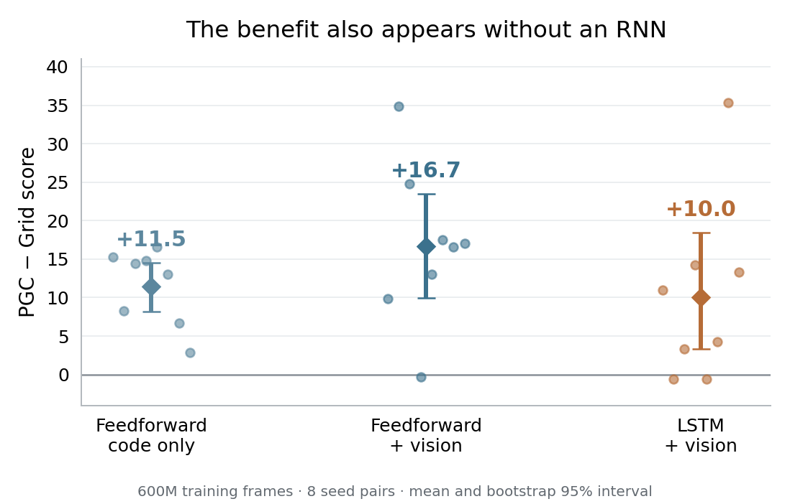

# Does the PGC benefit require an RNN?

**PGCs help separately trained feedforward networks too.** The general benefit therefore does not require learned recurrent memory.

These are existing evaluations at **600M training frames**, with eight seed pairs and 200 episodes per model. They are context for the new 1B LSTM experiments, not new history ablations.

| Trained network | Grid score | PGC + grid score | Difference (95% bootstrap interval) |
| --- | ---: | ---: | ---: |
| Feedforward, code only | 34.58 | 46.06 | +11.48 [8.18, 14.48] |
| Feedforward + vision | 78.66 | 95.32 | +16.66 [9.99, 23.44] |
| LSTM + vision | 86.11 | 96.14 | +10.03 [3.35, 18.42] |

The feedforward network receives the current code, vision or a heading image, the previous action and reward, and a **saved goal code**. That goal code is stored outside the network and supplied every step. Thus, the network has no recurrent state, but the full agent still has a form of memory.

This separates three questions:

| Question | What answers it? |
| --- | --- |
| Can PGCs help without a trained RNN? | Yes: the trained feedforward results above. |
| Do the existing 1B RNNs need their carried state to perform well? | Intervene on their hidden and cell states while keeping their inputs intact. |
| Is the PGC advantage caused by better long-term recurrent memory? | Establish a PGC-specific dependence on history, beyond the benefit already available in the supplied inputs. |

The three networks were trained separately and differ in architecture. Their score gaps cannot be subtracted to estimate a “recurrent contribution.” Removing state from a trained LSTM also changes the conditions it learned under; a performance drop alone does not identify useful memory as the cause.

For a history intervention, retain the saved goal code and previous action/reward if the question is specifically about **internal RNN memory**. Then describe the intervention as removing carried hidden and cell state, rather than removing all memory.

Source: [extension results](../../results_ext/EXTENSION.md), [machine-readable values](../../results_ext/extension.json), [network inputs](../../code/nets.py), and [goal-code storage](../../code/evaluate.py). The figure uses the stored bootstrap intervals; its dots are the eight paired seed differences. The original paired t-test p-values are 0.00031, 0.00259, and 0.0470, respectively, without a new multiple-comparison correction. Wilcoxon p-values are 0.00781, 0.0156, and 0.0391.

Reproduce the figure with `python scripts/summarize_lstm_history_context.py`.
