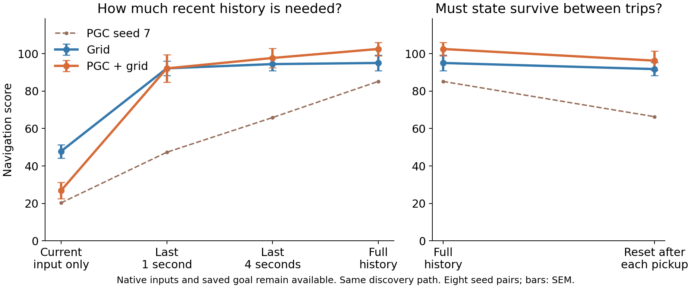

# What depends on recurrent history?



We kept the weights, images, live spatial code, saved goal code, and previous action/reward. We changed only how much internal LSTM state could carry forward. Both hidden state **h** and cell state **c** were limited.

Every branch followed the same grid controller until finding the first goal. After discovery, each model used its own controller and actual trajectory. This holds goal discovery fixed across both populations and all interventions.

| Carried history | Grid | PGC + grid | PGC − grid |
| --- | ---: | ---: | ---: |
| Full | 95.01 | 102.48 | +7.47 |
| None: current input only | 47.86 | 26.89 | -20.97 |
| Last 1 second (15 inputs) | 92.16 | 92.12 | -0.04 |
| Last 4 seconds (60 inputs) | 94.40 | 97.68 | +3.27 |
| Reset after every goal pickup | 91.75 | 96.25 | +4.50 |

**Models differ.** Most of the absolute navigation score returns with a few seconds of history, but the mean PGC advantage is only partly retained. PGC seed 7 is a substantial exception: its score falls from 85.16 to 65.86 with four seconds of history, and to 66.33 after pickup resets. It is included in every mean and test and shown as a dashed line. Across the other seven pairs, pickup resets change the population gap by between −3.28 and +2.27 points; seed 7 changes it by −19.22. This is a descriptive follow-up, not a replacement for the all-eight-seed tests.

**What “current input only” means:** zero the preceding h/c at every decision, then process the current input once. The externally saved goal and previous action/reward remain. It is not an agent with all memory removed.

**What the windows mean:** each decision uses exactly the latest 15 or 60 input vectors, replayed from zero. Their original goal messages, actions, rewards, and images are preserved. This is not a periodic reset with a varying history length.

**What pickup reset means:** clear h/c after each goal hit and teleport, then allow normal recurrence during the next return. Keep the updated goal message and hit reward.

## Does limiting history change the population gap?

These are the four predeclared comparisons. A negative change means the PGC advantage shrinks relative to full history. Intervals are paired 95% t intervals across eight seeds; the two p-value columns correct the same four contrasts separately.

| Intervention | Change in gap [95% interval] | Holm t p | Holm exact p |
| --- | ---: | ---: | ---: |
| None: current input only | -28.44 [-46.48, -10.39] | 0.02959 | 0.0625 |
| Last 1 second (15 inputs) | -7.51 [-18.40, +3.38] | 0.3596 | 0.125 |
| Last 4 seconds (60 inputs) | -4.20 [-9.81, +1.41] | 0.3596 | 0.09375 |
| Reset after every goal pickup | -2.97 [-8.67, +2.73] | 0.3596 | 0.2031 |

## What this can establish

The interventions test dependence on carried state in these frozen models. A collapse after zeroing state can reflect loss of useful recent information, an unfamiliar operating state, or both. It does not by itself prove superior memory, special attractors, or a causal role for episode-average PCA offsets. Success after pickup resets would show that state need not persist across return trips under this intervention; the external goal still preserves episode information.

The full PGC baseline is the PGC controller **after common grid-controlled discovery**, not native PGC exploration. Both full-history episode records reproduce the existing controller-hybrid baselines exactly, and all first-goal times match across all conditions. The ring-window implementation was checked against independent explicit replay, including asynchronous episode resets and windows longer than the available episode history. Shared-projection gates also matched native LSTMCell updates exactly at recorded inputs from all 16 checkpoints. Checkpoint hashes were unchanged.

[Numerical results, including return rate](summary.json) · [Protocol](protocol.json)

```sh
python scripts/lstm_history_horizon.py
python scripts/summarize_lstm_history_horizon.py
```
