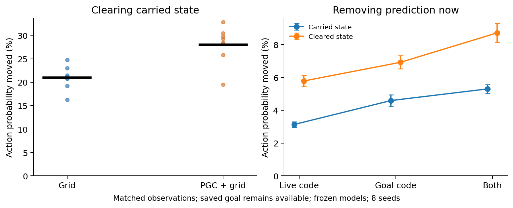

# Current input and carried recurrent state

At recorded native-policy states, we changed two things independently: the h/c state carried into the RNN, and the predictive spatial code presented on the current step. The visual embedding, previous action/reward, and external saved goal message remained available. All weights stayed frozen.

| Intervention | Grid | PGC + grid |
| --- | ---: | ---: |
| Clear h/c: action probability moved | 20.9% | 28.0% |

| Remove prediction now | Carried state | Cleared state |
| --- | ---: | ---: |
| Live code | 3.13% | 5.78% |
| Goal code | 4.59% | 6.92% |
| Both | 5.30% | 8.71% |

**Interpretation:** these tests separate the direct effect of the current code from sensitivity to the preceding recurrent state. Any difference between the two columns means that the same predictive input is processed differently depending on the state already in the RNN. It does not identify which past information is useful.

**Limit:** clearing h/c is an unfamiliar operating condition for these frozen networks. A large reset effect is not evidence of better memory, and a small input effect after reset can result from saturated or poorly calibrated gates. These are action-distribution changes, not navigation scores. Native snapshots also differ between populations because each policy visited its own states.

TV means the fraction of action probability redistributed (0% unchanged, 100% disjoint distributions). Episode averages are weighted equally within each seed; the independent comparison units are eight paired seeds. Four planned sensitivity contrasts receive Holm correction separately for paired-t and exact sign-flip tests. The auxiliary turn/go diagnostic is descriptive.

Reproduce with `python scripts/lstm_history_input_factorial.py`. Requires the local 1B checkpoints and native `*_action_states.npz` archives. Raw arrays and weights remain local.

[Numerical results](summary.json) · [Protocol](protocol.json) · [Past-input history versus present input](shared_replay/README.md)
