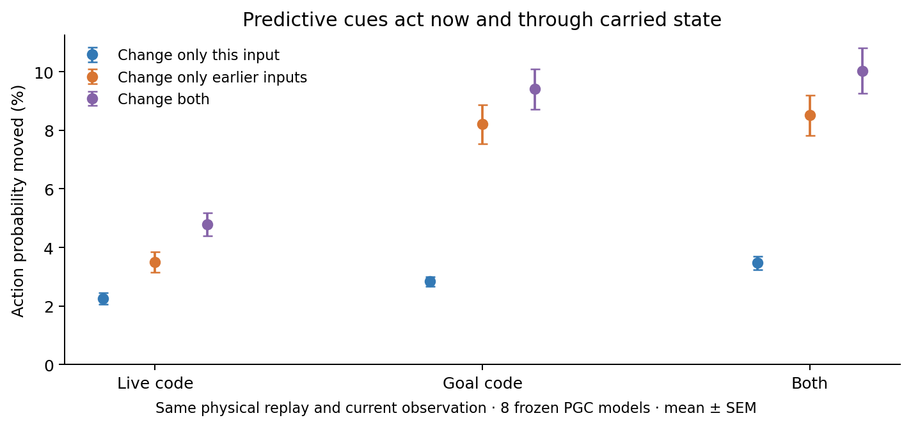
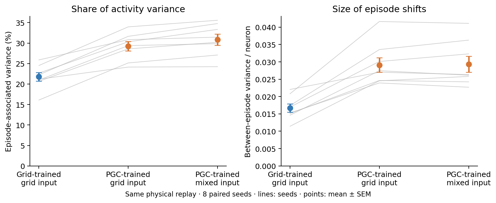

# Predictive inputs now versus in the past

We replayed the same images, movements, pickups, previous actions and rewards through each frozen PGC RNN. Four copies received native codes, ordinary live codes, ordinary goal codes, or both ordinary codes. They all started normally at zero and kept their own resulting h/c states. At selected moments, we independently changed the current input. No state was cleared or moved between trained networks.

| Remove prediction from | Only this input | Only previous inputs | Previous + current |
| --- | ---: | ---: | ---: |
| Live code | 2.26% | 3.51% | 4.78% |
| Goal code | 2.84% | 8.20% | 9.41% |
| Both | 3.47% | 8.51% | 10.03% |

The numbers are the fraction of action probability redistributed. **Only previous inputs** means that the current predictive input has already been restored: any remaining difference must reach the current action through the RNN state produced by its earlier inputs. **Only this input** holds that earlier state fixed. The columns are not additive; recurrent state and current input interact. None is a fraction of navigation performance explained.

This cleanly separates two computational routes. It does not establish whether the history-dependent part contains useful goal or movement information, whether it improves navigation, or whether it causes the larger episode-average activity shifts. The policies do not control this scripted replay; all branches are forced to receive identical physical experience. Changing the past codes may still move a frozen network away from its trained operating regime.

The external goal snapshot identity and its refresh times are identical in every branch. When prediction is removed, only the 169 predictive channels lose their 20 cm look-ahead shift; all 343 ordinary channels stay identical. Goal messages remain available on every step after the first pickup.

An exploratory check asks whether the histories also change episode-associated covariance, measured immediately before the current input. These are 430 sampled states, with equal episode weights; they are not the original pooled PCA numbers.

| Previous input history | Episode-associated variance | First 10 PCs |
| --- | ---: | ---: |
| Grid-trained: native | 21.8% | 46.7% |
| PGC-trained: native | 30.8% | 52.6% |
| PGC-trained: ordinary live | 30.7% | 52.4% |
| PGC-trained: ordinary goal | 29.2% | 52.0% |
| PGC-trained: both ordinary | 29.3% | 51.7% |

A smaller fraction does not mean the episode offsets were removed. With ordinary goal history, absolute between-episode variance changes only from 0.02936 to 0.02903, while total variance increases from 0.09464 to 0.09897. These are variances per hidden unit, averaged across seeds.

The grid reference uses the same saved replay rows. When both histories use ordinary codes, their external inputs match, but their trained visual encoders and recurrent networks differ. Persistent activity differences therefore cannot be assigned to recurrent weights alone. This covariance intervention still does not show that episode offsets are useful for behavior; the goal cue is supplied externally throughout each episode.

The full replay RGB hash exactly matches the earlier recording. Native reconstructed h/c and logits match saved activity exactly. The 430 selected known-goal states cover all 16 replay episodes; each episode receives equal weight within a seed. Three planned history-versus-immediate sensitivity contrasts receive Holm correction.

Reproduce with `python scripts/lstm_history_input_factorial.py --shared-replay`. Requires the local 1B checkpoints and original replay/activity archives. Raw arrays and weights remain local.

[Numerical results](summary.json) · [Protocol](protocol.json) · [Native-state reset factorial](../README.md)
