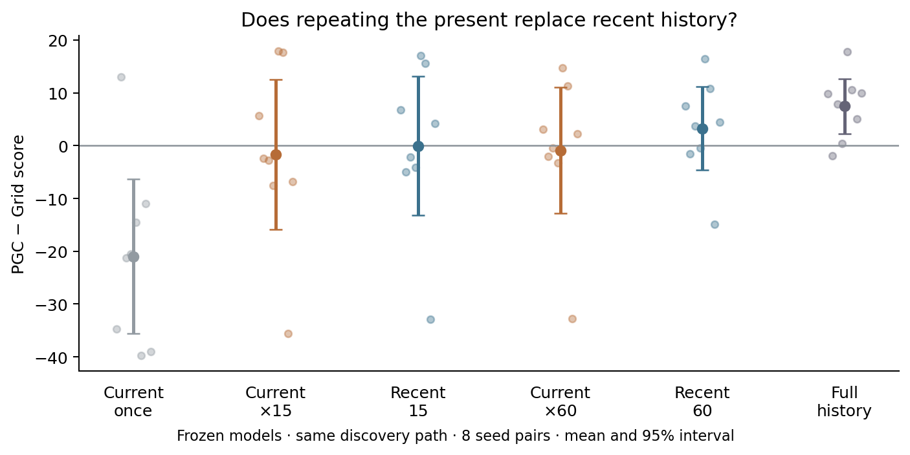

# Repeating the present versus using recent history

For the repeated-input controllers, we cleared both LSTM states before every decision. We then showed the **same current input** 15 or 60 times before taking one action. The environment moved only once. We compared this with replaying the actual last 15 or 60 inputs. All network weights stayed fixed.

**Repeating the present recovered much of the lost absolute score, but did not demonstrate recovery of the PGC advantage.** PGC score rose from 26.9 with one input to 89.6 with 15 repetitions; full-history PGC score was 102.5. The population gap under repetition is uncertain.

| Input supplied before each action | Grid score | PGC score | PGC − Grid, 95% interval |
| --- | ---: | ---: | ---: |
| Current input once | 47.86 | 26.89 | -20.97 [-35.65, -6.29] |
| Repeat current input 15 times | 91.28 | 89.56 | -1.72 [-15.93, +12.49] |
| Actual last 15 inputs | 92.16 | 92.12 | -0.04 [-13.16, +13.09] |
| Repeat current input 60 times | 91.70 | 90.81 | -0.89 [-12.87, +11.10] |
| Actual last 60 inputs | 94.40 | 97.68 | +3.27 [-4.59, +11.14] |
| Full history | 95.01 | 102.48 | +7.47 [+2.26, +12.68] |

Actual recent 15-input history gave PGC score 92.1, versus 89.6 when repeating the present. The paired difference (repeat minus actual history) was -2.56, with descriptive 95% interval [-5.19, +0.07]; this does not establish equivalence.

**Recovery was not universal.** Seed7 PGC scored 46.4 after 60 repeated inputs, compared with 65.9 using 60 real inputs and 85.2 with full history. All eight seeds remain in every primary comparison.

**What remained:** the current image, native live spatial code, externally saved goal code, previous action and previous reward. Repeating the input also repeats those last two values; it is an artificial computation, not a reconstructed physical journey. Each decision starts its repeated updates at zero.

**What this can show:** if repeating the present recovers the PGC advantage, chronological recent inputs are not required for that advantage under this constructed controller. The native trained policy may still use them. If repetition fails, missing useful history and an unfamiliar operating regime remain possible explanations. A nonsignificant difference does not establish equivalence.

Every branch followed the same intact Grid controller until first discovery. PGC full-history states therefore experienced Grid-controlled exploration. From then on, each controller chose its own actions. Full-history and current-once results reproduced every corresponding episode from the earlier experiment exactly. The saved goal remained available; this is not removal of all memory.

This was an **exploratory follow-up**, motivated by seeing seed1 lose performance with one input and recover with 15 chronological inputs. The four comparisons below were specified before any settling scores were observed. They compare the change in the PGC − Grid gap, not a percentage of performance explained.

| Gap comparison | Difference, 95% interval | Holm t p | Holm sign-flip p |
| --- | ---: | ---: | ---: |
| Repeat 15 − current once | +19.25 [-3.98, +42.48] | 0.2663 | 0.2109 |
| Repeat 15 − actual last 15 | -1.68 [-5.29, +1.93] | 0.3081 | 0.3516 |
| Repeat 60 − current once | +20.08 [-1.80, +41.95] | 0.2663 | 0.2109 |
| Repeat 60 − actual last 60 | -4.16 [-8.98, +0.66] | 0.2663 | 0.09375 |

Eight training seeds are the independent replicates; 128 matched episodes per seed and controller. Intervals are paired t intervals across seeds. Frozen-checkpoint repeated-input calculations were checked against explicit native LSTMCell updates on recorded real inputs.

[Numerical results](summary.json) · [Protocol](protocol.json) · [Chronological-history experiment](../lstm_history_horizon_1B/README.md)
