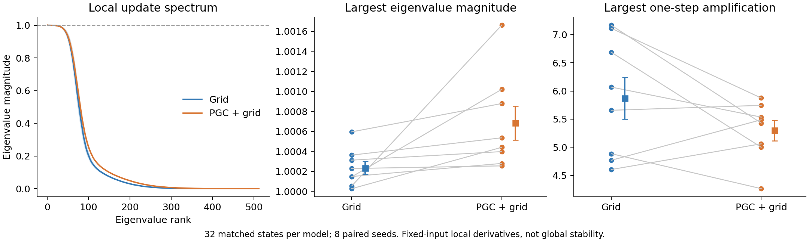
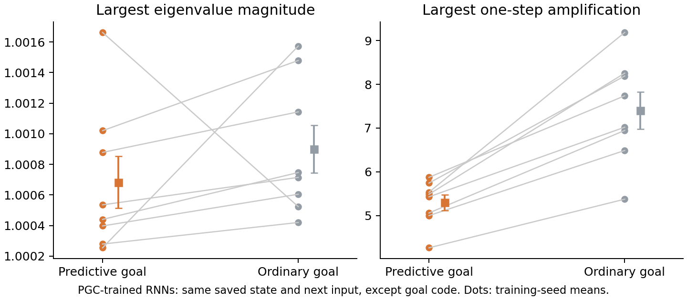

# Local RNN-update spectra

**This measures how a small change in the current RNN state affects the next state. It is different from PCA, which measures how activity is distributed.**



| Quantity, mean across eight training seeds | Grid | PGC + grid |
|---|---:|---:|
| Largest eigenvalue magnitude | 1.000234 | 1.000683 |
| Largest one-step amplification | 5.869 | 5.299 |

The largest eigenvalue magnitudes are very close to one. The largest singular values are much larger: some combinations of hidden/cell-state changes can be amplified over one step even when the eigenvalue magnitudes are near one. These are worst-case local perturbations, not typical noise or measured action changes.

| PGC minus grid | Difference | 95% paired interval | Holm t p | Holm exact p |
|---|---:|---|---:|---:|
| Largest eigenvalue magnitude | +0.000449 | [-0.000002, +0.000901] | 0.1017 | 0.01562 |
| Largest one-step amplification | -0.569784 | [-1.358018, +0.218449] | 0.1311 | 0.1562 |

The PGC spectral radius is slightly larger in all eight pairs, but by only about 0.00045. The exact sign-flip and paired-t tests disagree at the 5% threshold; the table reports both. The native-model amplification difference is uncertain. Neither comparison establishes a different global dynamical regime.

## Same-state predictive-goal removal



For PGC models, we also removed the predictive shift from the next goal input while holding the saved state and every other next input fixed. This is an instantaneous input intervention; the preceding history stays intact.

| Quantity | Change after removing predictive goal shift | 95% paired interval |
|---|---:|---|
| Largest eigenvalue magnitude | +0.000217 | [-0.000342, +0.000776] |
| Largest one-step amplification | +2.101160 | [+1.417082, +2.785238] |

**Removing the predictive goal shift increases worst-case one-step amplification in all eight seeds: 5.30 → 7.40.** Its exploratory paired-t p is 0.000168 and exact sign-flip p is 0.00781; the spectral-radius change is uncertain. These comparisons describe how the input changes local sensitivity. They do not show that the sensitivity change causes the navigation deficit.

## What was measured

We used 32 matched states per model: two saved moving states in each of 16 scripted episodes, selected near decisions 700 and 1000 without inspecting the neural result. Each saved state is the output after input t; its Jacobian uses the actual next input at t+1. Both h and c are included, giving a 512×512 derivative.

The original replay was reconstructed exactly, including its full image hash, while retaining only the 32 required next-step images. Analytic derivatives matched automatic differentiation to 2.2e-16. No model was retrained and no source recording was changed.

**Limits:** fixed-input, one-step derivatives cannot establish long-run stability, attractors, or memory duration. Real trajectories have changing inputs and successive Jacobians. Singular-value amplification depends on the relative scaling of h and c. Raw eigenvectors are not equated between separately trained networks.

[Numerical results](summary.json) · [Protocol](protocol.json) · [Covariance spectra](../lstm_eigenspectra_1B/README.md)

```sh
OPENBLAS_NUM_THREADS=1 OMP_NUM_THREADS=1 python scripts/lstm_local_dynamics_spectra.py
```

Reproduction requires the local 1B checkpoints and saved replay/activity arrays. Per-model JSON files retain sampled-state measurements; local NumPy archives retain the complete complex eigenvalues and singular spectra.
