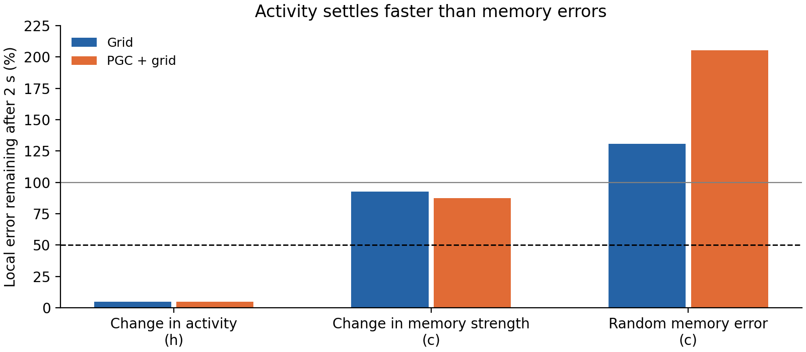

**The clearest distinction is between fast activity changes and slower errors in stored memory.** After accounting for every module's known phase directions, activity-only perturbations largely disappear. Errors in the strength of the stored memory pattern mostly remain.

An LSTM has hidden activity, `h`, and cell memory, `c`. We reused the preceding experiment's actual states and perturbations at eight fixed phase locations per module. We added one targeted perturbation: change the amplitude of the module-associated **cell-memory pattern while leaving hidden activity unchanged**. This avoids an apparent recovery driven mainly by rapid relaxation of `h`.

These recovery values describe the **local linear response** obtained by propagating the actual LSTM's state derivatives. A 2%-of-radius scale is used to evaluate visibility and the size of the implied phase changes. The nonlinear trajectory itself remains the common unperturbed reference.

There are four grid modules and two phases per module. We propagated derivatives for all eight explicit input phases through the original trained LSTM. The same perturbation was analyzed twice: after removing the tested module's two phase directions, then after removing all eight known directions. This is a **local nuisance-direction calculation**. No global eight-dimensional surface was constructed or fitted.

All four trained models, all four modules, both common-input regimes, both 5/30-second reference times, both perturbation metrics, all three fixed observation maps, and both 1/2-second recovery times were retained: **768 comparisons**, with eight locations per comparison.

| Full-state error remaining after 2 seconds, after all-eight-phase projection | Grid | PGC + grid |
| --- | ---: | ---: |
| Hidden-activity-only push | 4.9% — 64 / 64 qualified cases | 4.7% — 64 / 64 |
| Cell-memory pattern-strength push | 92.7% — 63 / 64 | 87.6% — 60 / 64 |
| Random cell-memory-only push | 131% — 57 / 64 | 205% — 53 / 64 |

The figure and table use cases with sufficient initial observable displacement and a plausible local phase explanation. The 64 cases per cell pool two seeds, four modules, two input regimes, two reference times, and two metrics. They are nested measurements, not 64 independent trained networks. The full aggregate also retains medians over every case, including those failing these guards. The 50% dashed line is the preceding assay's recovery benchmark, not a new eight-dimensional attractor criterion.

The additional six phases explain a substantial part of the residual pattern: across all full-state cases, they account for a median **74% of the remaining squared off-two-phase error in Grid and 79% in PGC + grid**. Yet the amplitude error left after removing those directions remains slow: its all-case median retention is **92.6% and 87.1%**, respectively. This suggests that the periodic code is embedded in a broader memory system containing persistent amplitude errors.

The fixed output views are more compressive. Among locally qualified hidden-output cases, residual retention after removing all eight phase directions is 12.8% for Grid (**20 / 64 cases**) and 1.9% for PGC + grid (**32 / 64 cases**). These differently selected subsets provide descriptive evidence about output filtering; they are not a controlled comparison establishing the navigation benefit.

Action-score projections produce tiny residuals, but the local-phase guard catches a misleading simplification: explaining the residual through the orthogonalized phase directions usually requires large compensating shifts in the tested module's phases. **Zero of 64 cell-pattern cases in either population passed the requirement that at least 80% of locations need no more than one tenth of a period in every phase.** All eight physical coefficients, including the compensating two, are saved. The complete-response fit is also reported separately, because its coefficients can differ from those of the isolated transverse component.

Numerical and observability failures remain explicit: effective projection ranks use the actual pseudoinverse cutoff; initially silent errors that later become visible are reported; near-zero initial residuals are excluded from qualified gain estimates. Four controls passed, including a known extra phase, unrelated persistent memory, a strictly cell-only perturbation, and an almost-collinear phase basis that hides a large compensating coefficient. Native states and the original two phase derivatives matched the preceding experiment **exactly**. The new eight-phase derivatives agreed with finite differences to a maximum relative error of **4.83 × 10⁻⁷**.

[Frozen protocol](protocol.json) · [Aggregate and denominators](aggregate.json) · [All comparisons](summary.json) · [Preceding two-phase report](../lstm_module_phase_torus/README.md)

Reproduce with `scripts/lstm_module_all_phase_control.py --freeze-only`, then the same script without the flag in a fresh output directory. Plot with `scripts/lstm_module_all_phase_control_report.py`. This final nuisance-factor check preserves every preceding result. No training, cloud instances, or new policy rollouts were used.
