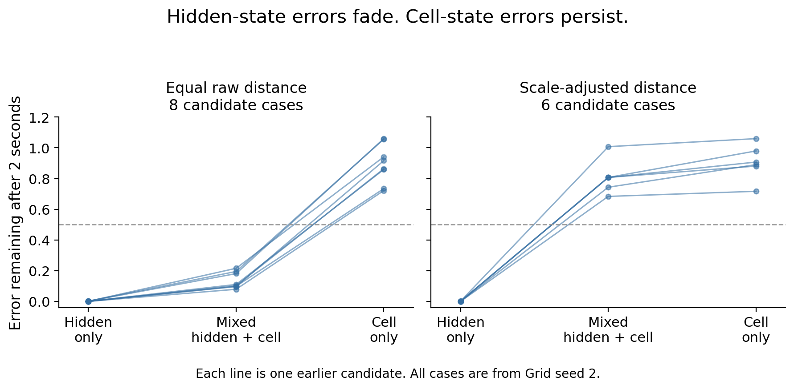

# Broader perturbations of the 14 activity-curve candidates

**The earlier radial recovery is real, but recovery depends strongly on which state component is perturbed. Hidden-state errors fade; cell-state errors persist.**

Each line is one earlier candidate, all from the Grid model trained with seed 2. The plot shows the median fraction of distance to the evolving activity curve remaining after two seconds. “Mixed” is the median across 16 fixed random directions. The dashed line is the previous half-error criterion. These repeated probes are not independent training seeds; no significance test is applied.

## What we tested

All 14 positive cases from the completed four-model observable screen were included. At eight fixed points on each curve, we changed the full recurrent state in both directions along 16 random directions, one hidden-only direction, one cell-only direction, and the previous radial and tangent controls. Every normal was projected off the observed curve tangent. Perturbations were 2% of the original curve radius using the same raw or scale-adjusted distance as each discovery case.

We then replayed identical future inputs and measured the unchanged fixed observables: every hidden output, or every trained actor score, at four future offsets. Distance was measured to the corresponding evolving unperturbed curve. Perturbed families were never centered separately. All finite kicks, observed coordinates, distances, observed arc displacements, and normal/tangential components are retained.

## Results

| Recovery interval | Cases passing all 19 tested normal-direction criteria |
|---|---:|
| 1 second | 0/14 |
| 2 seconds | 0/14 |
| 5 seconds | 1/14 |

At two seconds, every candidate failed the cell-only probe: its median error retention was 0.72–1.06. With raw distances, most random mixed directions contracted quickly because their visible effect was dominated by hidden-state changes. After adjusting hidden and cell distances by their original scales, mixed errors generally persisted too. All initial observable-normal displacement guards were satisfied; the failure was not caused by invisible or numerically zero perturbations.

One case passed every tested normal-direction median criterion at five seconds: module 2, axis 0, goal withheld, the 30-second anchor, actor-score observable, raw-distance kicks. Its scale-adjusted counterpart passed 11/19 directions, so the broader recovery does not hold across both kick metrics. The original 14 discovery labels remain unchanged.

## Meaning

The network quickly corrects some departures from the activity curve while retaining other cell-state disturbances that affect future activity. This is more specific than a general claim that all disturbances return to a one-dimensional ring. A second persistent phase of a torus could account for some of those directions; the separate two-phase experiment tests that possibility. Native, physically consistent access to the candidate states and behavioral use also remain separate follow-ups.

The audit covers a fixed finite set of directions and eight locations per curve. Its “all directions” count refers only to these 19 tested normal directions, using the existing median gain and normal-to-tangent criteria. It is not an exhaustive stability proof. Some full-state kicks exceed the natural hidden-output bounds; every overshoot count is recorded. Cell-only kicks leave hidden coordinates unchanged, so their persistence is not explained by that issue.

## Validation and reproduction

An analytic attracting ring with an unobserved drifting clock passes the new assay; a contracting plane fails the preferential-recovery comparison. Two tests pass, checking perturbation norms, signs, block specificity, tangent projection, and those positive/negative controls. Every frozen source hash and the completed parent-summary hash match.

Run `/opt/anaconda3/bin/python scripts/lstm_module_phase_normal_audit.py` from the repository root. Results include `protocol.json`, `controls.json`, `summary.json`, and one `result.json` plus `all_perturbations.npz` per candidate. `figure_values.json` contains every plotted value.
