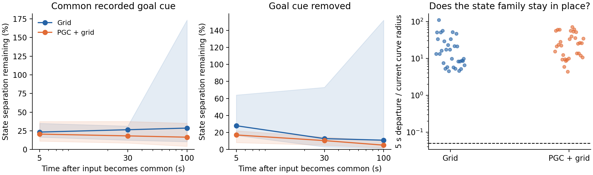
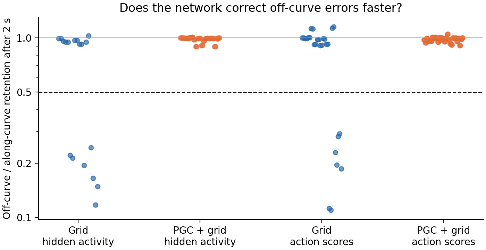

**This new test asked whether the grid modules' repeating spatial phases organize internal rings. Some circular output patterns qualified for further testing in one Grid model. No PGC model passed this first ring-factor screen.**

Each module has two independent directions in which its firing pattern repeats. We moved one module's saved-goal code through one complete repeat, while keeping its ordinary and predictive cells consistent with that module's maps. The other three modules stayed fixed. This is an explicitly synthetic code intervention, with a valid shared pickup geometry at phase zero; intermediate combinations need not correspond to one physical goal.

For the first 15 updates, only the selected saved-goal-code entries changed. Visual inputs, current-position code, previous actions, rewards, trained weights, and starting recurrent state came from the recorded agent history. We then gave every phase exactly the same repeated endpoint input, with either the actual recorded goal code or the entire goal code removed. Predictive offsets were retained during the phase sweep; this was not a predictive-cell ablation.

We tested both lattice directions of all four modules in both populations, seeds 1–2: **32 phase families**, two common-input conditions, and measurements after 5, 30, and 100 seconds. These are nested measurements from four trained networks, not 192 independent networks.

The complete hidden-plus-cell state retained some phase-history differences, but all **192 family/condition/time combinations** moved away from their reference curves under subsequent common input. Consequently, none advanced past the preregistered stationary full-state geometry screen. The expensive radial probe was not run on these rejected full-state cases, and was never counted as passing. Lines show median separation remaining, shading the full range; hidden and cell coordinates are scaled by their fixed initial block RMS. The final panel shows five-second departure after the 30-second reference; the dashed line is the original 5%-of-radius criterion.

We then prospectively tested fixed output coordinates: all 256 hidden activities, or all six trained action scores after subtracting their action-common offset. Four fixed future times were retained. Each output map was tested both with and without subtracting the one mean shared by the phase family. No neurons, action channels, circle decoder, or fitted plane were selected.

In this figure, **1 means that off-curve errors persist as strongly as shifts along the curve**; lower values indicate more selective recovery. Every geometry-qualified probe is included. The dashed line is one required recovery threshold, not the entire candidate definition.

| Trained model | Output/metric screens | Geometry-qualified recovery probes | Centered candidates | Noncentered candidates |
| --- | ---: | ---: | ---: | ---: |
| Grid, seed 1 | 192 | 17 | 0 | 0 |
| Grid, seed 2 | 192 | 28 | 12 | 2 |
| PGC + grid, seed 1 | 192 | 12 | 0 | 0 |
| PGC + grid, seed 2 | 192 | 88 | 0 | 0 |

The Grid seed-2 candidates mostly involve module 2, with one noncentered hidden-activity candidate from module 0. Several recur under both raw and block-RMS perturbations. Their radial/phase retention ratios range from about 0.11 to 0.29. These are promising conditional output structures under the specified synthetic code intervention. Their action-probability variation is small: approximately 0.00006–0.00013 RMS across phase. The candidate list preserves all coordinates, times, regimes, and metrics in the [observable aggregate](../lstm_module_phase_observable/aggregate.json).

Two follow-ups distinguish the mechanism. First, test recovery against many independent state perturbations, rather than only the centroid-derived radial direction. Second, vary both module phases jointly: a direction perpendicular to one phase circle can still lie along the other phase of a torus. The current one-dimensional slices do not measure that second phase tangent. These follow-ups are separate from the retained primary and fixed-output results.

Controls passed: analytic input closure to 2.4 × 10⁻¹⁵, elicited recurrent-state closure to 2.1 × 10⁻¹³, analytic versus native float32 code agreement to 6.4 × 10⁻⁷, and native replay error below 7.0 × 10⁻⁵. Both primitive periods, their derivatives, ordinary maps with the same phases, interleaved module membership, and unchanged off-module entries were checked. The observable tests include a ring with shared drift, a shrinking circle, silent output, and an actor-null spectator. The new and existing observable/actor control suite passed all ten tests.

[Primary protocol](protocol.json) · [Primary aggregate](aggregate.json) · [Full primary results](summary.json) · [Observable protocol](../lstm_module_phase_observable/protocol.json) · [Full observable results](../lstm_module_phase_observable/summary.json)

Reproduction uses `scripts/lstm_module_phase_ring.py` and `scripts/lstm_module_phase_observable.py`, each frozen with `--freeze-only` before outcomes. Both refuse to overwrite completed summary results; use a fresh output directory for a new run. Plotting scripts are `scripts/lstm_module_phase_ring_report.py` and `scripts/lstm_module_phase_observable_report.py`. No training, cloud instances, or policy rollouts were used; these are frozen-model input and state experiments.
