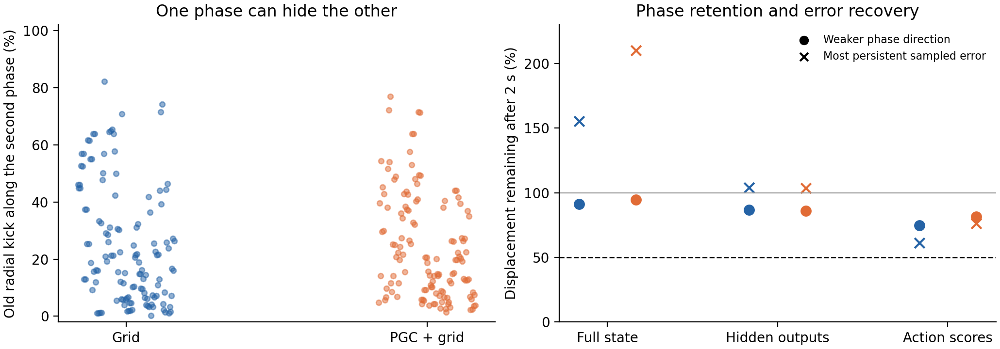

**Grid modules carry two phase directions, and both directions can persist in the RNN. The surrounding state errors do not consistently recover toward the resulting surface.**

The earlier one-dimensional test followed one phase circle at a time. A push away from that circle can also move the other phase. We measured this directly: the second phase accounts for a median **20% of the squared old radial push** in each population, with individual slice medians reaching 82% in Grid and 77% in PGC + grid.

We varied both primitive grid phases jointly on a 24 × 24 grid, using every module in the four original trained models: Grid and PGC + grid, seeds 1–2. The code changes were restricted to one saved-goal module. Other inputs followed the same recorded history. Future inputs were identical across phases, with the actual goal held or the whole goal code removed. This remains the explicitly synthetic module-code intervention described in the [one-dimensional report](../lstm_module_phase_ring/README.md).

We followed both exact phase derivatives through the real LSTM. A transverse error was then defined relative to **both** evolving phase directions. Six directions were tested separately: three random full-state directions, the surface-centroid radial direction, a hidden-activity-only direction, and a cell-memory-only direction. The last two stayed strictly within their own blocks. A single persistent direction could not hide among several rapidly decaying directions.

Recovery values are **local linear responses**, computed with Jacobian-vector products along the exact recurrent trajectories. The 2%-of-radius scale sets the initial observability checks. Candidate promotion would have triggered separate finite-amplitude verification; there were no promotions.

The complete screen contains **768 cases**: four models × four modules × two common-input regimes × two reference times (5 and 30 seconds) × two physical perturbation metrics × three observation maps × two recovery times (1 and 2 seconds). Each case was reported both with and without removal of the shared phase-family mean. No case passed the complete nomination criteria in either representation.

| After 2 seconds, full-state measurements | Grid | PGC + grid |
| --- | ---: | ---: |
| Retention of the weaker of the two phase directions | 91% | 95% |
| Retention of the most persistent sampled normal direction | 155% | 210% |
| Full-state cases passing every normal-direction recovery requirement | 0 / 64 | 0 / 64 |

These are medians across nested module, regime, anchor, and metric cases from **two trained seeds per population**. They are descriptive perturbation results, not a population significance test or a navigation-performance comparison. In the figure, circles show phase retention; crosses show the median of each case's most persistent sampled direction. Values above 100% indicate growth. The dashed line is the prespecified 50% recovery benchmark.

The output-coordinate checks retained all 256 hidden outputs or all six centered trained action scores at four fixed future times. They also required a visible signal, two distinct tangent directions, separation of non-neighboring phases, and approximate invariance of a periodic triangulated surface. Both fundamental phase windings and local phase orientation were checked without fitting a decoder. Some output errors decayed, but none of the complete output-surface tests passed all requirements.

Controls included an attracting two-phase torus, a shrinking torus, shared drift, collapse of the second phase, rotated tangent frames, periodic triangle seams, and initially silent perturbations becoming visible later. Nine tests passed, including independent review tests. Complete elicitation derivatives agreed with finite differences to a maximum relative error of **2.93 × 10⁻⁷**.

The next targeted check asks whether the residual error follows the other modules' known phases. That [local eight-phase control](../lstm_module_all_phase_control/README.md) preserves these results and includes an additional push that changes only the strength of the stored cell-memory pattern.

[Frozen protocol](protocol.json) · [Aggregate measurements](aggregate.json) · [Complete results](summary.json)

Reproduce with `scripts/lstm_module_phase_torus.py --freeze-only`, then run the same script without that flag in a fresh output directory. Use `scripts/lstm_module_phase_torus_report.py` for the figure. The frozen protocol records source and test hashes; every model retains its complete states and phase derivatives. No training, cloud instances, or new policy rollouts were used.
