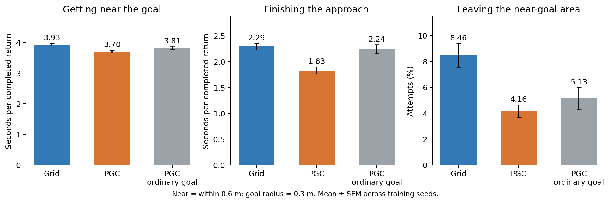
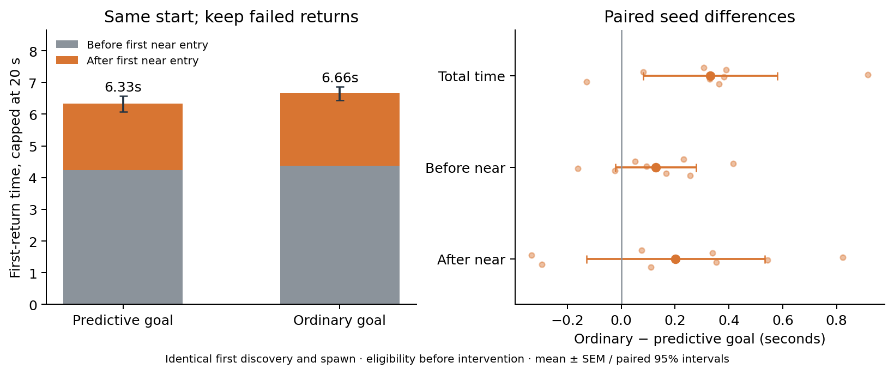
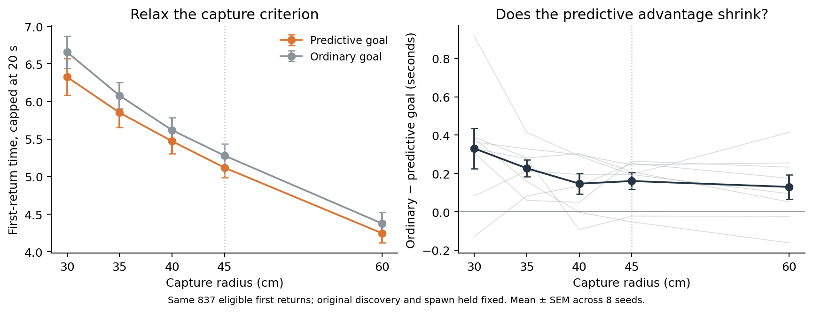

# Where the navigation advantage appears

**The PGC advantage appears after goal discovery: better return navigation, despite no earlier discovery on this evaluation set.**



| Measure | Grid | PGC | PGC with ordinary goal |
|---|---:|---:|---:|
| Score | 95.010 | 103.994 | 93.896 |
| First goal step (failure = 1350) | 423.142 | 459.621 | 459.621 |
| Goal discovery fraction | 0.870 | 0.847 | 0.847 |
| Return path efficiency | 0.699 | 0.782 | 0.743 |
| Goals / 1000 post-discovery steps | 9.118 | 10.516 | 9.411 |

Score separates exactly into first-discovery reward and later return rewards. PGC minus grid is **-0.234 points** from first discovery and **+9.219 points** from subsequent returns. This accounting is descriptive, not a mediation percentage.

## What the phases measure

Getting near ends at the first entry within 0.6 m of the true goal center. Finishing the approach includes all subsequent time until goal pickup, including excursions back outside that area. The actual pickup radius is 0.3 m. An attempt that starts inside 0.6 m has zero getting-near time. Durations in the figure condition on completed returns; the exit fraction includes all attempts that reached the near area, including censored attempts.

The original input-swap intervention changes only goal encoding. Its first-discovery behavior is identical to intact. Native grid versus PGC comparisons also involve different learned policies and visited states, so their phase differences alone do not establish a causal mechanism.

Matched successful-return comparisons pair the same episode, environment slot, and return number. Their spawn distances match exactly (within numerical tolerance), controlling initial trip difficulty. Requiring both trips to finish can still select easier cases. Full step exposures and censored returns are retained.

| Matched completed trips | Total time change | Before near | After near |
|---|---:|---:|---:|
| PGC − grid | -0.689 s | -0.234 s | -0.455 s |
| Ordinary goal − intact PGC | +0.446 s | +0.068 s | +0.377 s |

These differences concern matched trips that **both** controllers completed. They do not give a percentage of the score advantage explained. Full paired intervals and five-comparison corrections are in the numerical summary.

## First return: a comparison that retains failures



For goal-only substitution, the first goal discovery, first return spawn, and recurrent state before the changed goal input are identical. We select episodes whose first discovery leaves at least 20 seconds, then measure first-return time capped at 20 seconds. Failed returns remain in this endpoint. The episode-specific goal snapshot does not refresh until that first return succeeds.

| First-return measure | PGC intact | Ordinary goal | Change | 95% paired interval | Holm t p | Holm exact p |
|---|---:|---:|---:|---:|---:|---:|
| Time capped at 20 s | 6.326 | 6.657 | +0.330 | [+0.081, +0.580] | 0.06632 | 0.09375 |
| Before first near entry | 4.238 | 4.366 | +0.128 | [-0.022, +0.278] | 0.1789 | 0.2344 |
| After first near entry | 2.088 | 2.290 | +0.202 | [-0.130, +0.533] | 0.1928 | 0.2344 |
| Success within 20 s | 0.971 | 0.960 | -0.011 | [-0.023, +0.001] | 0.1789 | 0.2344 |

The mean capped first-return time increases by 0.33 seconds after removing predictive goal input. That comparison remains uncertain after correction for the four tested endpoints, and the phase components are also uncertain. It agrees in direction with the longer evaluation but does not independently establish concentration of the effect near the goal.

The before/after components sum exactly to capped time. The first-return analysis was added after the first two descriptive phase seeds, before inspecting these endpoints; it is exploratory. Its four comparisons form a separate Holm family. The native grid-versus-PGC first-discovery histories differ, so this matched causal comparison applies to the goal-only intervention within PGC-trained models.

## Capture-radius sensitivity

**This test does not establish that relaxing capture precision reduces the predictive-goal advantage.**



We reused the same 837 eligible first-return trajectories, keeping the original first discovery, goal message, starting position, and policy fixed. We asked when each trajectory would first satisfy a larger capture radius. Only the criterion for ending this first return changes. No new model rollouts were needed.

| Capture radius | Predictive goal | Ordinary goal | Ordinary − predictive | Original spawns inside enlarged disk |
|---|---:|---:|---:|---:|
| 30 cm | 6.326 s | 6.657 s | +0.330 s | 0 / 837 |
| 35 cm | 5.851 s | 6.078 s | +0.227 s | 0 / 837 |
| 40 cm | 5.472 s | 5.618 s | +0.147 s | 0 / 837 |
| 45 cm | 5.119 s | 5.280 s | +0.161 s | 7 / 837 |
| 60 cm | 4.246 s | 4.376 s | +0.130 s | 72 / 837 |

The one preselected exploratory comparison is the penalty at 30 cm minus the penalty at 45 cm: **+0.170s**, 95% paired interval **[-0.115,+0.454]**, paired-t p=0.2011, exact sign-flip p=0.1953. Positive means that widening the capture region reduces the disadvantage of ordinary goal input. Other curve points are descriptive.

Capture uses the first **post-step** distance strictly below the radius, matching the environment reward check. A first-step capture takes 1/15 s, including when the fixed original spawn is already inside the enlarged disk. Distances were recorded before any pickup teleport. The 30 cm endpoint reproduces every original first-return time and hit event exactly. Larger-radius first crossings always occur before any original return teleport, so preceding behavior remains observable.

This is a first-return reward-criterion counterfactual conditional on the original discovery and spawn. It is **not** a new evaluation of larger goals throughout the task: discovery, respawn rejection, later rewards, and subsequent returns would also change in that experiment. It does not test a native grid-trained controller, whose discovery history differs.

The contrast and radii were selected before inspecting this analysis, after the earlier navigation results; this is an exploratory follow-up. Eight training seeds are the replicates, with equal weight. Failures remain capped at 20 seconds. [Numerical results](radius_sensitivity.json) · [Protocol](radius_sensitivity_protocol.json).

```sh
python scripts/lstm_capture_radius_sensitivity.py
```

## A mostly turn-or-move policy

Across the full post-discovery traces, **15 of 16 native models use one turn direction and one translation action for at least 99.86% of sampled actions**. Translation can mean forward, backward, or sideways; the preferred axis differs across models. PGC seed 5 is a genuine three-action exception: left turn 28.0%, strafe left 58.8%, backward 13.2%. Thus a lower forward-action probability alone would not imply worse navigation.

Only seed pairs 1 and 5 share their preferred turn and movement axes, and PGC seed 5 additionally uses backward movement. Switching between grid and PGC controllers can therefore incur a change-of-strategy cost. These action-frequency descriptions were added after examining the completed behavior traces; they are exploratory. [Full action counts](action_strategy.json).

## Validation and reproduction

Every per-episode record reproduces the original code-swap evaluation exactly, for every instrumented variant. 8 training seeds are the statistical replicates. All comparisons here are exploratory; the numerical summary retains paired intervals and both Holm-corrected t and exact sign-flip tests.

```sh
OPENBLAS_NUM_THREADS=1 OMP_NUM_THREADS=1 python scripts/lstm_navigation_phases.py --device mps
python scripts/summarize_lstm_navigation_phases.py --refresh-from-trace
```

The rollout also saves local native-policy snapshots before the current LSTM input, for separate matched-state action analysis. No model is retrained. Raw NumPy arrays and checkpoint weights are local artifacts. [Numerical results](summary.json) · [Protocol](protocol.json)
