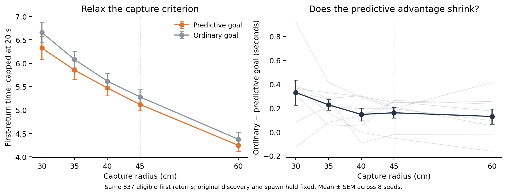

## Capture-radius sensitivity

**This test does not establish that relaxing capture precision reduces the predictive-goal advantage.**



We reused the same 837 eligible first-return trajectories, keeping the original first discovery, goal message, starting position, and policy fixed. We asked when each trajectory would first satisfy a larger capture radius. Only the criterion for ending this first return changes. No new model rollouts were needed.

| Capture radius | Predictive goal | Ordinary goal | Ordinary − predictive | Original spawns inside enlarged disk |
|---|---:|---:|---:|---:|
| 30 cm | 6.326 s | 6.657 s | +0.330 s | 0 / 837 |
| 35 cm | 5.851 s | 6.078 s | +0.227 s | 0 / 837 |
| 40 cm | 5.472 s | 5.618 s | +0.147 s | 0 / 837 |
| 45 cm | 5.119 s | 5.280 s | +0.161 s | 7 / 837 |
| 60 cm | 4.246 s | 4.376 s | +0.130 s | 72 / 837 |

The one preselected exploratory comparison is the penalty at 30 cm minus the penalty at 45 cm: **+0.170s**, 95% paired interval **[-0.115,+0.454]**, paired-t p=0.2011, exact sign-flip p=0.1953. Positive means that widening the capture region reduces the disadvantage of ordinary goal input. Other curve points are descriptive.

Capture uses the first **post-step** distance strictly below the radius, matching the environment reward check. A first-step capture takes 1/15 s, including when the fixed original spawn is already inside the enlarged disk. Distances were recorded before any pickup teleport. The 30 cm endpoint reproduces every original first-return time and hit event exactly. Larger-radius first crossings always occur before any original return teleport, so preceding behavior remains observable.

This is a first-return reward-criterion counterfactual conditional on the original discovery and spawn. It is **not** a new evaluation of larger goals throughout the task: discovery, respawn rejection, later rewards, and subsequent returns would also change in that experiment. It does not test a native grid-trained controller, whose discovery history differs.

The contrast and radii were selected before inspecting this analysis, after the earlier navigation results; this is an exploratory follow-up. Eight training seeds are the replicates, with equal weight. Failures remain capped at 20 seconds. [Numerical results](radius_sensitivity.json) · [Protocol](radius_sensitivity_protocol.json).

```sh
python scripts/lstm_capture_radius_sensitivity.py
```
