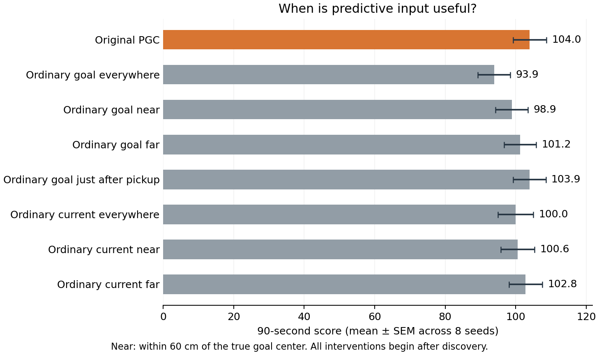

# When predictive input helps



Only the predictive shift is removed; no cells are silenced and no weights or hidden states are patched. Every branch follows the original PGC policy until first discovery. The goal and live current code are tested separately.

“Near” is within 0.6m of the true goal center; “far” is outside. “Just after pickup” means the first 15 decisions (one second) after each goal hit and respawn. The distance-based intervention uses privileged goal coordinates.

## Scores

| Condition | Mean score | SEM |
|---|---:|---:|
| Original PGC | 103.99 | 4.74 |
| Ordinary goal everywhere | 93.90 | 4.61 |
| Ordinary goal near | 98.91 | 4.63 |
| Ordinary goal far | 101.24 | 4.58 |
| Ordinary goal just after pickup | 103.94 | 4.65 |
| Ordinary current everywhere | 99.99 | 5.00 |
| Ordinary current near | 100.57 | 4.81 |
| Ordinary current far | 102.82 | 4.74 |

## Paired comparisons

The score counts every goal in the 90-second episode. First-discovery records match exactly across branches, so these score differences arise after discovery. Seeds are the statistical replicates. Intervals are marginal 95% intervals, not multiplicity-adjusted intervals.

### Primary

| Difference | Points | 95% interval | Holm t p | Holm exact p |
|---|---:|---:|---:|---:|
| Ordinary goal everywhere − Ordinary goal near | -5.01 | [-7.85, -2.17] | 0.01265 | 0.03125 |
| Ordinary goal everywhere − Ordinary goal far | -7.34 | [-10.26, -4.43] | 0.002247 | 0.03125 |
| Ordinary goal far − Ordinary goal near | +2.33 | [-0.43, +5.10] | 0.08602 | 0.07812 |
| Ordinary current far − Ordinary current near | +2.26 | [+0.71, +3.80] | 0.02143 | 0.04688 |

### Exploratory

| Difference | Points | 95% interval | Holm t p | Holm exact p |
|---|---:|---:|---:|---:|
| Ordinary goal everywhere − Original PGC | -10.10 | [-13.45, -6.75] | 0.001319 | 0.05469 |
| Ordinary goal near − Original PGC | -5.09 | [-7.21, -2.96] | 0.00459 | 0.05469 |
| Ordinary goal far − Original PGC | -2.75 | [-4.10, -1.41] | 0.009381 | 0.05469 |
| Ordinary goal just after pickup − Original PGC | -0.06 | [-1.27, +1.15] | 0.9118 | 0.9297 |
| Ordinary current everywhere − Original PGC | -4.00 | [-7.13, -0.88] | 0.05753 | 0.07031 |
| Ordinary current near − Original PGC | -3.43 | [-5.31, -1.54] | 0.01418 | 0.0625 |
| Ordinary current far − Original PGC | -1.17 | [-2.50, +0.16] | 0.1512 | 0.1875 |

## Scope and checks

The intervention changes later trajectories. Near/far exposure is therefore descriptive, not a matched amount of altered input, and neural history crosses phase boundaries. A phase effect does not imply that only that phase matters or equal a percentage of the population advantage. Switching inputs or controllers can itself change behavior.

All 1,024 baseline episode records reproduce the earlier evaluation exactly. Source checkpoints are unchanged. Full per-episode records, secondary return-efficiency endpoints, exposure counts, and source hashes are retained in [summary.json](summary.json) and the eight seed files.

```sh
OPENBLAS_NUM_THREADS=1 OMP_NUM_THREADS=1 python scripts/lstm_phase_intervention.py
python scripts/summarize_lstm_navigation_interventions.py --kind phase
```

[Protocol](protocol.json) · [Combined explanation](../../mechanisms/navigation-explanation.md)
