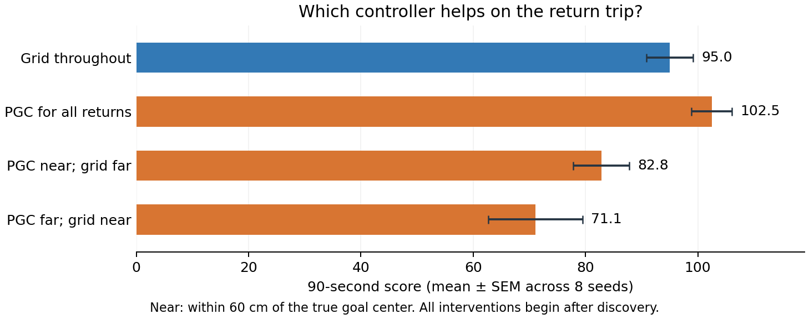

# Switching trained controllers during the return trip



Every branch uses the grid policy until the first goal is found. Then we choose the grid or PGC policy for all returns, only near the goal, or only far from it. Both frozen RNNs keep their own states and receive their native codes plus the branch’s actual images, actions, and rewards. No activity vector is transferred between models.

This compares return controllers after identical discovery experience. The PGC-after-discovery condition is not the original PGC policy during exploration. Selecting a controller by true goal distance is an oracle diagnostic.

Using PGC for the whole return raises mean score from **95.01 to 102.48**. The paired-t and exact tests disagree after correction, so the interval and both tests are retained below. Switching between controllers within each return lowers performance relative to keeping the PGC controller throughout.

The [action-strategy analysis](../lstm_navigation_phases_1B/action_strategy.json) shows that most paired networks prefer different movement axes or turn directions. Switching may therefore introduce coordination costs. That possibility was recognized after the experiment was specified; it is not itself a tested cause of the losses. These mixed-controller results do not cleanly allocate the native performance advantage to near or far navigation.

## Scores

| Condition | Mean score | SEM |
|---|---:|---:|
| Grid throughout | 95.01 | 4.12 |
| PGC for all returns | 102.48 | 3.59 |
| PGC near; grid far | 82.80 | 5.03 |
| PGC far; grid near | 71.08 | 8.42 |

## Paired comparisons

The score counts every goal in the 90-second episode. First-discovery records match exactly across branches, so these score differences arise after discovery. Seeds are the statistical replicates. Intervals are marginal 95% intervals, not multiplicity-adjusted intervals.

### Primary

| Difference | Points | 95% interval | Holm t p | Holm exact p |
|---|---:|---:|---:|---:|
| PGC for all returns − Grid throughout | +7.47 | [+2.26, +12.68] | 0.0349 | 0.07031 |
| PGC near; grid far − Grid throughout | -12.21 | [-25.24, +0.83] | 0.1248 | 0.09375 |
| PGC far; grid near − PGC near; grid far | -11.72 | [-25.35, +1.91] | 0.1248 | 0.09375 |

### Exploratory

| Difference | Points | 95% interval | Holm t p | Holm exact p |
|---|---:|---:|---:|---:|
| PGC far; grid near − Grid throughout | -23.93 | [-45.31, -2.54] | 0.03318 | 0.05469 |
| PGC near; grid far − PGC for all returns | -19.68 | [-32.81, -6.54] | 0.01968 | 0.02344 |
| PGC far; grid near − PGC for all returns | -31.40 | [-50.84, -11.95] | 0.01968 | 0.02344 |

## Scope and checks

The intervention changes later trajectories. Near/far exposure is therefore descriptive, not a matched amount of altered input, and neural history crosses phase boundaries. A phase effect does not imply that only that phase matters or equal a percentage of the population advantage. Switching inputs or controllers can itself change behavior.

All 1,024 baseline episode records reproduce the earlier evaluation exactly. Source checkpoints are unchanged. Full per-episode records, secondary return-efficiency endpoints, exposure counts, and source hashes are retained in [summary.json](summary.json) and the eight seed files.

```sh
OPENBLAS_NUM_THREADS=1 OMP_NUM_THREADS=1 python scripts/lstm_policy_hybrid.py
python scripts/summarize_lstm_navigation_interventions.py --kind hybrid
```

[Protocol](protocol.json) · [Combined explanation](../../mechanisms/navigation-explanation.md)
