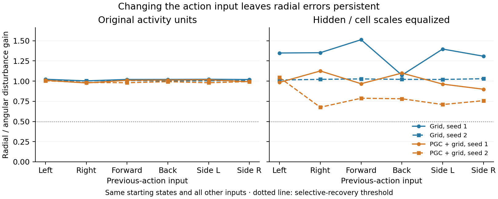

# Does the previous-action input switch on a ring?

**All 24 model/action cases fail the unchanged full-state ring criteria.** The future-hidden-activity check also finds no candidate in all 48 action/metric comparisons. Changing the previous-action input alone does not reveal a ring in these original pilot models.

Each line is one original trained model. A ratio near one means radial errors survive about as strongly as changes around the direction curve. The raw-unit ratios range from **0.977 to 1.023**. The dotted threshold is one part of the frozen candidate test; closed geometry, preservation of direction order, coverage and invariance must also pass.

## Why this test?

A [2026 fly-navigation study](https://www.nature.com/articles/s41586-026-11144-9) describes a goal circuit whose persistent activity depends on behavioral state. Our earlier action-context test changed the approach movement but still released the network under a turn input. This new experiment tests the previous-action input directly.

We reused each original pilot model’s full 512-coordinate state family after the same physical approach. We then changed only the six previous-action entries to left, right, forward, backward, left strafe or right strafe. The starting states, ordinary current code, saved goal, black visual input and reward were identical across these six branches. Both populations and seeds 1–2 were included, with no new outcome-based selection.

This is a **clamped-input experiment on the RNN**. In the translational conditions, location is held fixed while the action message says “move.” These branches measure input-dependent neural dynamics; they are not simulated navigation trajectories.

The LEFT branches reproduce every archived trajectory exactly: maximum error **0**. All criteria and the future-activity observation map are reused unchanged. Some future-activity comparisons suppress radial disturbances more strongly, while failing curve preservation and direction ordering. Every gate and case is retained in the [complete summary](summary.json).

[Frozen protocol](protocol.json) · [Independent review](review.json) · [Source](../../scripts/lstm_previous_action_sweep.py)
