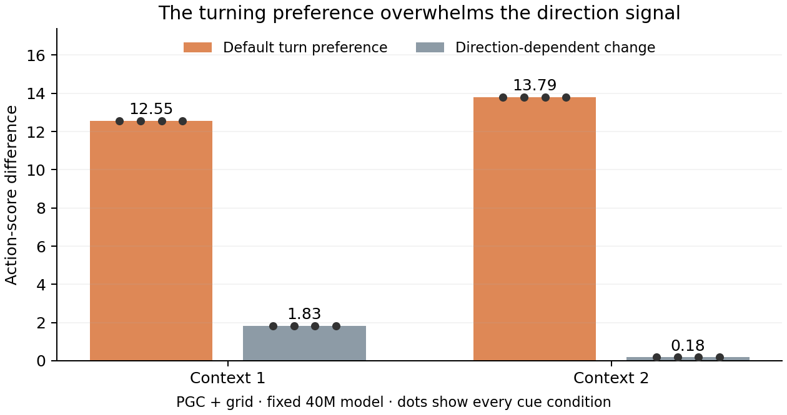

# Why the direction trace barely changes actions

**The PGC direction signal reaches the action scores. A much larger average preference for turning right overwhelms it.** In these contexts, the main bottleneck is the nearly deterministic action readout.

The tall bars show the average right-turn score advantage over the best movement action. The short bars show how much direction changes that same score difference (RMS across angles). Bars use the native cue; dots retain every cue condition. [Detailed figure including Grid](actor_bottleneck.png).

The final actor is a simple weighted sum of the 256 hidden activities, followed by softmax, which converts six scores into action probabilities. We passed the saved activity through those exact learned weights. We changed no states, weights, inputs or actions and ran no new navigation. This targeted follow-up was frozen after observing the earlier turning behavior and before calculating these values.

Here, the average is across controlled directions within one context. It is not the episode average used in the earlier PCA analysis.

**1. The signal reaches the actor.** We measured how much direction-dependent hidden variation lies in directions that the action weights can read. In the PGC contexts at four seconds, this is 5.68% and 2.50%. The five-dimensional actor-sensitive space occupies 1.95% of the 256-dimensional hidden space; that geometric reference is not a significance test. In these contexts, most hidden variation lies outside that small space. The PGC signal nevertheless produces score variation of 1.369 and 0.294 logit units. It has not simply disappeared into an actor-null direction.

**2. A strong default wins.** The average right-turn score exceeds the best translation score by 12.55 and 13.79 logit units. Direction changes the relevant pairwise margins by only 1.825 and 0.184 units RMS. No tested angle changes the highest-scoring action. The large baseline comes mainly from the average hidden activity read through the actor weights, rather than the actor bias parameter alone.

**3. The probabilities barely move.** The native PGC cue yields total translation probabilities of about 0.00283% and 0.000117% at four seconds. Softmax is operating in a nearly saturated regime: meaningful score variation produces very small probability changes. This explains why retaining direction information—and even shifting its neural representation—scarcely changes the observed movements. Grid also develops a strong default in these contexts, but it prefers strafing right and its late directional score variation is much smaller.

| Model / context | Hidden variation in actor-sensitive directions | Score variation | Default-action margin | Translation probability |
|---|---:|---:|---:|---:|
| Grid / 1 | 1.33% | 0.00448802 | 7.02 | 99.9106% |
| Grid / 2 | 2.57% | 2.3448e-05 | 11.48 | 99.999% |
| PGC + grid / 1 | 5.68% | 1.36871 | 12.55 | 0.00282507% |
| PGC + grid / 2 | 2.50% | 0.294398 | 13.79 | 0.000117163% |

The figures show all four cue variants at the final four-second point. The table above uses the native cue. Score variation is the RMS length of the six-score change vector across angles: square each centered score change, sum across actions, average across angles, then take the square root. Probability variation uses the same vector convention. The simple bar figure instead compares the average and directional RMS of the same pairwise score difference. The [complete 64-row table](all_conditions.csv) retains both models, both contexts, all four cues, and 0/1/2/4 seconds; the [full numerical record](summary.json) also retains singular values, every pairwise margin, exact probabilities and the separate linearized softmax calculation. Across every row, the top-scoring action remains unchanged across angles. Grid cue identities are exact.

We subtract only a score shared by all six actions, which cannot affect softmax. The linear reconstruction and that invariance are checked exactly to numerical tolerance. A fixed cosine/sine projection describes angular structure in the scores; it is not a trained decoder or evidence of behavioral generalization. Actor-sensitive hidden variance and score variance are reported separately from probability variation.

These results identify a concrete readout bottleneck in the fixed 40M pilot. They support testing whether exploration training can make existing directional information useful to the actor. The already frozen entropy continuation addresses that question separately; this analysis neither changes its protocol nor predicts its result. The native contexts differ across models, and the repeated angles are not independent trained agents.

[Frozen follow-up protocol](protocol.json) · [Review and five synthetic tests](review.json) · [Independent numerical audit](independent_review.json) · [Read-only numerical source](../../scripts/lstm_reorientation_actor_readout.py) · [Earlier state and navigation interventions](../lstm_reorientation_mechanism/final/README.md)

Reproduce with `OPENBLAS_NUM_THREADS=2 python scripts/lstm_reorientation_actor_readout.py`; rebuild this display with `python scripts/plot_reorientation_actor_readout.py`.
