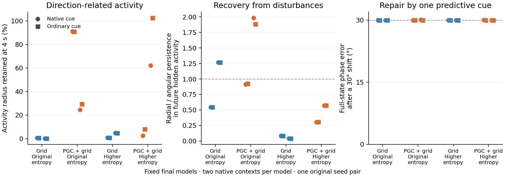

# Matched exploration: final neural and behavioral measurements

All four fixed final models are included. Each continued from the same 40M parent within its population for another 50,073,600 learning frames. Only the exploration coefficient differs between arms.

Each model contributes its first two physically eligible native histories. The circles and squares compare predictive and ordinary cue inputs within that frozen model. The middle panel measures recovery relative to the evolving activity family; the complete ring criteria also test its geometry and persistence. A low ratio alone is one component of the mechanism. Grid cue branches are identity controls.

| Model | Exploration | Blind free goals/episode | Ordinary cue | Reset every blind update | Vision restored |
|---|---|---:|---:|---:|---:|
| Grid | original | 0.4375 | 0.4375 | 0.4375 | 0.5000 |
| PGC + grid | original | 0.0156 | 0.0156 | 0.0000 | 0.5312 |
| Grid | explore | 0.0000 | 0.0000 | 0.0000 | 0.0000 |
| PGC + grid | explore | 0.0469 | 0.0469 | 0.0156 | 0.0000 |

These rates retain all 64 original evaluation episodes, including zero-event episodes. Full learning curves, all cue and reset variants, goalward progress and paired slot uncertainty remain in the [behavior summary](../../rl_blind_reorientation_entropy/summary.json).

| Model / exploration / context | Hidden radius retained | Phase error: ordinary → predictive | Translation probability | Mean goalward progress |
|---|---:|---:|---:|---:|
| Grid / original / 1 | 0.481% | 30.000° → 30.000° | 99.99% | -0.0869 m |
| Grid / original / 2 | 0.2% | 30.000° → 30.000° | 99.41% | +0.0751 m |
| PGC + grid / original / 1 | 91.3% | 30.000° → 29.991° | 12.8% | +0.0338 m |
| PGC + grid / original / 2 | 24.5% | 30.000° → 30.075° | 0.006928% | +0.0012 m |
| Grid / explore / 1 | 0.889% | 30.000° → 30.000° | 74.1% | +0.0010 m |
| Grid / explore / 2 | 4.76% | 30.000° → 30.000° | 70.22% | +0.0065 m |
| PGC + grid / explore / 1 | 2.58% | 30.000° → 30.012° | 67.32% | -0.0041 m |
| PGC + grid / explore / 2 | 62.2% | 30.000° → 29.996° | 83.63% | -0.0198 m |

Translation probability uses the exact learned action layer across all 768 controlled directions at free-choice onset. Navigation uses 192 directions, matched action and motor-noise draws, and 30 free actions. These controlled contexts differ from whole-episode behavioral evaluation. Goal opportunity bounds are retained for every context; zero hits from unreachable starts are not evidence about memory.

**Remembered direction can control movement in these continued agents.** In the original-entropy PGC model’s first context, replacing the state with one elicited 30° away changes 1,042 of 5,760 sampled actions. Erasing state changes 754 actions and reduces goalward progress from +3.38 cm to −0.11 cm. Removing the predictive pulse changes only 27 actions; its lasting phase repair is 0.0095°. This separates use of recurrent direction information from repair by this brief cue. The second context has negligible action dependence, so this is a context-specific mechanism.

| Model / exploration / context | Predictive → ordinary: changed actions | +30° state | −30° state | State reset | Goalward progress: native → reset |
|---|---:|---:|---:|---:|---:|
| Grid / original / 1 | 0 | 0 | 0 | 0 | -8.69 → -8.69 cm |
| Grid / original / 2 | 0 | 0 | 1 | 6 | +7.51 → +7.51 cm |
| PGC + grid / original / 1 | 27 | 1042 | 1065 | 754 | +3.38 → -0.11 cm |
| PGC + grid / original / 2 | 0 | 0 | 0 | 0 | +0.12 → +0.12 cm |
| Grid / explore / 1 | 0 | 0 | 0 | 988 | +0.10 → -0.72 cm |
| Grid / explore / 2 | 0 | 1 | 2 | 3 | +0.65 → +0.64 cm |
| PGC + grid / explore / 1 | 0 | 4 | 4 | 898 | -0.41 → -0.08 cm |
| PGC + grid / explore / 2 | 13 | 182 | 162 | 319 | -1.98 → -1.54 cm |

Each count is out of 5,760 saved action entries. These are matched counterfactual comparisons within one model and history, not independent samples or statistical tests over trained seeds. All eight contexts and both raw/scaled state interventions are retained in the complete data.

The unchanged full-state screen nominates **0 / 32 cue branches**. The all-hidden future-activity screen nominates **0 / 64 centered comparisons** and **0 / 64 uncentered comparisons**. These counts describe nested checks of four endpoints, not independent trained agents.

All cue directions, both perturbation metrics, every geometry gate, all state edits and all 128 action-layer rows remain in the source outputs. This report adds no fits, thresholds or checkpoint selection.

[Complete report data](summary.json) · [Independent audit](../independent_artifact_audit.json) · [Frozen method](../../../docs/research/reorientation_entropy_mechanism_reproduction.md) · [Reproduction inputs](../../rl_blind_reorientation_entropy/REPRODUCE.md)
