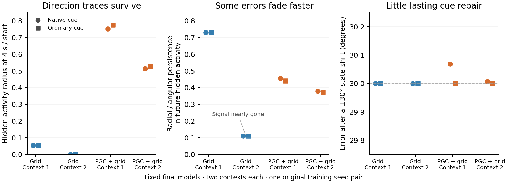

# What changed inside the new blind-reorientation agents?

**The PGC model retains stronger direction-related hidden activity in these contexts. Some disturbances fade selectively, while the predictive pulse produces almost no lasting phase repair and scarcely changes the next movements.**

We used the actual square arena, maps, goal code and trained LSTM. For each final model, we took the first two physically eligible native task histories and replayed their visible/turn/forward-probe sequence across 768 directions, ending at the same location. We then supplied one correct, ordinary, or ±60° wrong current cue and held subsequent inputs identical within that model. The saved goal code stayed intact. The primary comparison is the complete hidden + cell state; a second analysis observes every hidden unit over the following second.

**The positive difference:** after four seconds the PGC hidden-state family retains about 51–75% of its starting radius, versus about 0.013–5.4% for Grid in these four contexts. In the future-hidden-activity analysis, radial disturbances in PGC persist about 38–46% as strongly as angular disturbances. Similar values remain with the predictive pulse removed or rotated, suggesting a property of the trained dynamics and preceding history, rather than an acute stabilization effect of that pulse. The second Grid context also has a low radial ratio, but its observable activity is below the frozen amplitude guard.

**What that activity is doing:** direction remains readable from both populations with a new analysis readout fitted at each time. The state families also drift and change phase order. No branch passes the unchanged full-state criteria; none of the 32 future-hidden-activity branch/metric checks passes either. The measured organization is a changing directional trace with unequal sensitivity to disturbances. The action tests below show how little this trace controls the subsequent blind behavior.

**Causal test:** just before the cue, we substituted a state belonging to a direction 30° away, or applied a small radial/random disturbance. We compared a correct predictive cue with ordinary and wrong-direction cues, withdrew the cue, and ran the original actor for two seconds with matched action and motor-noise draws. A separate reset removes all hidden and cell state immediately after the cue. All 192 directions, failures and zero-hit windows are retained.

| Population / context | Late error: ordinary → native | Mean path | Mean goalward progress | +30° edit: changed actions | Reset: changed actions |
|---|---:|---:|---:|---:|---:|
| Grid / 1 | 30.000° → 30.000° | 0.601 m | -0.0854 m | 0 / 5,760 | 0 / 5,760 |
| Grid / 2 | 30.000° → 30.000° | 0.522 m | +0.0052 m | 0 / 5,760 | 0 / 5,760 |
| PGC + grid / 1 | 30.000° → 30.068° | 0.026 m | -0.0011 m | 1 / 5,760 | 7 / 5,760 |
| PGC + grid / 2 | 30.000° → 30.007° | 0.026 m | -0.0007 m | 0 / 5,760 | 0 / 5,760 |

The table uses raw full-state geometry and the unperturbed native-cue movement baseline. The underlying per-context `causal/context*/result.json` files retain both perturbation metrics, both ±30° edits, ±2% radial/random edits at both prescribed times, every cue, both reference conventions and actor-probability changes. Action entries are paired samples from one policy, not independent experimental replicates.

All native, ordinary and wrong-cue variants produce identical sampled actions for each matched edit in these contexts. PGC movement is mostly rotation with little translation. Its remaining direction information has very weak influence on the free actor here. Grid cue shams are exact, and a post-cue reset exactly erases every prior state-edit difference.

**Goal opportunity:** the two Grid contexts and the first PGC context start too far from the goal disk for any 30-step action sequence to hit it under the saved motor-noise tapes. Their zero-hit counts are therefore opportunity-limited. Phase repair, action changes and continuous progress remain measurable. The second PGC context is not ruled out by that speed bound: its goal-disk gap is 0.491 m and the maximum path bound is 0.702 m. It still moves only about 0.026 m and has zero hits. Every context is retained. The controlled forced delay is noiseless to match the neural flow; free movement uses native motor noise. Native noisy whole-episode evaluations are a separate result.

The native physical contexts and saved goal codes differ between the two models. Thus the population comparison describes these trained agents in their own task histories; the cue-removal and perturbation comparisons within each frozen agent isolate the acute effect. These are fixed final checkpoints of one original training-seed pair, not a population-level significance test.

[Complete numerical summary](mechanism_summary.json) · [Independent artifact and goal-opportunity audit](independent_artifact_audit.json) · [All future-hidden-activity results](../../lstm_reorientation_observable/README.md) · [Frozen protocol](../../../docs/research/reorientation_mechanism_protocol.json) · [Exact reproduction commands and timing](../../../docs/research/reorientation_mechanism_reproduction.md)

Rebuild this display with `python scripts/plot_reorientation_final_mechanism.py`. Every underlying numerical analysis and threshold is unchanged.
