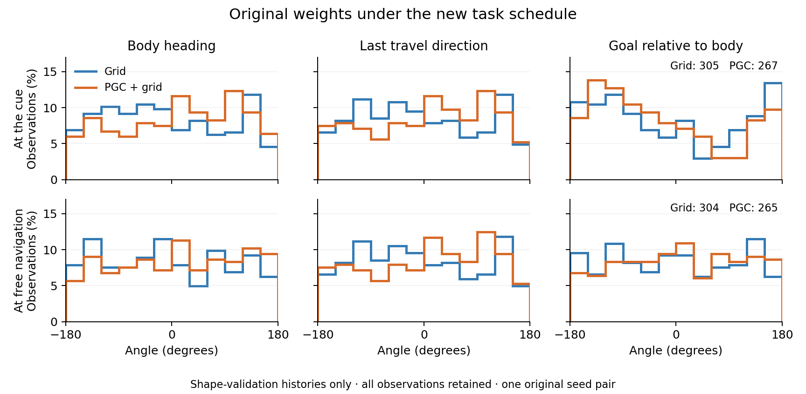

# Angular coverage of original-checkpoint transfer histories

**These are original 1B checkpoints running the new task schedule for shape validation. They have not been trained on this task.** The plot is a support check, not a new trained-model mechanism result.

The observer recorded every encountered probe endpoint and free-navigation start across 2,700 policy updates per population. No angular observations were excluded. Each panel uses 30° bins; each curve sums to 100%.

| Population | Event boundary | Observations | Body-heading bins | Travel-direction bins | Goal-bearing bins |
|---|---|---:|---:|---:|---:|
| Grid | Probe endpoint | 305 | 12/12 | 12/12 | 12/12 |
| Grid | Free navigation | 304 | 12/12 | 12/12 | 12/12 |
| PGC + grid | Probe endpoint | 267 | 12/12 | 12/12 | 12/12 |
| PGC + grid | Free navigation | 265 | 12/12 | 12/12 | 12/12 |

World heading, last travel direction, and goal direction relative to the body are separate quantities. Their empirical distributions describe the policy-generated histories. The controlled experiment deliberately replays a complete 360° family; its angular distribution should not be mistaken for the policy’s usual distribution.

All twelve 30° bins are occupied in every distribution. The largest empty angular gaps range from 5.3° to 12.5° across these recorded samples. This finds no large missing direction sector in the original transfer histories; the endpoint goal-bearing distributions still show clear nonuniformity.

The [complete JSON](coverage.json) retains all observations, source hashes, bin counts, largest angular gaps, and circular summaries. Repeated events and paired endpoint/free-start observations are nested within one original seed pair. Fresh coverage will be collected from the fixed final trained checkpoints.
