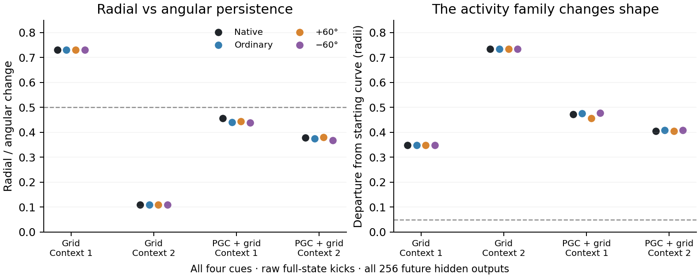

# Future activity after the task-native direction cue

**Some radial disturbances shrink faster than angular disturbances, but the activity families change shape and lose phase order. None passes the unchanged conditional-ring criteria.**

We observed every hidden unit at four future times, then repeated that measurement two seconds later. This asks whether a ring survives in activity that can influence the actor even when other cell-state coordinates drift. No decoder plane or neuron subset was selected.

The four branches receive a native predictive cue, ordinary spatial cue, or predictive cue rotated by ±60° exactly once. Their subsequent inputs are identical. The analysis starts one second after that cue and finishes at the first free-action input, before the actor moves.

**Left:** values below 0.5 meet the selective radial-recovery part of the test. PGC values are similar with the native cue removed or rotated. **Right:** every branch changes substantially relative to its starting activity curve, even after subtracting common background drift; all exceed the 0.05-radius invariance threshold. Phase order also fails in every case. Both conditions must pass alongside the other frozen guards.

| Model / context | Cue | Radial/angular | Curve departure |
|---|---|---:|---:|
| Grid / 1 | Native | 0.730 | 0.348 |
| Grid / 1 | Ordinary | 0.730 | 0.348 |
| Grid / 1 | +60° | 0.730 | 0.348 |
| Grid / 1 | −60° | 0.730 | 0.348 |
| Grid / 2 | Native | 0.111 | 0.734 |
| Grid / 2 | Ordinary | 0.111 | 0.734 |
| Grid / 2 | +60° | 0.111 | 0.734 |
| Grid / 2 | −60° | 0.111 | 0.734 |
| PGC + grid / 1 | Native | 0.456 | 0.472 |
| PGC + grid / 1 | Ordinary | 0.440 | 0.476 |
| PGC + grid / 1 | +60° | 0.444 | 0.457 |
| PGC + grid / 1 | −60° | 0.438 | 0.478 |
| PGC + grid / 2 | Native | 0.379 | 0.405 |
| PGC + grid / 2 | Ordinary | 0.374 | 0.408 |
| PGC + grid / 2 | +60° | 0.380 | 0.406 |
| PGC + grid / 2 | −60° | 0.368 | 0.408 |

The second Grid context also falls below the minimum observable-activity amplitude. Its small radial/angular ratio therefore accompanies a weak, changing trace. Exact Grid cue shams are retained in the figure/table; their repeated points are not independent observations.

Across both contexts, four cue branches and both full-state perturbation metrics, **0/32 centered and 0/32 noncentered checks pass**. These are nested checks of one original seed pair, not 32 trained agents. All hidden/cell RMS-scaled results and every gate are retained in [the numerical summary](summary.json). Saved15→60 trajectories replayed exactly before the probes. Actor probability differences are reported separately; this geometry analysis does not simulate free navigation.

[Frozen protocol](protocol.json) · [Independent review and known-system controls](review.json) · [Primary and causal results](../lstm_reorientation_mechanism/final) · [Adapter](../../scripts/lstm_endogenous_reorientation_observable.py)

Reproduce each fixed population with `OPENBLAS_NUM_THREADS=2 python scripts/lstm_endogenous_reorientation_observable.py --condition gc100` (then `pgc33 --require-complete`). Rebuild this figure with `python scripts/plot_reorientation_observable.py`. The validated `observable_probe` and its gates were reused unchanged.
