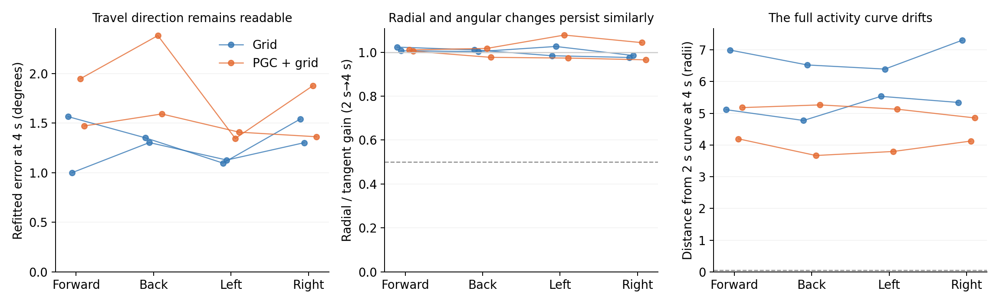

# The result survives changes in movement action

We repeated the same travel-memory test using forward, backward, leftward and rightward movement. Each family followed the same world-space paths and reached the same endpoint. Body orientation and the previous-action input matched the action. Every family began from the same native recurrent context for that model.

All 16 model/action combinations retain readable travel-direction information. None meets the unchanged full-state attracting-ring criteria. Radial disturbances persist about as strongly as changes along the activity curve, and the whole curve moves away from its earlier location. This pattern suggests a changing memory trace across movement contexts.

| Action | Model | Refitted travel error at 4 s | Radial/tangent gain, 2→4 s | Drift from 2 s curve (radii) |
|---|---|---:|---:|---:|
| forward | Grid seed1 | 1.57° | 1.023 | 5.11 |
| forward | Grid seed2 | 1.00° | 1.007 | 6.99 |
| forward | PGC + grid seed1 | 1.95° | 1.011 | 4.19 |
| forward | PGC + grid seed2 | 1.47° | 1.005 | 5.18 |
| backward | Grid seed1 | 1.35° | 1.011 | 4.77 |
| backward | Grid seed2 | 1.30° | 1.003 | 6.52 |
| backward | PGC + grid seed1 | 2.38° | 1.017 | 3.67 |
| backward | PGC + grid seed2 | 1.59° | 0.977 | 5.26 |
| strafe left | Grid seed1 | 1.10° | 0.984 | 5.53 |
| strafe left | Grid seed2 | 1.13° | 1.026 | 6.39 |
| strafe left | PGC + grid seed1 | 1.34° | 1.078 | 3.80 |
| strafe left | PGC + grid seed2 | 1.41° | 0.973 | 5.13 |
| strafe right | Grid seed1 | 1.54° | 0.976 | 5.34 |
| strafe right | Grid seed2 | 1.30° | 0.985 | 7.30 |
| strafe right | PGC + grid seed1 | 1.88° | 1.044 | 4.12 |
| strafe right | PGC + grid seed2 | 1.36° | 0.965 | 4.85 |

The table and figure use raw full-state distances; [the numeric summary](action_summary.json) also reports the unchanged h/c RMS-scaled analysis. The refitted decoder measures available information; it is fitted separately at each time and does not define a ring. Lines connect repeated action measurements of the same trained model, not independent replications.

The original forward condition was regenerated and matched every published state/input exactly. Actual endpoint errors were below 1e−5 m before the documented numerical snap. The explicit stop and common blind-turn input were identical across actions. Native predictive current inputs were replaced by ordinary current codes during the autonomous test; the saved goal code remained intact.

This is a separately frozen coverage check using original seeds 1–2 and context 0. The actor did not choose the scripted approach sequence; its preceding recurrent context came from a real policy history. See the [frozen protocol](protocol.json), [all outcomes](summary.json), and per-action folders.
