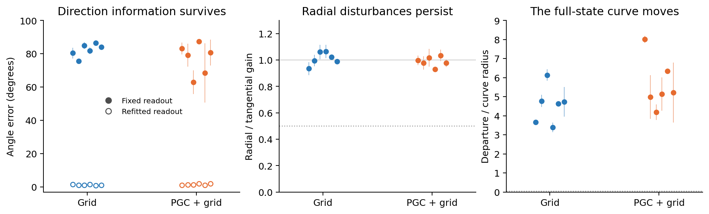

# Held-out original models: persistent direction traces

**The same pattern appears in twelve held-out trained models: direction information remains, while radial mistakes persist and the full-state curve moves. None of the 24 native contexts passes the frozen ring-candidate screen.**



Each point is one trained seed, averaged over two contexts. Lines show the range of those two contexts, not confidence intervals. The middle and right panels show raw full-state coordinates; every case was also tested after separately rescaling hidden and cell state.

We fixed the methods using seeds 1–2, then tested Grid and PGC + grid seeds 3–8. Every held-out context was generated by its own original policy with **continuous native vision**. A deterministic window clock selected the first two physically eligible fifteen-update windows after goal discovery, from different environment slots. Selection used only wall/goal clearance. It never used neural results.

For each context, real forward trajectories approached the same endpoint from 768 directions. After an explicit stop, the recurrent system received one common input: black vision, ordinary current grid code, the unchanged native saved goal, turn action and zero reward. Thus no active current predictive cue supplied the angle during the autonomous screen.

Over the primary two-to-four-second interval:

- Radial/tangential gain was **0.89–1.11** in raw coordinates across all 24 contexts. Radial errors survived almost as strongly as angular differences.
- Full states moved **3.2–8.2 curve radii** away from the earlier fixed curve. No case passed the full-state invariance criterion in either coordinate metric.
- At four seconds, a refitted analysis readout recovered the starting travel direction with **0.75–2.31° error** on held-out angles. The readout fixed before darkness had **51–88° error**.

These results suggest a persistent direction trace spread through recurrent state, with changing expression and little selective attraction toward the tested circular family. They provide a held-out replication of that mechanism across both populations. Phases and contexts are nested measurements; the replication units are the twelve trained models.

The [frozen protocol](protocol.json), [all candidate outcomes](summary.json) and [seed-level descriptive summary](seed_summary.json) retain every model and context. Full trajectories and exact current-input vectors are stored per model for independent observable-state and cue-pulse analyses. The shared collector's console wording includes “scheduled blackout”; in this wrapper that event is only a window boundary. Its tested observation mask is always false, and saved collection metadata explicitly records continuous vision.

```bash
OPENBLAS_NUM_THREADS=2 /opt/anaconda3/bin/python -m pytest tests/test_lstm_travel_memory_heldout.py -q
OPENBLAS_NUM_THREADS=2 /opt/anaconda3/bin/python scripts/lstm_travel_memory_heldout.py
OPENBLAS_NUM_THREADS=2 /opt/anaconda3/bin/python scripts/plot_lstm_travel_memory_heldout.py
```
