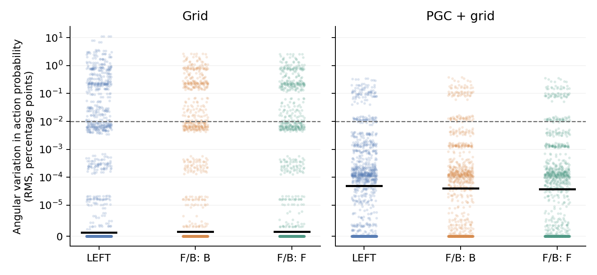
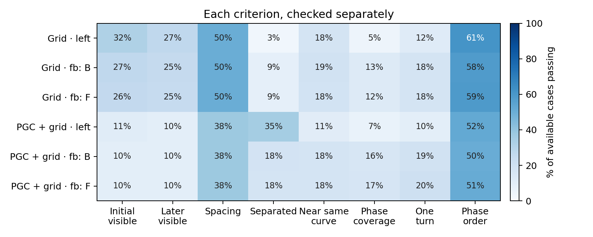

# What the six-action observer found

We took independent copies of each saved RNN state, supplied each of the six truthful actions, and read the next action probabilities. This tests whether angular information becomes visible under different inputs. The queries were never inserted into the memory-retention trajectory.

Dots show every available case across all fixed windows, including exact aliases. Black lines are medians. The dashed line is the prespecified 0.01-percentage-point visibility floor. This is a numerical screen, not a navigation-benefit threshold.

| Original model | Available | Visible at both ends | Geometry passed | Conditional tests completed | Candidates |
| --- | ---: | ---: | ---: | ---: | ---: |
| Grid | 3328/3328 | 818 | 0 | 0 | 0 |
| PGC + grid | 3328/3328 | 330 | 0 | 0 | 0 |

A failed geometry criterion means the measured pattern did not meet that particular ring screen. It does not mean the RNN carried no information. The full table retains overlapping failures, initial and later probability sensitivity, and the centered-probability/logit diagnostics.

Qualifying curves receive the fixed broad perturbations in both raw and h/c-RMS metrics. Observable-normal recovery, phase-only responses, invisible responses, and held-out equivalence are separate results. Insufficient transverse visibility is inconclusive; it is not failed recovery. Held-out queries always use the original discovery phase label.

In this batch, **0 named cases** reached completed conditional tests. If that count is zero, no perturbation or held-out query was executed; there are no measured recovery failures to report.

There is one original seed per population. The 3,328 cases per population are repeated measurements of those two networks, not thousands of independent models. LEFT has 1,280 cases; each F/B section has 1,024. Exact aliases remain in these denominators; numerical-only totals are also saved. F/B is a periodic-input diagnostic, and phase drift is reported against zero body rotation.

Execution complete for both cohorts: **True**. Pending or physically unavailable cases remain explicit and are never counted as scientific negatives.

This report only reads saved arrays and checks their arithmetic and provenance. It creates no environment, policy rollout, recurrent transition, or additional query. Full records: [summary](summary.json), [validation](validation.json).
