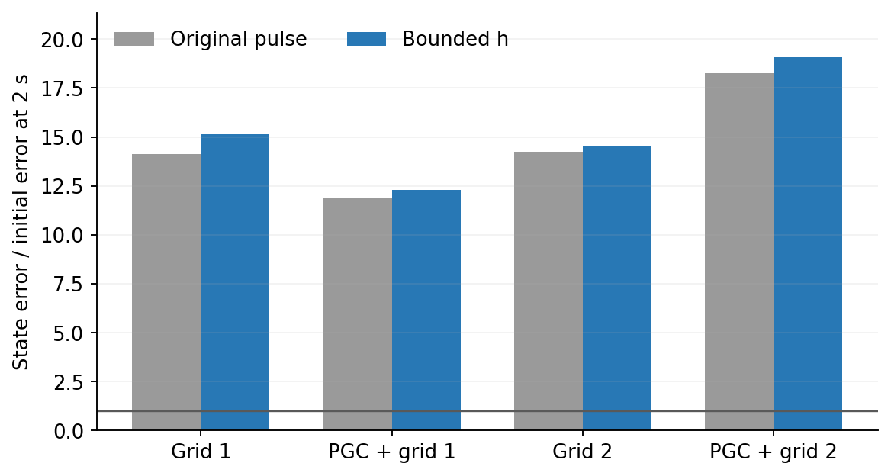
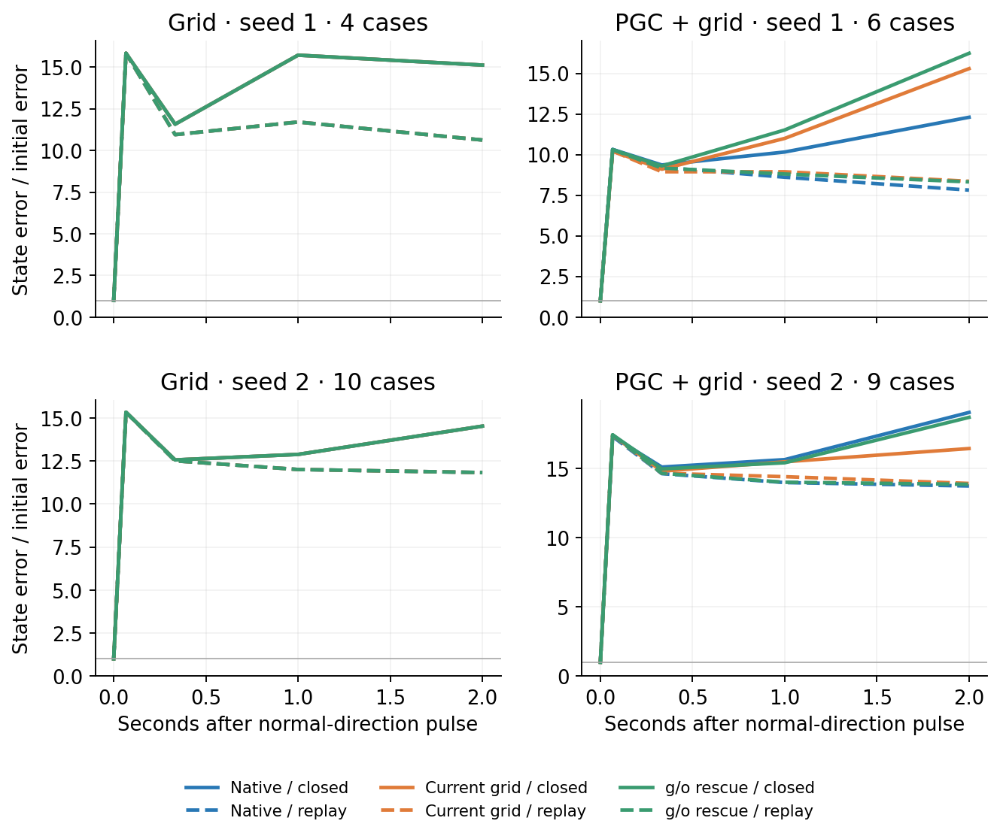
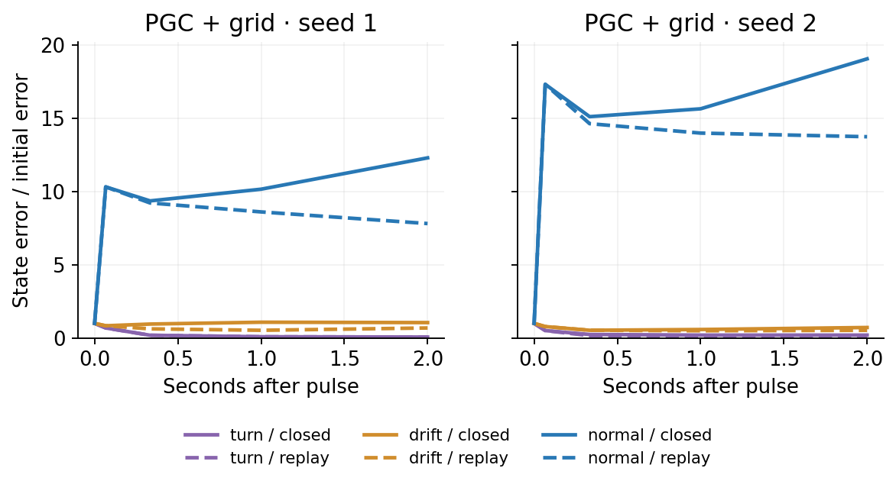

# Native movement: bounded-state robustness

**The large finite response survives the hidden-state bound correction.** On the same cases, the random-direction response remains amplified in all four models, while observed-turn nudges mostly fade. The effect of removing current predictive input still differs between the two PGC seeds.

This repeats every original case with legal initial hidden-state values. Each proposed hidden-state value h was clipped to [-1, 1]; the c displacement was unchanged at that step. All six full h/c pulses were then only shrunk to the smallest clipped norm within their case. The original experiment remains separate and unchanged.

The three direction labels refer to the original pulses. Clipping changes their angles, so the bounded random direction is not claimed to remain exactly orthogonal. Actual norms, bounds and pairwise angles are retained for every case. The final matched norms range from 0.01436 to 0.01997; random-direction cosines with their originals remain at least 0.9867. The largest angle change is in a drift pulse (cosine 0.7343).

We nudged the original RNN state during naturally repeated turns. Before bounding, the directions were an observed turning-state change, the drift between successive turns, and a random direction orthogonal to both. Within each case, all six bounded nudges had the same actual scaled size. No circle was fitted or imposed.

The state was then followed for two seconds with native input, current predictive features replaced by ordinary grid features, or predictive influence restored only to the candidate update and output gate. The saved goal cue stayed native throughout. Each pulse was compared with its own unpulsed input-route control.

Solid lines include the agent–environment feedback loop. Dashed lines replay the exact recorded native RNN inputs, including previous actions and rewards.

| Model | Eligible / all episodes | Native normal-pulse gain, closed loop | Same gain, replay | Current-grid gain, closed loop |
|---|---:|---:|---:|---:|
| gc100_s1 | 4/32 | 15.120 (n=8) | 10.623 (n=8) | 15.120 (n=8) |
| pgc33_s1 | 6/32 | 12.302 (n=10) | 7.817 (n=10) | 15.294 (n=10) |
| gc100_s2 | 10/32 | 14.530 (n=16) | 11.833 (n=16) | 14.530 (n=16) |
| pgc33_s2 | 9/32 | 19.062 (n=16) | 13.745 (n=16) | 16.451 (n=16) |

Gain = remaining scaled h/c error divided by the initial pulse. n counts signed pulse/case observations; opposite signs are not independent models. Both figures use the SAME cases for closed loop/replay, all three input routes, and all signed directions at each horizon. Cases must remain preterminal everywhere and have recorded replay available; per-horizon cohort sizes are saved. Less-restricted counts and responses remain separately available. All missing and censored cases remain in the saved report.

| Model | Native goal progress, cm | Change after current-grid substitution, cm | Mean policy TV from substitution |
|---|---:|---:|---:|
| gc100_s1 | 17.52 | +0.00 | 0.0000 |
| pgc33_s1 | 6.12 | -1.09 | 0.1519 |
| gc100_s2 | 13.74 | +0.00 | 0.0000 |
| pgc33_s2 | 5.10 | -1.26 | 0.2048 |

| PGC model | Input route | Actions different from native | Policy TV from native | Goal progress, cm |
|---|---|---:|---:|---:|
| pgc33_s1 | Native | 0.0% | 0.000 | 6.12 |
| pgc33_s1 | Current grid | 18.3% | 0.152 | 5.02 |
| pgc33_s1 | g/o rescue | 9.4% | 0.086 | 5.27 |
| pgc33_s2 | Native | 0.0% | 0.000 | 5.10 |
| pgc33_s2 | Current grid | 19.0% | 0.205 | 3.84 |
| pgc33_s2 | g/o rescue | 5.6% | 0.051 | 3.30 |

| Model | Original normal-pulse gain | Bounded normal-pulse gain | Matched signed cases |
|---|---:|---:|---:|
| gc100_s1 | 14.130 | 15.120 | 8 |
| pgc33_s1 | 11.906 | 12.302 | 10 |
| gc100_s2 | 14.239 | 14.530 | 16 |
| pgc33_s2 | 18.274 | 19.062 | 16 |

The robustness comparison above uses the intersection of the two experiments’ cases, in addition to requiring the same cases across input routes, streams and directions. The unpulsed route outcomes were checked for exact identity between experiments.

These are short-window progress measurements from the mechanically selected turns, not complete-episode navigation scores. First goal hits terminate each branch; its endpoint is held for the fixed-time progress comparison, and teleportation never counts as travel.

All initial hidden-state values are within [-1, 1]. The case-specific target norms and actual direction cosines are recorded; these remain finite interventions rather than an infinitesimal stability spectrum.

Every selected native-only fork exactly reproduced the archived inputs, h/c states, logits, sampled actions, physical transitions and random-state clocks before interventions. Grid substitution and rescue were exact shams. All four original checkpoints stayed unchanged. No training or cloud compute was used.

This measures local state and policy sensitivity along observed movement trajectories. The nominal turn direction comes from observed movement; these responses characterize finite state sensitivity along that movement. The report keeps full h/c, h-only, c-only, policy TV, action changes, movement progress and censored right-turn/right-strafe switching times separately. Two original seeds are a discovery sample, not a population significance test.

All branch summaries and raw-artifact hashes: [summary.json](summary.json). The frozen protocol and source manifest are under `docs/research/native_movement_bounded_pulse_*`.
