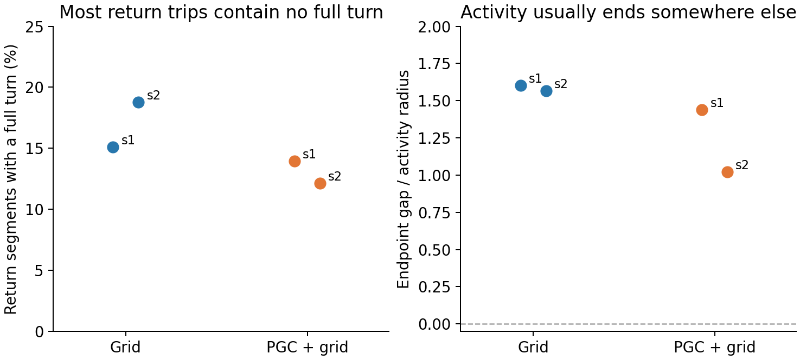

# Recurrent activity during native turns

**We recorded 128 complete episodes from four original agents, with no training or input changes.** Full heading turns occurred in 12–19% of return segments. After a full turn, hidden activity usually ended roughly one to two activity radii from its starting pattern.

A point at zero in the right panel would mean the hidden-activity trajectory closed. The plot uses all 256 hidden units; PCA and fitted angular decoders are not involved. Each point is one trained model, summarized over its native return turns.

| Original agent | Return segments | With a full turn | With repeated turns | Median hidden-activity endpoint gap / radius |
| --- | ---: | ---: | ---: | ---: |
| Grid seed 1 | 305 | 46 | 4 | 1.60 |
| Grid seed 2 | 346 | 65 | 12 | 1.57 |
| PGC + grid seed 1 | 308 | 43 | 6 | 1.44 |
| PGC + grid seed 2 | 330 | 40 | 10 | 1.02 |

**What this suggests.** A full body turn is usually part of a changing navigation computation, rather than one completed orbit through an unchanged neural activity pattern. The PGC models have smaller median hidden-activity gaps in these two discovery seed pairs. The causal perturbation experiment tests whether prediction helps recover useful movement-related activity.

**What was measured.** A turn is a first passage through a new signed multiple of 2π within one uninterrupted search or return segment. Goal pickups and teleports are never stitched into cycles. Return segments begin with a saved goal and include both completed and episode-censored trips. Endpoints use the actual recorded discrete steps, so crossing overshoot, sensory noise and changing physical position contribute to the gap. This census alone neither tests attraction nor isolates an invariant subsystem.

The complete data also retain full `(h,c)` geometry in raw and fixed block-RMS units, and all centered actor logits. Every model passed exact native-forward equivalence, and its weights remained unchanged. The ordinary-current-code substitution was separately checked against an independently instantiated grid population; it changes 169 current-code slots in PGC agents and is an exact sham in Grid agents. The census itself uses native inputs only.

This is an exploratory result from two trained seed pairs. Turns are repeated observations within each model, not independent training replications. [All model summaries and source hashes](census_report.json).

Reproduce this report: `python scripts/report_native_movement_cycles.py`.
