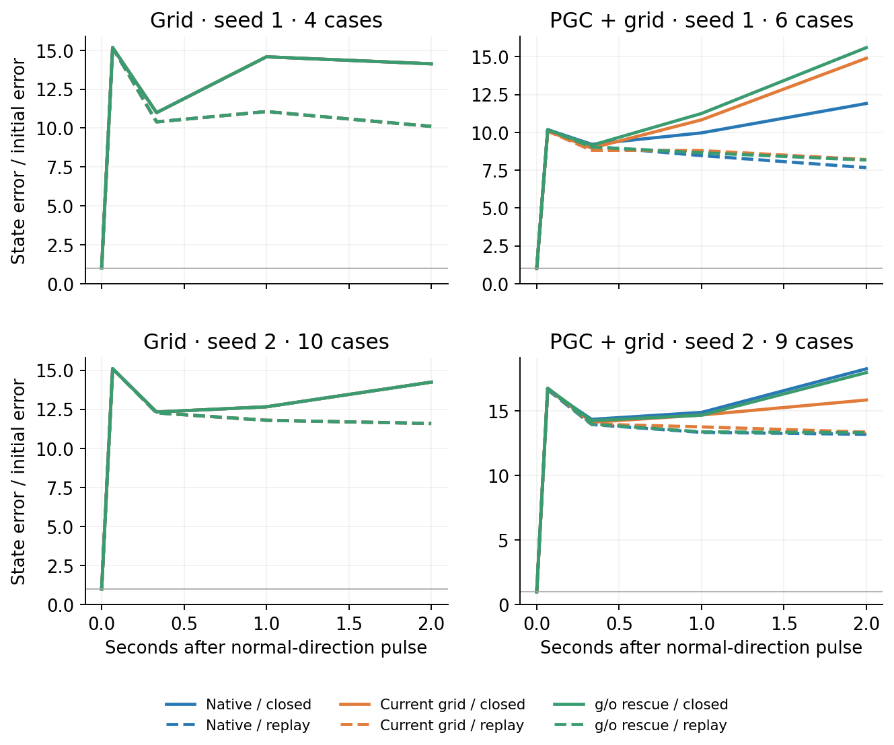
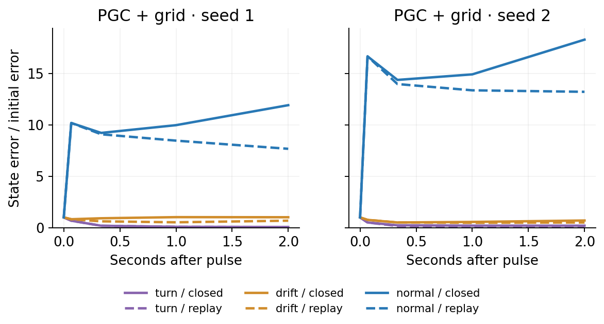

# Native movement: state impulse responses

**The current predictive signal changes steering, but these turning states do not show a consistent predictive-input stabilization effect across the two discovery seeds.** Replacing current predictive features changed about 18–19% of sampled actions and reduced two-second goal progress by about 1.1–1.3 cm. Restoring their candidate/output-gate influence brought action choices closer to native; progress recovery was mixed.

The observed-turn nudges mostly faded. Equal-sized orthogonal random nudges produced much larger state and policy changes, including a large first-update amplification. These are finite interventions in the stated block-RMS metric, not an infinitesimal stability spectrum or a validated radial test. The input-removal effect on this response reversed between the two PGC seeds.

We nudged the original RNN state during naturally repeated turns. The three directions were an observed turning-state change, the drift between successive turns, and a random direction orthogonal to both. Each nudge had the same scaled size. No circle was fitted or imposed.

The state was then followed for two seconds with native input, current predictive features replaced by ordinary grid features, or predictive influence restored only to the candidate update and output gate. The saved goal cue stayed native throughout. Each pulse was compared with its own unpulsed input-route control.

Solid lines include the agent–environment feedback loop. Dashed lines replay the exact recorded native RNN inputs, including previous actions and rewards.

| Model | Eligible / all episodes | Native normal-pulse gain, closed loop | Same gain, replay | Current-grid gain, closed loop |
|---|---:|---:|---:|---:|
| gc100_s1 | 4/32 | 14.130 (n=8) | 10.108 (n=8) | 14.130 (n=8) |
| pgc33_s1 | 6/32 | 11.906 (n=10) | 7.667 (n=10) | 14.895 (n=10) |
| gc100_s2 | 10/32 | 14.239 (n=16) | 11.595 (n=16) | 14.239 (n=16) |
| pgc33_s2 | 9/32 | 18.274 (n=16) | 13.205 (n=16) | 15.859 (n=16) |

Gain = remaining scaled h/c error divided by the initial pulse. n counts signed pulse/case observations; opposite signs are not independent models. Both figures use the SAME cases for closed loop/replay, all three input routes, and all signed directions at each horizon. Cases must remain preterminal everywhere and have recorded replay available; per-horizon cohort sizes are saved. Less-restricted counts and responses remain separately available. All missing and censored cases remain in the saved report.

| Model | Native goal progress, cm | Change after current-grid substitution, cm | Mean policy TV from substitution |
|---|---:|---:|---:|
| gc100_s1 | 17.52 | +0.00 | 0.0000 |
| pgc33_s1 | 6.12 | -1.09 | 0.1519 |
| gc100_s2 | 13.74 | +0.00 | 0.0000 |
| pgc33_s2 | 5.10 | -1.26 | 0.2048 |

| PGC model | Input route | Actions different from native | Policy TV from native | Goal progress, cm |
|---|---|---:|---:|---:|
| pgc33_s1 | Native | 0.0% | 0.000 | 6.12 |
| pgc33_s1 | Current grid | 18.3% | 0.152 | 5.02 |
| pgc33_s1 | g/o rescue | 9.4% | 0.086 | 5.27 |
| pgc33_s2 | Native | 0.0% | 0.000 | 5.10 |
| pgc33_s2 | Current grid | 19.0% | 0.205 | 3.84 |
| pgc33_s2 | g/o rescue | 5.6% | 0.051 | 3.30 |

These are short-window progress measurements from the mechanically selected turns, not complete-episode navigation scores. First goal hits terminate each branch; its endpoint is held for the fixed-time progress comparison, and teleportation never counts as travel.

The pulses were not clipped. The saved per-case metadata records any hidden-state coordinates that initially exceeded the normal [-1, 1] range; these are finite interventions in the stated coordinates, not an infinitesimal stability spectrum.

Every selected native-only fork exactly reproduced the archived inputs, h/c states, logits, sampled actions, physical transitions and random-state clocks before interventions. Grid substitution and rescue were exact shams. All four original checkpoints stayed unchanged. No training or cloud compute was used.

This measures local state and policy sensitivity along observed movement trajectories. A turn secant is not a validated ring phase; contraction in an orthogonal direction alone does not identify a ring. The report keeps full h/c, h-only, c-only, policy TV, action changes, movement progress and censored right-turn/right-strafe switching times separately. Two original seeds are a discovery sample, not a population significance test.

All branch summaries and raw-artifact hashes: [summary.json](summary.json). The frozen protocol and source manifest are under `docs/research/native_movement_pulse_*`.
