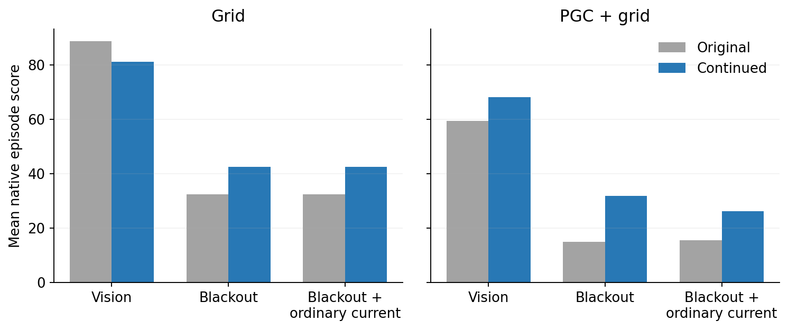

# Learning to navigate through brief cue interruptions

**Training the existing LSTM improved navigation during blackouts. The same fixed models still produced no ring candidates in the direction-memory tests.**

Each original agent taught a copy of itself using its full-vision action probabilities. Only the four existing LSTM weight/bias tensors changed. The square maps, six actions, CNN, action-output layer and saved goal code stayed the same. No direction label, additional controller or ring-shaped loss was supplied.

| Blackout navigation score | Original | After training |
| --- | ---: | ---: |
| Grid | 32.5 | 42.5 |
| PGC + grid | 15.0 | 31.9 |

The gains came from more returns to discovered goals. Each model actually found its first goal in one fewer evaluation episode. These are **one training seed per population**, with 16 fixed evaluation episodes per condition.

## What changed in the computation?

The new networks reproduced their full-vision teachers much better on exactly the same recorded input histories. During blackouts, retaining the trained PGC network's recurrent state gave **0.87 KL mismatch**; erasing that state before every update increased it to **1.28**. Its retained state therefore contributes useful information to action selection in this comparison.

In live blackout navigation, replacing the trained PGC model's current predictive values with ordinary-grid values reduced its score from **31.9 to 26.3**. Erasing its recurrent state reduced the native-input score to **20.6**. The full report includes the visible-input erasure control and all six conditions. Live pickups can change the subsequent blackout schedule; the recorded-history tests keep input timing exactly matched.

We erased **both hidden activity and cell memory**, or replaced **only the current predictive code**, depending on the condition. Saved goal codes, previous-action and previous-reward inputs remained available. These are tests of the stated inputs and state, not removal of every possible source of history.

## Did a ring emerge?

We replayed identical histories through the original and final weights, then tested heading and movement-direction memories in the complete recurrent state, hidden activity and action scores. We also tested each final model in its own navigation contexts. **No case qualified:** 0/36 matched two-second final tests, 0/36 final own-context tests, and no individual nomination among all 720 metric/time/centering rows.

Direction differences and radial errors persisted together, while the reference curves changed shape. The supported mechanism in this pilot is **better processing of interrupted inputs, with a useful contribution from recurrent history**. A stable ring was not the learned solution identified by these assays.

[Complete learning results and controls](report/README.md) · [Geometry figures and every test](../lstm_distillation_memory/README.md) · [Independent audit](report/independent_audit.json) · [Reproduction](../native_distillation_release/REPRODUCE.md)

Both models completed the fixed 180 updates, or 1,036,800 physics frames each. All stage checkpoints and outcomes are retained. Computation was local; cloud cost was $0. The clock audit separates recorded execution time from the longer calendar interval during apparent host suspension.
