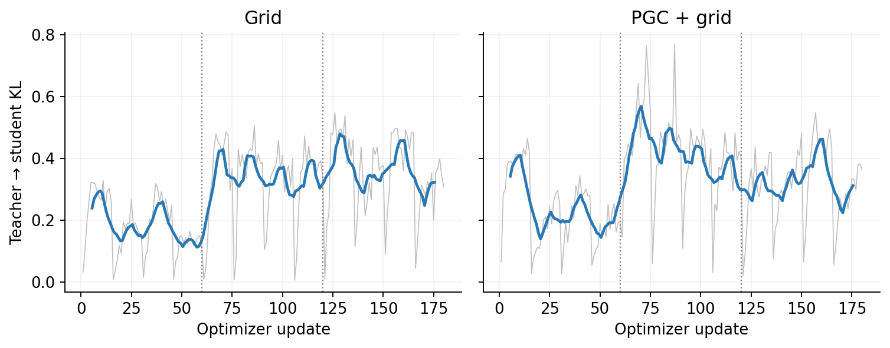
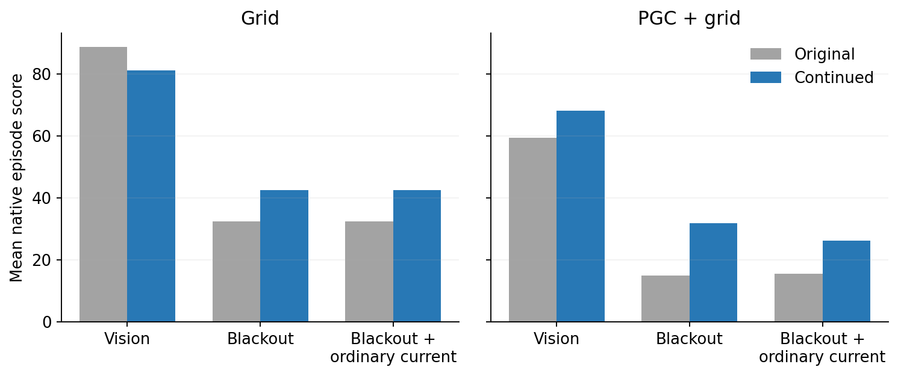
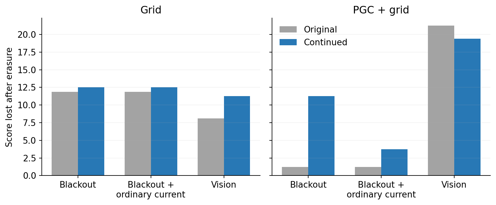
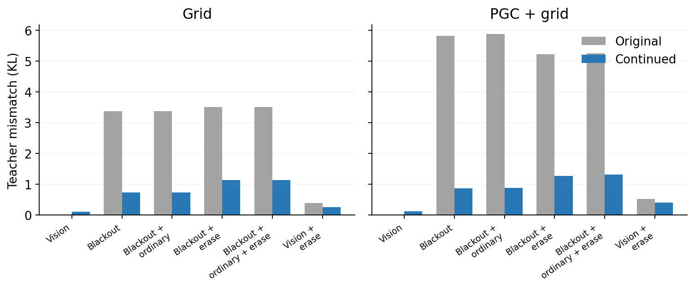

# Recurrent policy distillation: fixed local pilot

Grid: teacher mismatch on the unchanged blackout histories went from **3.37 to 0.74 KL**; navigation score during blackouts went from **32.50 to 42.50** on the new episodes.

PGC + grid: teacher mismatch on the unchanged blackout histories went from **5.83 to 0.87 KL**; navigation score during blackouts went from **15.00 to 31.88** on the new episodes.

These are two individual models, one original training seed per population. Every fixed endpoint and held-out episode is retained; the trial counts do not provide replication across independently trained models.

Each original agent taught a copy of itself to act through brief visual blackouts. Only the existing LSTM weights changed; the CNN, actor, critic, native maps and saved goal code stayed fixed. Training matched the full-vision teacher’s six-action probabilities on the action history actually executed.

Both models completed the fixed 180 updates (1,036,800 native physics frames each). All losses and gradients were finite; every stored training unroll replayed exactly. The original and all three stage checkpoints are retained.

The training task became harder at updates 60 and 120. The curve combines changing blackout durations and teacher-control rates; the fixed held-out comparisons below provide the before/after test.

| Model | Condition | Original score | Continued score |
|---|---|---:|---:|
| gc100 | seen | 88.75 | 81.25 |
| gc100 | blind | 32.50 | 42.50 |
| gc100 | blind_current_grid | 32.50 | 42.50 |
| gc100 | blind_every_reset | 20.62 | 30.00 |
| gc100 | blind_current_grid_every_reset | 20.62 | 30.00 |
| gc100 | seen_scheduled_every_reset | 80.62 | 70.00 |
| pgc33 | seen | 59.38 | 68.12 |
| pgc33 | blind | 15.00 | 31.88 |
| pgc33 | blind_current_grid | 15.62 | 26.25 |
| pgc33 | blind_every_reset | 13.75 | 20.62 |
| pgc33 | blind_current_grid_every_reset | 14.38 | 22.50 |
| pgc33 | seen_scheduled_every_reset | 38.12 | 48.75 |

Each score retains 16 held-out native episodes. Erasure clears h/c before every scheduled black input; its visible control follows the same rule with vision available. These live branches share duration draws, but their own pickups can shift renewal times. Exposure counts and every episode remain in the JSON.

| Model | Blackout erasure cost, original → continued | Visible erasure cost, original → continued |
|---|---:|---:|
| gc100 | 11.88 → 12.50 | 8.12 → 11.25 |
| pgc33 | 1.25 → 11.25 | 21.25 → 19.38 |

Erasure cost is the intact score minus the reset score; positive values mean the reset hurts navigation. This disruption can reflect stored information and a changed recurrent-state distribution.

| Model | Live condition | Original scheduled exposures | Continued scheduled exposures |
|---|---|---:|---:|
| gc100 | seen | 8817 (40.8%) | 7943 (36.8%) |
| gc100 | blind | 9249 (42.8%) | 8259 (38.2%) |
| gc100 | blind_current_grid | 9249 (42.8%) | 8259 (38.2%) |
| gc100 | blind_every_reset | 9335 (43.2%) | 8366 (38.7%) |
| gc100 | blind_current_grid_every_reset | 9335 (43.2%) | 8366 (38.7%) |
| gc100 | seen_scheduled_every_reset | 8909 (41.2%) | 8020 (37.1%) |
| pgc33 | seen | 6027 (27.9%) | 6102 (28.2%) |
| pgc33 | blind | 6321 (29.3%) | 6323 (29.3%) |
| pgc33 | blind_current_grid | 6351 (29.4%) | 6314 (29.2%) |
| pgc33 | blind_every_reset | 6373 (29.5%) | 6383 (29.6%) |
| pgc33 | blind_current_grid_every_reset | 6285 (29.1%) | 6325 (29.3%) |
| pgc33 | seen_scheduled_every_reset | 6130 (28.4%) | 6136 (28.4%) |

Each live branch has 21,600 total updates. The vision branches retain RGB during their scheduled intervals.

| Model | Fixed replay condition | Original gap KL | Continued gap KL |
|---|---|---:|---:|
| gc100 | seen | 0.00000 | 0.10742 |
| gc100 | blind | 3.36945 | 0.73935 |
| gc100 | blind_current_grid | 3.36945 | 0.73935 |
| gc100 | blind_every_reset | 3.50579 | 1.14644 |
| gc100 | blind_current_grid_every_reset | 3.50579 | 1.14644 |
| gc100 | seen_scheduled_every_reset | 0.39740 | 0.26104 |
| pgc33 | seen | 0.00000 | 0.12480 |
| pgc33 | blind | 5.82606 | 0.86992 |
| pgc33 | blind_current_grid | 5.87954 | 0.88743 |
| pgc33 | blind_every_reset | 5.22506 | 1.27544 |
| pgc33 | blind_current_grid_every_reset | 5.25049 | 1.32296 |
| pgc33 | seen_scheduled_every_reset | 0.53175 | 0.41494 |

Fixed replay uses all 32 archived original episodes per model, with exactly matched inputs, masks and teacher targets before/after. These trajectories and masks were evaluation-only. Lower KL means closer teacher imitation on this unchanged input history.

Native current and goal messages remain available. Improved imitation or navigation alone is not a memory test: recurrent erasure and the visible-control/replay comparisons measure how much the new controller uses its history. Different original teachers and the effective PGC input replacement also prevent interpreting the across-population learning difference as a clean PGC causal effect.

Both fixed final models receive the existing direction-memory geometry screen irrespective of their behavioral results. These are newly learned continuations, separate from the completed frozen-agent findings. No cloud compute or training extension was used.

The frozen limit was 1,800 seconds measured by `time.monotonic`, per model. Calendar time was longer during an apparent host suspension; execution duration is not a claim of completion within 30 calendar minutes. [Clock audit](../runtime_clock_audit.json), [execution record](../execution.json).

Full metrics, raw episode tables, exposure counts, checkpoint integrity and parameter changes: [summary.json](summary.json).
