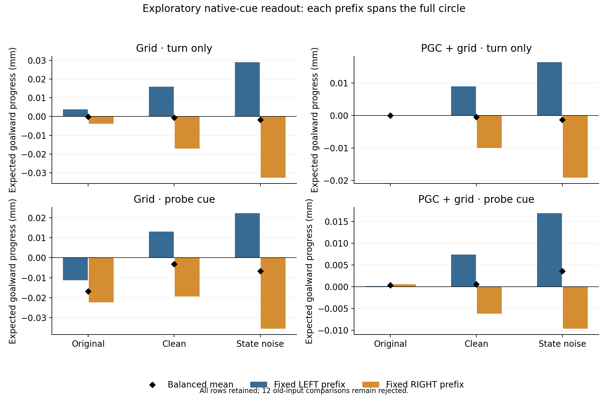
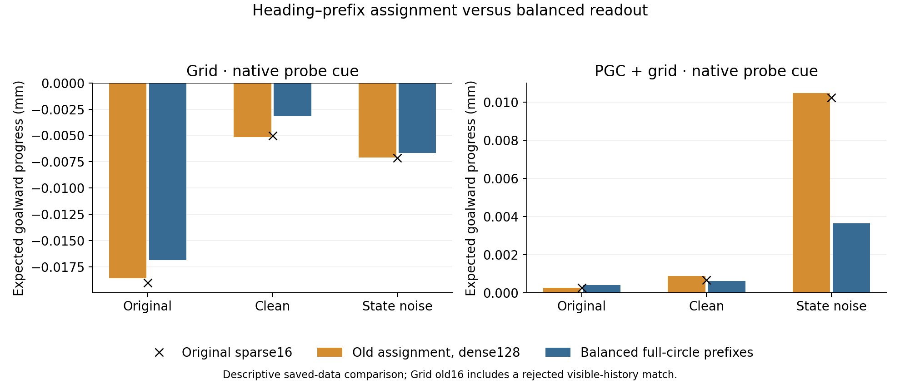
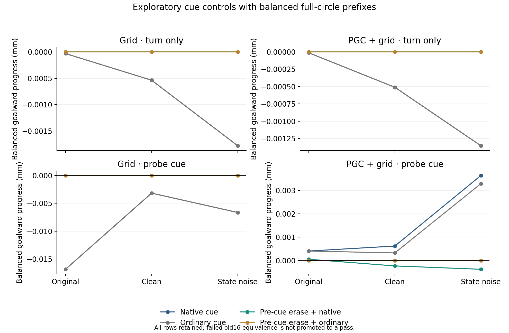

# Descriptive full-circle readout from a failed-equivalence run

**The sealed old-input equivalence check failed and remains rejected.** All1,536 families and196,608 phase rows were saved, including12 failed comparisons. A microscopic pose difference crossed a hard visual stripe boundary in Grid context11’s RIGHT/probe history during encoding. No tolerance, state, input or scientific completion status was changed. This report independently audits the recorded full-circle cohort as a standalone exploratory description.

Each fixed LEFT and fixed RIGHT prefix now covers every heading. The retained actor reads the already-saved first-choice hidden state; all contexts, modes, four cue/reset branches and six endpoints remain in the analysis. No recurrent trajectory, CNN, policy rollout or optimization was rerun.

The table below uses the native probe cue. The old assignment chooses LEFT for the first heading half-circle and RIGHT for its antipodes. Comparing that assignment with balanced prefixes on the same dense arrays describes the assignment effect; comparing it with the original sparse16 also involves sampling. Grid’s old16 comparison additionally contains the explicitly rejected visual history and cannot be called input-equivalent. These are descriptive comparisons of saved histories, not new causal interventions.

| Model | Endpoint | Original sparse (mm) | Dense old assignment (mm) | LEFT full circle (mm) | RIGHT full circle (mm) | Balanced (mm) | Max shared error (mm) |
|---|---|---:|---:|---:|---:|---:|---:|
| Grid | original | -0.01902813 | -0.01861979 | -0.01133277 | -0.02236821 | -0.01685049 | 2.273689e-05 |
| Grid | clean | -0.00503946 | -0.005146003 | 0.01305335 | -0.01940163 | -0.00317414 | 1.026552e-05 |
| Grid | noise | -0.007154087 | -0.007119978 | 0.02220859 | -0.03550862 | -0.006650013 | 1.008499e-05 |
| PGC + grid | original | 0.0002564241 | 0.0002566672 | 0.0001865327 | 0.0006188686 | 0.0004027006 | 2.763854e-07 |
| PGC + grid | clean | 0.0006545775 | 0.0008864034 | 0.007417353 | -0.006184972 | 0.0006161903 | 1.984628e-06 |
| PGC + grid | noise | 0.01022641 | 0.01047473 | 0.01691396 | -0.009639392 | 0.003637285 | 4.337677e-06 |

The largest observed shared-angle progress discrepancy was 2.27e-05 mm. This includes the known non-equivalent visible history, not just floating-point actor arithmetic. Every discrepancy and its componentwise bound are retained. These checks cover shared angles; they are not a numerical error bound for every unshared full-circle state. Effects near this scale require that precision context. 6 intact c-state comparisons also fail their frozen bounds; small later action/progress differences do not repair the rejected input or state equivalence.

The first-choice motor state is the declared zero-velocity brake. Signed progress uses the same actual six-action native physics; facing-goal alignment is auxiliary because strafing can also be useful. A phase-averaged policy is a mathematical counterfactual, not an actual recurrent-state erasure. A full-circle actor readout does not establish recurrent attraction or a ring.

Scope: one original seed per population,16 contexts,2 prefixes,2 modes,4 branches,3 endpoints per population;196,608 phase rows. No p-values, ring qualification or outcome-based exclusions. Arithmetic/report completion is distinct from the failed experiment-equivalence status.

[All conditions](all_conditions.csv) · [All contexts](all_contexts.csv) · [Independent arithmetic audit](independent_validation.json) · [All retained raw artifacts](../artifacts.json) · [Rendering mismatch diagnosis](../../native_turn_counterbalanced_readout_design/mismatch_diagnosis.json)
