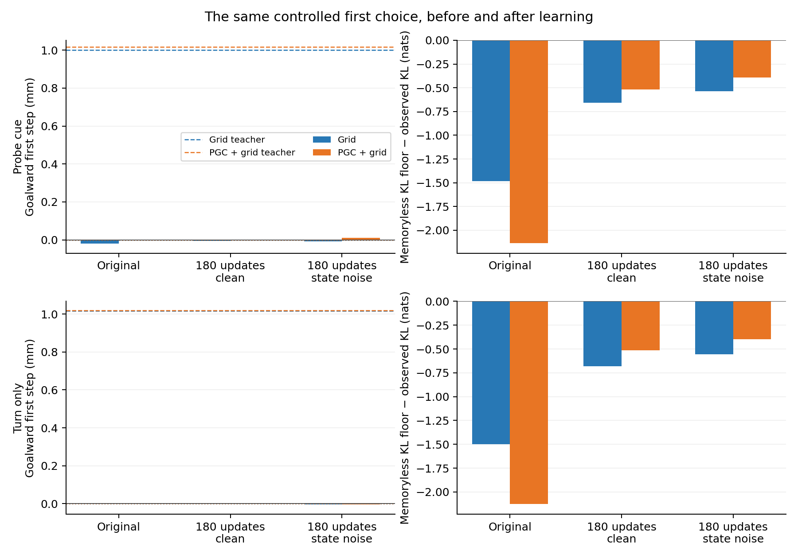

# Can the navigation LSTM learn a useful direction memory?

We trained four copies of the existing navigation agents: Grid and PGC + grid, each with or without small disturbances to the RNN state. During short blind turns, each agent had to choose actions using its earlier observations. Its original full-vision policy supplied the action targets. Only the LSTM weights learned; the arena, grid maps, visual encoder and action head were retained.

**The policies became better at matching their teachers. Useful direction memory remained small.** The strongest first-choice result was the noise-trained PGC model: **0.0102 mm** toward the goal, compared with about **1 mm** for its teacher. Replacing the predictive cue with ordinary grid code left **0.0097 mm**. Erasing the RNN state at the choice removed this small effect. Erasing it before the cue and then restoring the correct predictive input did not recover useful progress.

Whole-episode navigation also failed to improve consistently. These scores come from the modified blind-turn task, using one original seed pair and 16 evaluation episodes per condition.

| Blind navigation score | Original | Clean training | Training with state noise |
| --- | ---: | ---: | ---: |
| Grid | 61.25 | 65.63 | 60.00 |
| PGC + grid | 70.00 | 69.38 | 58.75 |

**What this suggests:** the continuation changed action selection and strengthened a small history signal in the PGC model. This training recipe did not turn the predictive cue into an effective memory-repair signal. Every fixed final checkpoint proceeds to the same geometry tests, including models with weak behavioral results.

For cue removal, we changed only the 169 predictive entries in the **current** spatial code to their ordinary-grid values. The saved goal code stayed native. State erasure zeroed both hidden and cell state at the specified boundary. No ring, angle label or circular loss was supplied during learning.

[All conditions and four figures](report/README.md) · [Independent audit](report/independent_validation.json) · [Frozen training protocol](../../docs/research/native_turn_distillation_protocol.json) · [Frozen geometry protocol](../../docs/research/native_turn_geometry_protocol.json)
