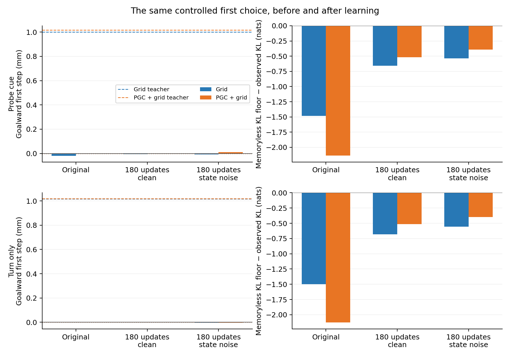
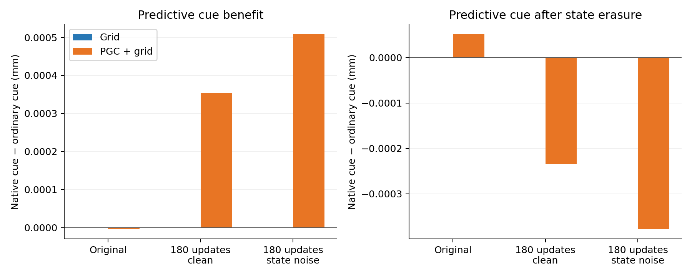
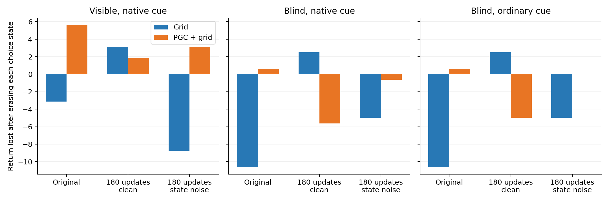
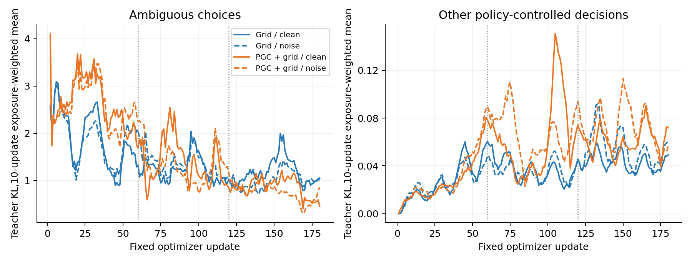

# Teaching angular history in the original navigation RNN

Four fixed continuations trained only the original LSTM: Grid and PGC+grid, each with clean or weakly perturbed recurrent states. The original fully informed policies supplied action targets on the actual visited trajectories. CNNs, action heads, critics, maps and six-action physics were retained. The noisy arm applies two small incoming-state perturbations during cue retention, at the single predeclared scale of10% of each original state block’s native one-update change.

The measured first choice has identical current inputs across opposite headings. Positive goalward displacement above the saved common-action reference reflects useful history. The separate KL panel compares imitation with the best memoryless teacher-KL floor; positive values beat that floor. Teacher dashed lines put the movement scale in context.

| Model | Endpoint | Native cue step (mm) | Ordinary cue step (mm) | Erase before native cue (mm) | Erase before ordinary cue (mm) | Erase at choice (mm) |
|---|---|---:|---:|---:|---:|---:|
| Grid | original | -0.019028 | -0.019028 | -0.000000 | -0.000000 | -0.000000 |
| Grid | clean | -0.005039 | -0.005039 | -0.000000 | -0.000000 | -0.000000 |
| Grid | noise | -0.007154 | -0.007154 | -0.000000 | -0.000000 | -0.000000 |
| PGC + grid | original | 0.000256 | 0.000261 | 0.000051 | 0.000000 | -0.000000 |
| PGC + grid | clean | 0.000655 | 0.000301 | -0.000234 | 0.000000 | -0.000000 |
| PGC + grid | noise | 0.010226 | 0.009718 | -0.000378 | 0.000000 | 0.000000 |

The cue comparisons replace only the predictive current-code entries at the measured probe. Saved goal code remains native. The repair comparison erases state before delivering that cue, then withdraws it before the identical choice input. Ordinary-cue reset and choice-reset controls have exactly identical states/logits across all16 phases.

The visible and blind live controls share held-code/cue and forced-turn/brake scheduling rules. Visibility changes RGB only. These are modified-task controls, not original unmodified navigation scores. Actual event times/exposures can diverge after actions and hits; the table retains their denominators.

| Model | Endpoint | Live branch | Mean return | Choice / other / forced inputs | Erased choices |
|---|---|---|---:|---:|---:|
| Grid | original | seen_native | 71.250 | 276 / 18745 / 2579 | 0 |
| Grid | original | seen_reset_every_choice | 74.375 | 282 / 18648 / 2670 | 282 |
| Grid | original | blind_native | 61.250 | 270 / 18797 / 2533 | 0 |
| Grid | original | blind_ordinary | 61.250 | 270 / 18797 / 2533 | 0 |
| Grid | original | blind_reset_every_choice | 71.875 | 267 / 18797 / 2536 | 267 |
| Grid | original | blind_ordinary_reset_every_choice | 71.875 | 267 / 18797 / 2536 | 267 |
| Grid | clean | seen_native | 71.250 | 276 / 18706 / 2618 | 0 |
| Grid | clean | seen_reset_every_choice | 68.125 | 279 / 18687 / 2634 | 279 |
| Grid | clean | blind_native | 65.625 | 282 / 18634 / 2684 | 0 |
| Grid | clean | blind_ordinary | 65.625 | 282 / 18634 / 2684 | 0 |
| Grid | clean | blind_reset_every_choice | 63.125 | 282 / 18652 / 2666 | 282 |
| Grid | clean | blind_ordinary_reset_every_choice | 63.125 | 282 / 18652 / 2666 | 282 |
| Grid | noise | seen_native | 62.500 | 279 / 18725 / 2596 | 0 |
| Grid | noise | seen_reset_every_choice | 71.250 | 282 / 18661 / 2657 | 282 |
| Grid | noise | blind_native | 60.000 | 285 / 18604 / 2711 | 0 |
| Grid | noise | blind_ordinary | 60.000 | 285 / 18604 / 2711 | 0 |
| Grid | noise | blind_reset_every_choice | 65.000 | 276 / 18724 / 2600 | 276 |
| Grid | noise | blind_ordinary_reset_every_choice | 65.000 | 276 / 18724 / 2600 | 276 |
| PGC + grid | original | seen_native | 75.000 | 157 / 19892 / 1551 | 0 |
| PGC + grid | original | seen_reset_every_choice | 69.375 | 153 / 19960 / 1487 | 153 |
| PGC + grid | original | blind_native | 70.000 | 174 / 19767 / 1659 | 0 |
| PGC + grid | original | blind_ordinary | 70.000 | 174 / 19767 / 1659 | 0 |
| PGC + grid | original | blind_reset_every_choice | 69.375 | 177 / 19746 / 1677 | 177 |
| PGC + grid | original | blind_ordinary_reset_every_choice | 69.375 | 177 / 19746 / 1677 | 177 |
| PGC + grid | clean | seen_native | 74.375 | 201 / 19529 / 1870 | 0 |
| PGC + grid | clean | seen_reset_every_choice | 72.500 | 189 / 19652 / 1759 | 189 |
| PGC + grid | clean | blind_native | 69.375 | 210 / 19435 / 1955 | 0 |
| PGC + grid | clean | blind_ordinary | 70.000 | 207 / 19453 / 1940 | 0 |
| PGC + grid | clean | blind_reset_every_choice | 75.000 | 216 / 19353 / 2031 | 216 |
| PGC + grid | clean | blind_ordinary_reset_every_choice | 75.000 | 216 / 19353 / 2031 | 216 |
| PGC + grid | noise | seen_native | 69.375 | 183 / 19659 / 1758 | 0 |
| PGC + grid | noise | seen_reset_every_choice | 66.250 | 174 / 19759 / 1667 | 174 |
| PGC + grid | noise | blind_native | 58.750 | 201 / 19461 / 1938 | 0 |
| PGC + grid | noise | blind_ordinary | 59.375 | 201 / 19461 / 1938 | 0 |
| PGC + grid | noise | blind_reset_every_choice | 59.375 | 181 / 19676 / 1743 | 181 |
| PGC + grid | noise | blind_ordinary_reset_every_choice | 59.375 | 181 / 19676 / 1743 | 181 |

All180 update losses/gradients were finite and stored-input/noise replays were exact. Forced actions had zero direct loss, while later choices retained gradients through their full histories. Batches without ambiguous choices are retained and explicitly counted.

| Model | Arm | Choice inputs | Other control inputs | No-choice batches | Acquisition monotonic seconds | Evaluation monotonic seconds | Calendar seconds |
|---|---|---:|---:|---:|---:|---:|---:|
| Grid | clean | 3286 | 227625 | 8 | 825.3 | 303.2 | 1128.6 |
| Grid | noise | 3166 | 228744 | 8 | 763.8 | 330.2 | 1094.1 |
| PGC + grid | clean | 2524 | 234545 | 7 | 831.4 | 304.2 | 1135.8 |
| PGC + grid | noise | 2591 | 233974 | 4 | 740.1 | 330.4 | 1070.6 |

## Every paired-history condition

| Model | Endpoint | History | Variant | First step (mm) | Common-action ceiling (mm) | Teacher KL | Memoryless KL floor | Cases / pairs |
|---|---|---|---|---:|---:|---:|---:|---:|
| Grid | original | turn_only | native | -0.002285 | 3.53384e-06 | 1.965683 | 0.466545 |256 /128|
| Grid | original | turn_only | ordinary | -0.002285 | 3.53384e-06 | 1.965683 | 0.466545 |256 /128|
| Grid | original | turn_only | cue_plus60 | -0.002285 | 3.53384e-06 | 1.965683 | 0.466545 |256 /128|
| Grid | original | turn_only | cue_minus60 | -0.002285 | 3.53384e-06 | 1.965683 | 0.466545 |256 /128|
| Grid | original | turn_only | pre_cue_reset_native | -0.000000 | 3.53384e-06 | 2.011880 | 0.466545 |256 /128|
| Grid | original | turn_only | pre_cue_reset_ordinary | -0.000000 | 3.53384e-06 | 2.011880 | 0.466545 |256 /128|
| Grid | original | turn_only | choice_reset_native | -0.000000 | 3.53384e-06 | 1.727118 | 0.466545 |256 /128|
| Grid | original | turn_only | choice_reset_ordinary | -0.000000 | 3.53384e-06 | 1.727118 | 0.466545 |256 /128|
| Grid | original | probe_glimpse | native | -0.019028 | 3.53384e-06 | 1.949796 | 0.467949 |256 /128|
| Grid | original | probe_glimpse | ordinary | -0.019028 | 3.53384e-06 | 1.949796 | 0.467949 |256 /128|
| Grid | original | probe_glimpse | cue_plus60 | -0.019028 | 3.53384e-06 | 1.949796 | 0.467949 |256 /128|
| Grid | original | probe_glimpse | cue_minus60 | -0.019028 | 3.53384e-06 | 1.949796 | 0.467949 |256 /128|
| Grid | original | probe_glimpse | pre_cue_reset_native | -0.000000 | 3.53384e-06 | 1.988770 | 0.467949 |256 /128|
| Grid | original | probe_glimpse | pre_cue_reset_ordinary | -0.000000 | 3.53384e-06 | 1.988770 | 0.467949 |256 /128|
| Grid | original | probe_glimpse | choice_reset_native | -0.000000 | 3.53384e-06 | 1.705082 | 0.467949 |256 /128|
| Grid | original | probe_glimpse | choice_reset_ordinary | -0.000000 | 3.53384e-06 | 1.705082 | 0.467949 |256 /128|
| Grid | clean | turn_only | native | -0.001450 | 3.53384e-06 | 1.146648 | 0.466545 |256 /128|
| Grid | clean | turn_only | ordinary | -0.001450 | 3.53384e-06 | 1.146648 | 0.466545 |256 /128|
| Grid | clean | turn_only | cue_plus60 | -0.001450 | 3.53384e-06 | 1.146648 | 0.466545 |256 /128|
| Grid | clean | turn_only | cue_minus60 | -0.001450 | 3.53384e-06 | 1.146648 | 0.466545 |256 /128|
| Grid | clean | turn_only | pre_cue_reset_native | -0.000000 | 3.53384e-06 | 1.223131 | 0.466545 |256 /128|
| Grid | clean | turn_only | pre_cue_reset_ordinary | -0.000000 | 3.53384e-06 | 1.223131 | 0.466545 |256 /128|
| Grid | clean | turn_only | choice_reset_native | -0.000000 | 3.53384e-06 | 1.474559 | 0.466545 |256 /128|
| Grid | clean | turn_only | choice_reset_ordinary | -0.000000 | 3.53384e-06 | 1.474559 | 0.466545 |256 /128|
| Grid | clean | probe_glimpse | native | -0.005039 | 3.53384e-06 | 1.126630 | 0.467949 |256 /128|
| Grid | clean | probe_glimpse | ordinary | -0.005039 | 3.53384e-06 | 1.126630 | 0.467949 |256 /128|
| Grid | clean | probe_glimpse | cue_plus60 | -0.005039 | 3.53384e-06 | 1.126630 | 0.467949 |256 /128|
| Grid | clean | probe_glimpse | cue_minus60 | -0.005039 | 3.53384e-06 | 1.126630 | 0.467949 |256 /128|
| Grid | clean | probe_glimpse | pre_cue_reset_native | -0.000000 | 3.53384e-06 | 1.198804 | 0.467949 |256 /128|
| Grid | clean | probe_glimpse | pre_cue_reset_ordinary | -0.000000 | 3.53384e-06 | 1.198804 | 0.467949 |256 /128|
| Grid | clean | probe_glimpse | choice_reset_native | -0.000000 | 3.53384e-06 | 1.455332 | 0.467949 |256 /128|
| Grid | clean | probe_glimpse | choice_reset_ordinary | -0.000000 | 3.53384e-06 | 1.455332 | 0.467949 |256 /128|
| Grid | noise | turn_only | native | -0.004808 | 3.53384e-06 | 1.023425 | 0.466545 |256 /128|
| Grid | noise | turn_only | ordinary | -0.004808 | 3.53384e-06 | 1.023425 | 0.466545 |256 /128|
| Grid | noise | turn_only | cue_plus60 | -0.004808 | 3.53384e-06 | 1.023425 | 0.466545 |256 /128|
| Grid | noise | turn_only | cue_minus60 | -0.004808 | 3.53384e-06 | 1.023425 | 0.466545 |256 /128|
| Grid | noise | turn_only | pre_cue_reset_native | -0.000000 | 3.53384e-06 | 1.087760 | 0.466545 |256 /128|
| Grid | noise | turn_only | pre_cue_reset_ordinary | -0.000000 | 3.53384e-06 | 1.087760 | 0.466545 |256 /128|
| Grid | noise | turn_only | choice_reset_native | -0.000000 | 3.53384e-06 | 1.383112 | 0.466545 |256 /128|
| Grid | noise | turn_only | choice_reset_ordinary | -0.000000 | 3.53384e-06 | 1.383112 | 0.466545 |256 /128|
| Grid | noise | probe_glimpse | native | -0.007154 | 3.53384e-06 | 1.003788 | 0.467949 |256 /128|
| Grid | noise | probe_glimpse | ordinary | -0.007154 | 3.53384e-06 | 1.003788 | 0.467949 |256 /128|
| Grid | noise | probe_glimpse | cue_plus60 | -0.007154 | 3.53384e-06 | 1.003788 | 0.467949 |256 /128|
| Grid | noise | probe_glimpse | cue_minus60 | -0.007154 | 3.53384e-06 | 1.003788 | 0.467949 |256 /128|
| Grid | noise | probe_glimpse | pre_cue_reset_native | -0.000000 | 3.53384e-06 | 1.065432 | 0.467949 |256 /128|
| Grid | noise | probe_glimpse | pre_cue_reset_ordinary | -0.000000 | 3.53384e-06 | 1.065432 | 0.467949 |256 /128|
| Grid | noise | probe_glimpse | choice_reset_native | -0.000000 | 3.53384e-06 | 1.363834 | 0.467949 |256 /128|
| Grid | noise | probe_glimpse | choice_reset_ordinary | -0.000000 | 3.53384e-06 | 1.363834 | 0.467949 |256 /128|
| PGC + grid | original | turn_only | native | -0.000032 | 3.31147e-06 | 2.618885 | 0.491544 |256 /128|
| PGC + grid | original | turn_only | ordinary | -0.000032 | 3.31147e-06 | 2.618885 | 0.491544 |256 /128|
| PGC + grid | original | turn_only | cue_plus60 | -0.000032 | 3.31147e-06 | 2.618885 | 0.491544 |256 /128|
| PGC + grid | original | turn_only | cue_minus60 | -0.000032 | 3.31147e-06 | 2.618885 | 0.491544 |256 /128|
| PGC + grid | original | turn_only | pre_cue_reset_native | 0.000000 | 3.31147e-06 | 2.736965 | 0.491544 |256 /128|
| PGC + grid | original | turn_only | pre_cue_reset_ordinary | 0.000000 | 3.31147e-06 | 2.736965 | 0.491544 |256 /128|
| PGC + grid | original | turn_only | choice_reset_native | -0.000000 | 3.31147e-06 | 2.266351 | 0.491544 |256 /128|
| PGC + grid | original | turn_only | choice_reset_ordinary | -0.000000 | 3.31147e-06 | 2.266351 | 0.491544 |256 /128|
| PGC + grid | original | probe_glimpse | native | 0.000256 | 3.31147e-06 | 2.628237 | 0.494015 |256 /128|
| PGC + grid | original | probe_glimpse | ordinary | 0.000261 | 3.31147e-06 | 2.627880 | 0.494015 |256 /128|
| PGC + grid | original | probe_glimpse | cue_plus60 | 0.000239 | 3.31147e-06 | 2.629452 | 0.494015 |256 /128|
| PGC + grid | original | probe_glimpse | cue_minus60 | 0.000274 | 3.31147e-06 | 2.626876 | 0.494015 |256 /128|
| PGC + grid | original | probe_glimpse | pre_cue_reset_native | 0.000051 | 3.31147e-06 | 2.762249 | 0.494015 |256 /128|
| PGC + grid | original | probe_glimpse | pre_cue_reset_ordinary | 0.000000 | 3.31147e-06 | 2.757832 | 0.494015 |256 /128|
| PGC + grid | original | probe_glimpse | choice_reset_native | -0.000000 | 3.31147e-06 | 2.284960 | 0.494015 |256 /128|
| PGC + grid | original | probe_glimpse | choice_reset_ordinary | -0.000000 | 3.31147e-06 | 2.284960 | 0.494015 |256 /128|
| PGC + grid | clean | turn_only | native | -0.002667 | 3.31147e-06 | 1.005894 | 0.491544 |256 /128|
| PGC + grid | clean | turn_only | ordinary | -0.002667 | 3.31147e-06 | 1.005894 | 0.491544 |256 /128|
| PGC + grid | clean | turn_only | cue_plus60 | -0.002667 | 3.31147e-06 | 1.005894 | 0.491544 |256 /128|
| PGC + grid | clean | turn_only | cue_minus60 | -0.002667 | 3.31147e-06 | 1.005894 | 0.491544 |256 /128|
| PGC + grid | clean | turn_only | pre_cue_reset_native | 0.000000 | 3.31147e-06 | 1.061661 | 0.491544 |256 /128|
| PGC + grid | clean | turn_only | pre_cue_reset_ordinary | 0.000000 | 3.31147e-06 | 1.061661 | 0.491544 |256 /128|
| PGC + grid | clean | turn_only | choice_reset_native | -0.000000 | 3.31147e-06 | 1.438525 | 0.491544 |256 /128|
| PGC + grid | clean | turn_only | choice_reset_ordinary | -0.000000 | 3.31147e-06 | 1.438525 | 0.491544 |256 /128|
| PGC + grid | clean | probe_glimpse | native | 0.000655 | 3.31147e-06 | 1.009893 | 0.494015 |256 /128|
| PGC + grid | clean | probe_glimpse | ordinary | 0.000301 | 3.31147e-06 | 1.009970 | 0.494015 |256 /128|
| PGC + grid | clean | probe_glimpse | cue_plus60 | 0.000555 | 3.31147e-06 | 1.009620 | 0.494015 |256 /128|
| PGC + grid | clean | probe_glimpse | cue_minus60 | 0.000567 | 3.31147e-06 | 1.010061 | 0.494015 |256 /128|
| PGC + grid | clean | probe_glimpse | pre_cue_reset_native | -0.000234 | 3.31147e-06 | 1.074574 | 0.494015 |256 /128|
| PGC + grid | clean | probe_glimpse | pre_cue_reset_ordinary | 0.000000 | 3.31147e-06 | 1.072849 | 0.494015 |256 /128|
| PGC + grid | clean | probe_glimpse | choice_reset_native | -0.000000 | 3.31147e-06 | 1.450674 | 0.494015 |256 /128|
| PGC + grid | clean | probe_glimpse | choice_reset_ordinary | -0.000000 | 3.31147e-06 | 1.450674 | 0.494015 |256 /128|
| PGC + grid | noise | turn_only | native | -0.004099 | 3.31147e-06 | 0.891379 | 0.491544 |256 /128|
| PGC + grid | noise | turn_only | ordinary | -0.004099 | 3.31147e-06 | 0.891379 | 0.491544 |256 /128|
| PGC + grid | noise | turn_only | cue_plus60 | -0.004099 | 3.31147e-06 | 0.891379 | 0.491544 |256 /128|
| PGC + grid | noise | turn_only | cue_minus60 | -0.004099 | 3.31147e-06 | 0.891379 | 0.491544 |256 /128|
| PGC + grid | noise | turn_only | pre_cue_reset_native | 0.000000 | 3.31147e-06 | 0.975120 | 0.491544 |256 /128|
| PGC + grid | noise | turn_only | pre_cue_reset_ordinary | 0.000000 | 3.31147e-06 | 0.975120 | 0.491544 |256 /128|
| PGC + grid | noise | turn_only | choice_reset_native | 0.000000 | 3.31147e-06 | 1.322129 | 0.491544 |256 /128|
| PGC + grid | noise | turn_only | choice_reset_ordinary | 0.000000 | 3.31147e-06 | 1.322129 | 0.491544 |256 /128|
| PGC + grid | noise | probe_glimpse | native | 0.010226 | 3.31147e-06 | 0.884248 | 0.494015 |256 /128|
| PGC + grid | noise | probe_glimpse | ordinary | 0.009718 | 3.31147e-06 | 0.884496 | 0.494015 |256 /128|
| PGC + grid | noise | probe_glimpse | cue_plus60 | 0.009638 | 3.31147e-06 | 0.884142 | 0.494015 |256 /128|
| PGC + grid | noise | probe_glimpse | cue_minus60 | 0.009514 | 3.31147e-06 | 0.884551 | 0.494015 |256 /128|
| PGC + grid | noise | probe_glimpse | pre_cue_reset_native | -0.000378 | 3.31147e-06 | 0.988174 | 0.494015 |256 /128|
| PGC + grid | noise | probe_glimpse | pre_cue_reset_ordinary | 0.000000 | 3.31147e-06 | 0.986261 | 0.494015 |256 /128|
| PGC + grid | noise | probe_glimpse | choice_reset_native | 0.000000 | 3.31147e-06 | 1.332025 | 0.494015 |256 /128|
| PGC + grid | noise | probe_glimpse | choice_reset_ordinary | 0.000000 | 3.31147e-06 | 1.332025 | 0.494015 |256 /128|

This is new recurrent policy distillation from one original seed pair. Across-population learning differences combine different teachers and initial weights. The within-model cue and erasure comparisons test predictive information and useful history. All four fixed finals also receive the separately registered native-turn geometry analysis, irrespective of these behavioral outcomes. No stage checkpoint was selected by performance.

Acquisition was capped at1800 monotonic seconds per run, with a separate600-second final evaluation cap. Shared original evaluations and geometry are separately timed; calendar durations are reported independently. No cloud compute was used.
