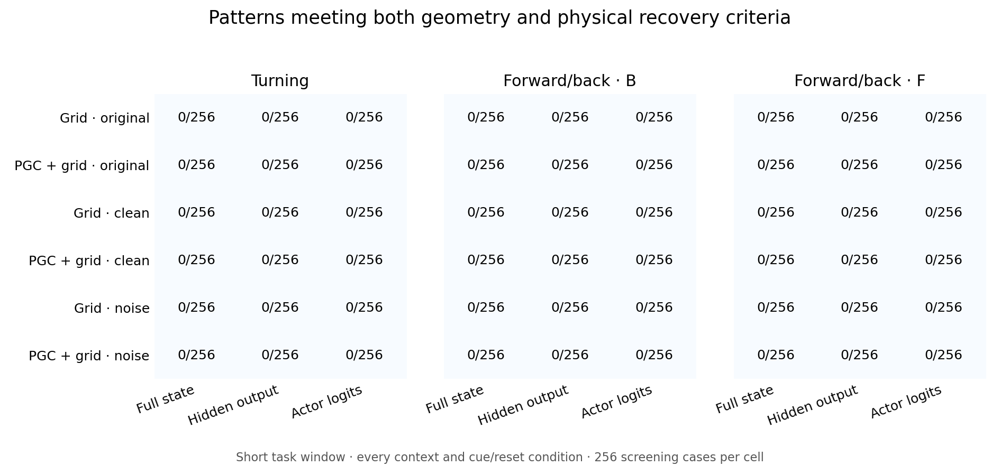
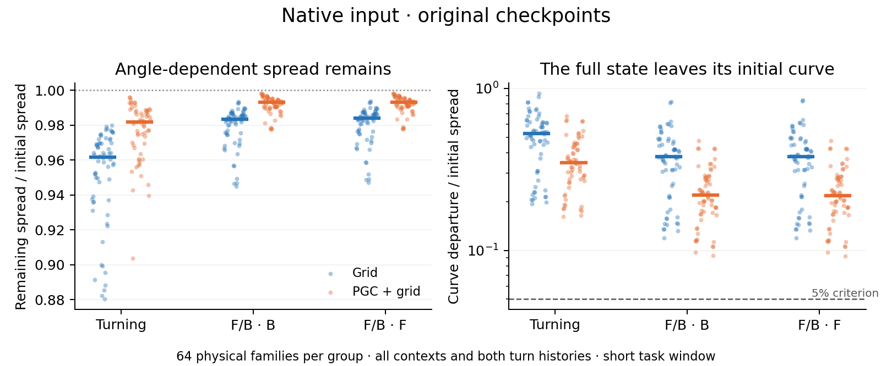
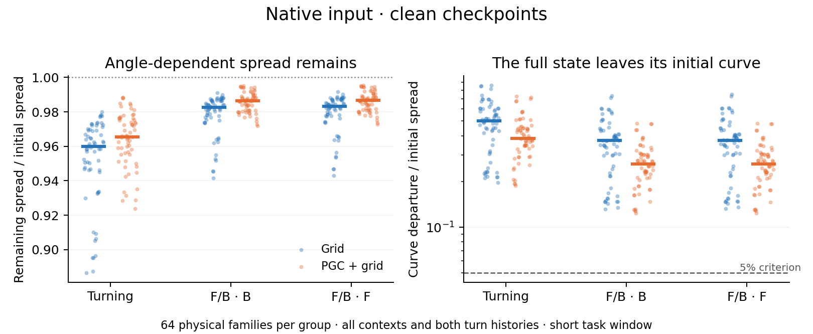
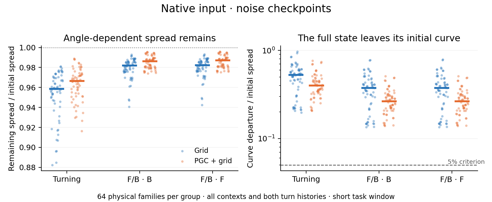

# Actual turn-history geometry

We gave the trained networks a full circle of physically consistent headings, using the same turn sequence at every angle. Then every angle received the same future input.

We screened all hidden/cell states, all hidden outputs and all actor logits for a coherent angle-dependent pattern. Qualifying curves would proceed to matched disturbances under both raw and h/c-normalized metrics. No curve passed the geometry screen, so no broad disturbance tests were run in this batch.

| Network | Turning: state / hidden / actor | F/B B-section | F/B F-section |
| --- | --- | --- | --- |
| Grid · original | 0 / 0 / 0 of 256 | 0 / 0 / 0 of 256 | 0 / 0 / 0 of 256 |
| PGC + grid · original | 0 / 0 / 0 of 256 | 0 / 0 / 0 of 256 | 0 / 0 / 0 of 256 |
| Grid · clean | 0 / 0 / 0 of 256 | 0 / 0 / 0 of 256 | 0 / 0 / 0 of 256 |
| PGC + grid · clean | 0 / 0 / 0 of 256 | 0 / 0 / 0 of 256 | 0 / 0 / 0 of 256 |
| Grid · noise | 0 / 0 / 0 of 256 | 0 / 0 / 0 of 256 | 0 / 0 / 0 of 256 |
| PGC + grid · noise | 0 / 0 / 0 of 256 | 0 / 0 / 0 of 256 | 0 / 0 / 0 of 256 |

The 256 cases per entry cover 16 contexts, two continuous turn histories, two cue modes and four cue/reset conditions. They are screening cases, not 256 independent trained networks. Every result, including all longer horizons and both centered/noncentered output tests, remains in the model summaries.

Turning uses three updates from the cue boundary. The full-state forward/back test evolves two updates; its two-section output test observes through the third. The forward/back reference begins after the eight-update choice boundary and a truthful setup cycle; B and F are analyzed separately.

A forward/back candidate is a memory pattern under a periodic physical drive. Its measured neural phase drift must be compared with the unchanged body heading before calling it stationary heading memory. Turning phase transport is compared with the actual body rotation. A geometric candidate alone does not quantify navigation benefit.

Nominal kicks outside the hidden-state bounds remain recorded. Physical qualification uses a smaller shared amplitude or the clipped-and-size-matched follow-up. Zero, invisible or badly reoriented physical kicks are marked inconclusive, rather than failed recovery.

[Numerical summary](summary.json) · [Saved-data validation](validation.json)

## What prevented nomination

Across all 199,680 saved screening rows, 0 passed every necessary geometry check. The staged protocol therefore ran 0 broad disturbance tests. A geometry rejection is not a measured failure of disturbance recovery.

The strongest full-state pattern is retained angular spread combined with drift away from the starting curve. The figures below include the native branch only, keeping all 64 physical families per population and regime; reset controls remain in the complete counts. Turning spans three updates (0.2 s), and the full-state F/B comparison spans two updates (0.133 s) from its separate periodic reference.

| Network | Regime | Native families | Median spread retained | Median curve departure |
| --- | --- | --- | --- | --- |
| Grid · original | fb_B | 64 | 98.3% | 37.8% |
| Grid · original | fb_F | 64 | 98.4% | 38.1% |
| Grid · original | left | 64 | 96.2% | 52.8% |
| PGC + grid · original | fb_B | 64 | 99.3% | 21.9% |
| PGC + grid · original | fb_F | 64 | 99.3% | 21.8% |
| PGC + grid · original | left | 64 | 98.2% | 34.7% |
| Grid · clean | fb_B | 64 | 98.3% | 37.2% |
| Grid · clean | fb_F | 64 | 98.3% | 37.4% |
| Grid · clean | left | 64 | 96.0% | 50.0% |
| PGC + grid · clean | fb_B | 64 | 98.6% | 26.0% |
| PGC + grid · clean | fb_F | 64 | 98.7% | 26.0% |
| PGC + grid · clean | left | 64 | 96.6% | 38.4% |
| Grid · noise | fb_B | 64 | 98.2% | 37.5% |
| Grid · noise | fb_F | 64 | 98.2% | 37.6% |
| Grid · noise | left | 64 | 95.9% | 52.6% |
| PGC + grid · noise | fb_B | 64 | 98.6% | 26.5% |
| PGC + grid · noise | fb_F | 64 | 98.7% | 26.5% |
| PGC + grid · noise | left | 64 | 96.6% | 40.0% |

The 128-angle spacing guard also rejects many curves: neighbouring samples can be too far apart relative to the family radius. This is a finite-resolution limitation, not a finding that the true curve is discontinuous. Some centered hidden-output and actor-output families pass every other geometry check. They are legitimate targets for a separately specified denser sampling test; their current nomination remains negative.

Distances use interpolation along every segment of the closed polygon, rather than just the nearest sampled vertex. Denser sampling could still alter the polygon approximation. The full-state drift and the centered-output results should therefore be reported separately.

| Network | Regime | Observable | All cases | Pass all except spacing | Pass all except spacing + departure |
| --- | --- | --- | --- | --- | --- |
| Grid · original | fb_B | all_actor | 256 | 24 | 28 |
| Grid · original | fb_B | all_hidden | 256 | 42 | 82 |
| Grid · original | fb_B | full_state | 256 | 0 | 116 |
| Grid · original | fb_F | all_actor | 256 | 22 | 28 |
| Grid · original | fb_F | all_hidden | 256 | 44 | 84 |
| Grid · original | fb_F | full_state | 256 | 0 | 120 |
| Grid · original | left | all_actor | 256 | 2 | 4 |
| Grid · original | left | all_hidden | 256 | 8 | 56 |
| Grid · original | left | full_state | 256 | 0 | 112 |
| PGC + grid · original | fb_B | all_actor | 256 | 12 | 24 |
| PGC + grid · original | fb_B | all_hidden | 256 | 34 | 104 |
| PGC + grid · original | fb_B | full_state | 256 | 0 | 120 |
| PGC + grid · original | fb_F | all_actor | 256 | 13 | 32 |
| PGC + grid · original | fb_F | all_hidden | 256 | 39 | 103 |
| PGC + grid · original | fb_F | full_state | 256 | 0 | 118 |
| PGC + grid · original | left | all_actor | 256 | 2 | 8 |
| PGC + grid · original | left | all_hidden | 256 | 6 | 35 |
| PGC + grid · original | left | full_state | 256 | 0 | 112 |
| Grid · clean | fb_B | all_actor | 256 | 18 | 24 |
| Grid · clean | fb_B | all_hidden | 256 | 30 | 78 |
| Grid · clean | fb_B | full_state | 256 | 0 | 112 |
| Grid · clean | fb_F | all_actor | 256 | 24 | 28 |
| Grid · clean | fb_F | all_hidden | 256 | 38 | 80 |
| Grid · clean | fb_F | full_state | 256 | 0 | 114 |
| Grid · clean | left | all_actor | 256 | 0 | 4 |
| Grid · clean | left | all_hidden | 256 | 4 | 66 |
| Grid · clean | left | full_state | 256 | 0 | 106 |
| PGC + grid · clean | fb_B | all_actor | 256 | 19 | 50 |
| PGC + grid · clean | fb_B | all_hidden | 256 | 22 | 108 |
| PGC + grid · clean | fb_B | full_state | 256 | 0 | 120 |
| PGC + grid · clean | fb_F | all_actor | 256 | 22 | 60 |
| PGC + grid · clean | fb_F | all_hidden | 256 | 26 | 115 |
| PGC + grid · clean | fb_F | full_state | 256 | 0 | 120 |
| PGC + grid · clean | left | all_actor | 256 | 0 | 8 |
| PGC + grid · clean | left | all_hidden | 256 | 0 | 37 |
| PGC + grid · clean | left | full_state | 256 | 0 | 110 |
| Grid · noise | fb_B | all_actor | 256 | 30 | 32 |
| Grid · noise | fb_B | all_hidden | 256 | 52 | 94 |
| Grid · noise | fb_B | full_state | 256 | 0 | 112 |
| Grid · noise | fb_F | all_actor | 256 | 26 | 30 |
| Grid · noise | fb_F | all_hidden | 256 | 60 | 90 |
| Grid · noise | fb_F | full_state | 256 | 0 | 116 |
| Grid · noise | left | all_actor | 256 | 4 | 14 |
| Grid · noise | left | all_hidden | 256 | 6 | 56 |
| Grid · noise | left | full_state | 256 | 0 | 112 |
| PGC + grid · noise | fb_B | all_actor | 256 | 25 | 46 |
| PGC + grid · noise | fb_B | all_hidden | 256 | 43 | 112 |
| PGC + grid · noise | fb_B | full_state | 256 | 0 | 124 |
| PGC + grid · noise | fb_F | all_actor | 256 | 28 | 52 |
| PGC + grid · noise | fb_F | all_hidden | 256 | 45 | 115 |
| PGC + grid · noise | fb_F | full_state | 256 | 0 | 124 |
| PGC + grid · noise | left | all_actor | 256 | 4 | 16 |
| PGC + grid · noise | left | all_hidden | 256 | 2 | 35 |
| PGC + grid · noise | left | full_state | 256 | 0 | 114 |

The omitted-gate columns are diagnostics, not relaxed criteria or positive results. Exact failure sets, native-only counts, both metrics, centered/noncentered outputs and every longer window are retained in [failure_patterns.json](failure_patterns.json).
