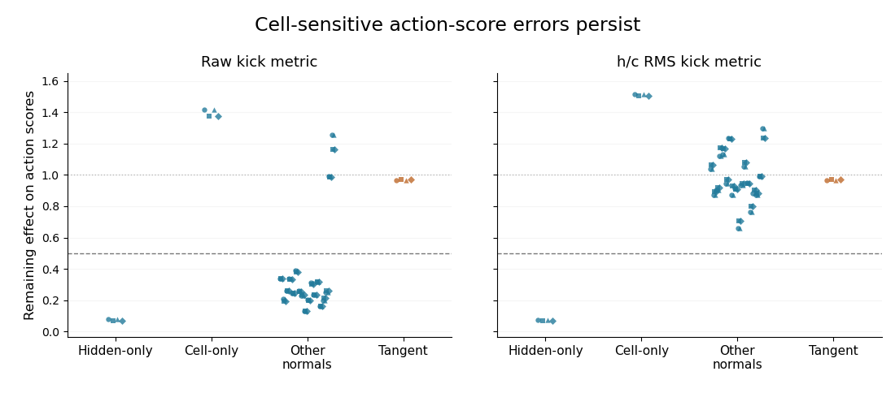

# Cell-sensitive output errors survive the resolved PGC disturbance tests

The only four original-model comparisons that reached finite recovery all belong to **one PGC context (8), after a pre-cue reset and a native probe**: LEFT/RIGHT preparation prefixes × backward/forward sections of the same periodic input. They are not four independent contexts or networks. No intact-history or Grid superiority claim follows.

All plotted dots are case-direction medians, not independent replicates or fitted estimates. “Other normals” retains all 16 fixed random directions plus full-radial and cell-radial kicks. Blue points show normal off-curve action-score gain; orange tangent points show total action-score displacement gain. The dashed line is the normal-gain criterion (0.5); the dotted line is unchanged size (1). The four marker shapes denote the two preparation prefixes × two periodic sections in the same context.

[Full direction-by-direction figure](recovery_gains.png) · [Compact PDF](recovery_compact.pdf)

After two recurrent updates (0.133 s), the action-output effect of hidden-only kicks shrinks by about 92–93%. Cell-only effects instead grow, while radial effects persist. Tangent output differences retain about 97% of their size. These are actor-score off-curve gains after physical state kicks, **not hidden/cell state-norm recovery**. The actor observation uses two consecutive score vectors, spanning a three-update (0.2 s) window.

| Physical kick metric | Hidden-only | Cell-only | 16 random normals | Full radial | Cell radial | Tangent total |
| --- | ---: | ---: | ---: | ---: | ---: | ---: |
| raw | 0.071–0.077 | 1.377–1.415 | 0.131–0.388 | 0.988–0.990 | 1.161–1.257 | 0.967–0.971 |
| h_c_RMS | 0.071–0.074 | 1.502–1.516 | 0.660–1.237 | 0.989–0.990 | 1.237–1.298 | 0.967–0.971 |

Numbers are ranges of direction medians across the four related cases at 1,024 headings. In the raw metric, all 16 random normals and hidden-only pass; cell-only, full-radial and cell-radial fail. In the RMS metric, only hidden-only passes. Every normal remains observable, both initial and final tangent references remain visible, no factor leakage occurs, and the final physical kicks satisfy bounds. Thus these are conclusive failures of the fixed broad-recovery criterion, not missing/zero disturbances. The criterion requires every normal's median gain and gain relative to tangent to be at most 0.5.

The same classifications hold at 512 headings; the largest change in a direction's median gain from 512 to 1,024 is 0.010789. The full CSV retains all 336 direction rows (four cases × two metrics × two densities × 21 directions), including successful directions and tangent controls.

The geometry gate concerns the angular shape after removing its common mean shift; it does not establish a stationary absolute actor-output family. These tests use periodically alternating native forward/backward action inputs. No endogenous ring is nominated. Grid's 162 metric pairs remain sampling-unresolved; PGC has 102 unresolved pairs plus these four recovery failures. Exact aliases remain in those main-report denominators, while these four comparisons are not declared exact aliases.

[All directions and both densities](all_directions.csv) · [Exact keys, visibility, convergence, mean drift and provenance](summary.json) · [Unchanged main report](../report_original/README.md)
