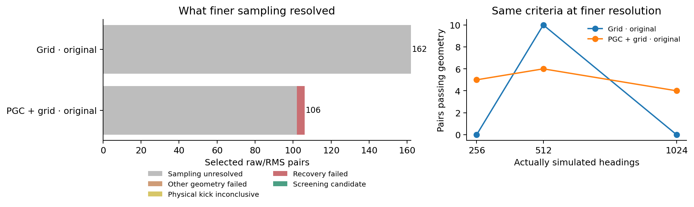

# Finer sampling of the same angular families

We repeated every spacing-only case with 1,024 real physical histories. The 256, 512 and 1,024 curves contain actual simulated states. No states were interpolated.

| Network | Selected pairs | Sampling unresolved | Other geometry failed | Kick inconclusive | Recovery failed | Candidates |
| --- | ---: | ---: | ---: | ---: | ---: | ---: |
| Grid · original | 162 | 162 | 0 | 0 | 0 | 0 |
| PGC + grid · original | 106 | 102 | 0 | 0 | 4 | 0 |

A pair contains the same case under raw and h/c-normalized disturbances. Both must pass. Exact sham controls remain in the totals; these are screening cases from fixed models, not independent trained networks.

Sampling is unresolved when spacing still fails or the 512/1,024 polygons do not converge. Recovery is tested only after both densities meet the original geometry criteria. Invisible, zero or badly reoriented bounded kicks are physically inconclusive.

The audit checks all selected and excluded source rows, genuine shared inputs, separate hidden/cell state agreement, nearest-segment convergence, physical-angle transport, eight full-circle perturbation anchors, all 20 normal directions and both signs. It also reconstructs bounded kick geometry from the saved physical vectors.

A positive is a screening candidate. Eight disturbance anchors can miss a vulnerable angle; confirmation requires denser phase/Jacobian checks and a behavioral cue-repair experiment. Forward/back results concern a periodically driven memory family. Measured phase drift remains necessary before interpreting it as stationary heading memory.

The original 128-heading results remain unchanged. This follow-up covers only the prospectively selected spacing-only cases and their required metric controls.

[All counts and cases](summary.json) · [Independent saved-array checks](validation.json)
