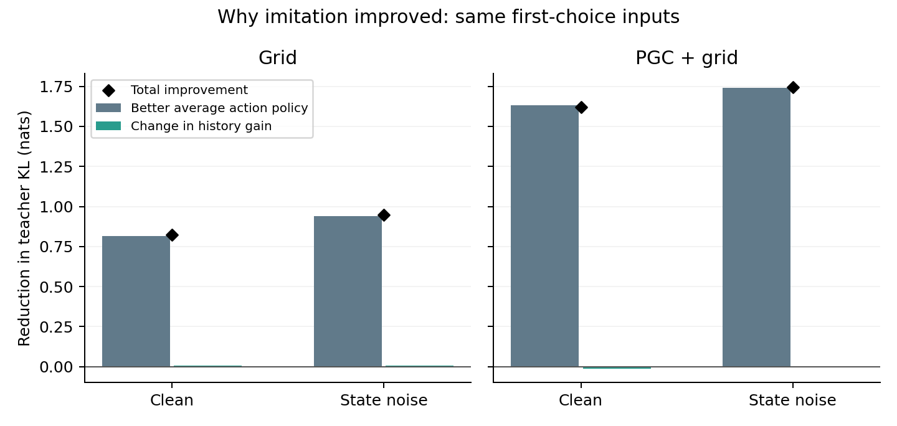

# Why imitation improved

We separated a better average action policy from using history to vary actions among cases with exactly the same current input. This exploratory analysis uses saved probabilities only.

| Model | Continuation | Total KL improvement | Better average policy | Change in history gain | Average-policy share |
|---|---|---:|---:|---:|---:|
| Grid | clean | 0.823166 | 0.816760 | 0.006406 | 99.22% |
| Grid | noise | 0.946008 | 0.939048 | 0.006961 | 99.26% |
| PGC + grid | clean | 1.618344 | 1.630241 | -0.011896 | 100.74% |
| PGC + grid | noise | 1.743990 | 1.739936 | 0.004053 | 99.77% |

All values are in nats. The two contributions add exactly to total improvement; negative history gain is retained.

Within each identical-input group, we average the teacher and student action probabilities. The **average-policy mismatch** asks whether those two averages agree. **History gain** asks whether the actual history-dependent student choices match the teacher better than using the student’s own average for every case.

**Observed KL = teacher memoryless floor + average-policy mismatch − history gain.** The identity also holds after weighting groups by their number of cases. Choice-state reset gives zero history gain in all576 checked groups.

A better average policy can substantially reduce imitation error without choosing the right action for each hidden heading. The averaged policy here is a mathematical comparison, not an executed state-erasure experiment or a measure of generalization. History gain is an association with the teacher’s choices, not a causal memory test.

Primary display: native probe cue, all16 contexts. All6 endpoints, all8 variants, turn-only/probe/combined groups and exact Grid shams are retained below. These are fixed models from one original seed pair, not independent network replicates.

[All conditions](all_conditions.csv) · [Every context/input group](all_context_groups.csv) · [All original-to-final changes](all_improvements.csv) · [Exact arithmetic and source hashes](summary.json)
