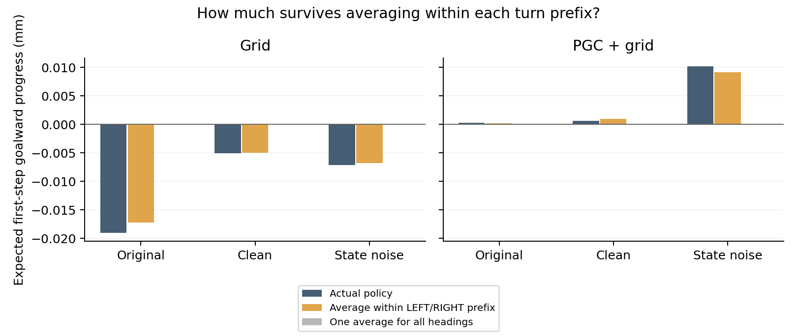

# Separating the two turn prefixes

The preparation used LEFT for one half of the heading circle and RIGHT for the other. We therefore compared each saved policy with its average within the actual turn prefix, and with one average across all headings. All prefix labels were read from the recorded action histories and checked against the input one-hots.

| Model | Endpoint | Actual progress (mm) | Within-prefix average (mm) | Whole-group average (mm) | Actual minus prefix average (mm) |
|---|---|---:|---:|---:|---:|
| Grid | original | -0.019028 | -0.017179 | -0.000000 | -0.001849 |
| Grid | clean | -0.005039 | -0.004961 | -0.000000 | -0.000079 |
| Grid | noise | -0.007154 | -0.006822 | -0.000000 | -0.000332 |
| PGC + grid | original | 0.000256 | 0.000214 | 0.000000 | 0.000042 |
| PGC + grid | clean | 0.000655 | 0.001012 | -0.000000 | -0.000357 |
| PGC + grid | noise | 0.010226 | 0.009145 | 0.000000 | 0.001082 |

The plot is deliberately zoomed to small effects; the fully informed teachers achieved about 1 mm per first update. All three columns are evaluated against the same saved six-action physical outcomes.

| Model | Endpoint | Total history gain (nats) | Prefix-associated part | Within-prefix part |
|---|---|---:|---:|---:|
| Grid | original | -0.011789 | -0.011824 | 0.000035 |
| Grid | clean | -0.005383 | -0.005980 | 0.000597 |
| Grid | noise | -0.004828 | -0.003629 | -0.001200 |
| PGC + grid | original | 0.011631 | 0.000066 | 0.011565 |
| PGC + grid | clean | -0.000265 | -0.004480 | 0.004215 |
| PGC + grid | noise | 0.015684 | 0.004860 | 0.010824 |

The two signed parts add exactly to total history gain. The same decomposition holds for progress relative to the whole-group average. All endpoints, interventions, contexts and modes remain in the appendices.

Scope: one original seed per population, 16 contexts, both modes and all eight variants; original, clean and noisy endpoints are all retained.

**This is an association check.** Prefix is correlated with heading and other preceding observations. Averaging within a prefix does not causally erase only angular memory, and a surviving within-prefix difference is not by itself evidence of continuous angular memory or a ring. A counterbalanced task would be needed to separate reliance on these correlated features.

[All conditions](all_conditions.csv) · [Every input group](all_input_groups.csv) · [Actual action-history labels and source hashes](summary.json) · [Main decomposition](../native_turn_imitation_decomposition/README.md)
