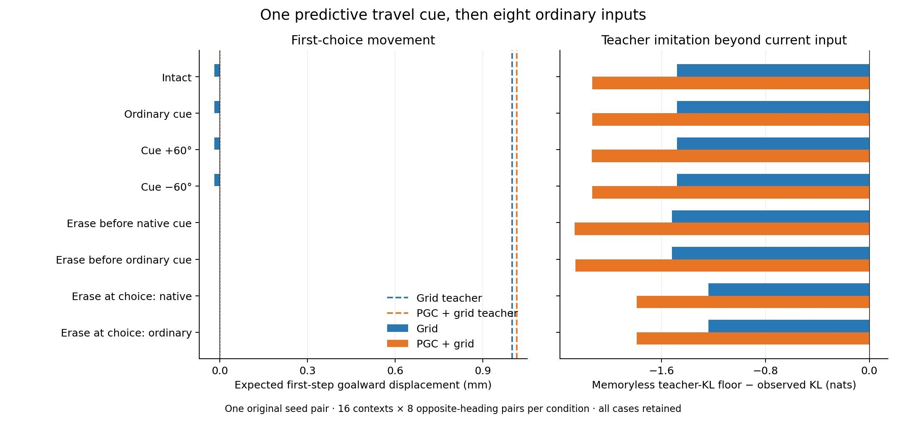
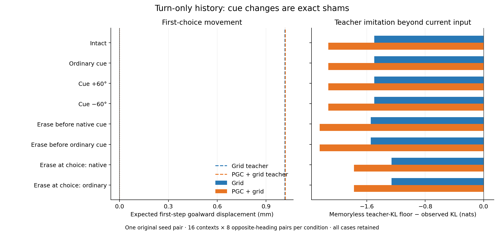

# Original recurrent memory and predictive cue use

**The original networks show very little useful angular-history influence after the common blind suffix.** Intact first-choice progress was -0.019028 mm for Grid and 0.000256 mm for PGC + grid, versus 1.001 and 1.016 mm for their fully informed teachers. Removing the predictive cue changed the PGC value to 0.000261 mm. The tiny positive PGC displacement is not a meaningful navigation gain at this scale.

We replayed the original networks through the same controlled turning histories. At the measured choice, every heading received the same complete input. Only the earlier cue or recurrent-state erasure changed. No weights were trained.

**Left:** expected goalward displacement on the next native action. Dashed lines show the fully informed teachers; dotted lines near zero mark the best shared action for each opposite-heading pair. The very small blind-history effects are shown numerically below. Exceeding the shared-action reference reveals a history-dependent action difference, whose practical size must also be considered.

**Right:** the best memoryless teacher-KL floor minus the observed teacher KL. Positive values mean the network imitates the fully informed teacher better than any common action distribution could. This is a stronger imitation comparison; useful movement does not require it.

| Model | Intact step (mm) | Ordinary cue (mm) | Native cue after erasure (mm) | Ordinary cue after erasure (mm) | Choice erasure (mm) |
|---|---:|---:|---:|---:|---:|
| Grid | -0.0190 | -0.0190 | -0.0000 | -0.0000 | -0.0000 |
| PGC + grid | 0.0003 | 0.0003 | 0.0001 | 0.0000 | -0.0000 |

The cue changes only the 169 predictive current-code entries in PGC models. Saved goal code remains native. Rotations use measured travel direction, which can differ from body heading after the common turns. All cue substitutions are exact shams in Grid models and in the turn-only histories.

Erasure before the ordinary cue leaves exactly identical states and logits across all 16 headings. Erasure at the choice does the same. These are direct controls for the information supplied by the predictive cue and the intervening recurrent computation.

## All fixed conditions

| History | Model | Condition | Step (mm) | Teacher KL (nats) | Memoryless KL floor (nats) | Cases / pairs |
|---|---|---|---:|---:|---:|---:|
| turn_only | Grid | Intact | -0.0023 | 1.96568 | 0.46654 | 256 / 128 |
| turn_only | Grid | Ordinary cue | -0.0023 | 1.96568 | 0.46654 | 256 / 128 |
| turn_only | Grid | Cue +60° | -0.0023 | 1.96568 | 0.46654 | 256 / 128 |
| turn_only | Grid | Cue −60° | -0.0023 | 1.96568 | 0.46654 | 256 / 128 |
| turn_only | Grid | Erase before native cue | -0.0000 | 2.01188 | 0.46654 | 256 / 128 |
| turn_only | Grid | Erase before ordinary cue | -0.0000 | 2.01188 | 0.46654 | 256 / 128 |
| turn_only | Grid | Erase at choice: native | -0.0000 | 1.72712 | 0.46654 | 256 / 128 |
| turn_only | Grid | Erase at choice: ordinary | -0.0000 | 1.72712 | 0.46654 | 256 / 128 |
| turn_only | PGC + grid | Intact | -0.0000 | 2.61888 | 0.49154 | 256 / 128 |
| turn_only | PGC + grid | Ordinary cue | -0.0000 | 2.61888 | 0.49154 | 256 / 128 |
| turn_only | PGC + grid | Cue +60° | -0.0000 | 2.61888 | 0.49154 | 256 / 128 |
| turn_only | PGC + grid | Cue −60° | -0.0000 | 2.61888 | 0.49154 | 256 / 128 |
| turn_only | PGC + grid | Erase before native cue | 0.0000 | 2.73697 | 0.49154 | 256 / 128 |
| turn_only | PGC + grid | Erase before ordinary cue | 0.0000 | 2.73697 | 0.49154 | 256 / 128 |
| turn_only | PGC + grid | Erase at choice: native | -0.0000 | 2.26635 | 0.49154 | 256 / 128 |
| turn_only | PGC + grid | Erase at choice: ordinary | -0.0000 | 2.26635 | 0.49154 | 256 / 128 |
| probe_glimpse | Grid | Intact | -0.0190 | 1.94980 | 0.46795 | 256 / 128 |
| probe_glimpse | Grid | Ordinary cue | -0.0190 | 1.94980 | 0.46795 | 256 / 128 |
| probe_glimpse | Grid | Cue +60° | -0.0190 | 1.94980 | 0.46795 | 256 / 128 |
| probe_glimpse | Grid | Cue −60° | -0.0190 | 1.94980 | 0.46795 | 256 / 128 |
| probe_glimpse | Grid | Erase before native cue | -0.0000 | 1.98877 | 0.46795 | 256 / 128 |
| probe_glimpse | Grid | Erase before ordinary cue | -0.0000 | 1.98877 | 0.46795 | 256 / 128 |
| probe_glimpse | Grid | Erase at choice: native | -0.0000 | 1.70508 | 0.46795 | 256 / 128 |
| probe_glimpse | Grid | Erase at choice: ordinary | -0.0000 | 1.70508 | 0.46795 | 256 / 128 |
| probe_glimpse | PGC + grid | Intact | 0.0003 | 2.62824 | 0.49401 | 256 / 128 |
| probe_glimpse | PGC + grid | Ordinary cue | 0.0003 | 2.62788 | 0.49401 | 256 / 128 |
| probe_glimpse | PGC + grid | Cue +60° | 0.0002 | 2.62945 | 0.49401 | 256 / 128 |
| probe_glimpse | PGC + grid | Cue −60° | 0.0003 | 2.62688 | 0.49401 | 256 / 128 |
| probe_glimpse | PGC + grid | Erase before native cue | 0.0001 | 2.76225 | 0.49401 | 256 / 128 |
| probe_glimpse | PGC + grid | Erase before ordinary cue | 0.0000 | 2.75783 | 0.49401 | 256 / 128 |
| probe_glimpse | PGC + grid | Erase at choice: native | -0.0000 | 2.28496 | 0.49401 | 256 / 128 |
| probe_glimpse | PGC + grid | Erase at choice: ordinary | -0.0000 | 2.28496 | 0.49401 | 256 / 128 |

The teacher-KL comparisons also show substantial room for learning: every original variant remains above its memoryless imitation floor. The results motivate teaching useful angular history before testing a learned continuation for ring geometry and stability. This is one original seed pair under controlled input conditions. All contexts and outcomes are retained; no statistical threshold selected a model or condition.

The initial recurrent state was recomputed from each checkpoint’s complete native input prefix, with the original terminal resets. The original cached states matched exactly. Raw first-choice states, logits, six-action physics, references and hashes are retained beside this report.
