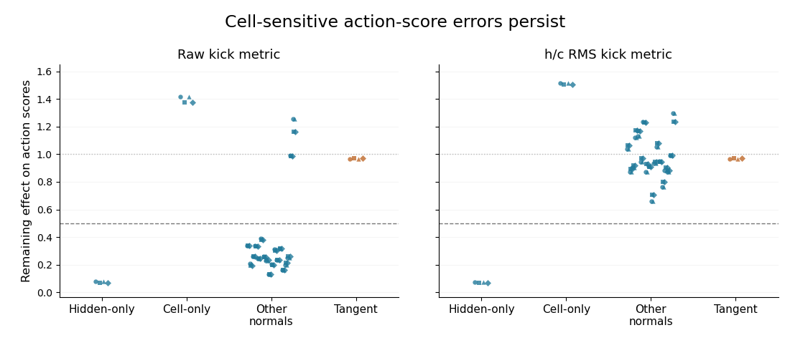

# What the new ring tests found

**The clearest new result is fast correction of some action-output errors, while errors caused by cell-memory disturbances persist.** In the original PGC network's context **8**, the output effect of disturbing hidden activity shrank by about **93%**. Disturbing cell memory made its output error **1.4–1.5 times larger**. Action-output differences along the candidate curve retained about **97%** of their size.

Here, **1 means the disturbance's effect is unchanged; 0 means it has disappeared**. These are changes in action-score errors, **not recovery of the hidden/cell-state norms**. Recovery spans two recurrent updates (0.133 s); the two-score observation spans three updates (0.2 s). This was one context after memory erasure and a predictive cue, tested with both turn histories and both phases of an actual forward/backward cycle. The dots are repeated measurements within that context. The curve test used mean-subtracted shapes, so the absolute output pattern could still drift. [Exact conditions, all directions and both sampling densities](../native_turn_geometry_resolution/original_recovery_supplement/README.md).

**What this suggests:** the LSTM can quickly suppress the output effect of a hidden-state disturbance, while a cell-state disturbance continues to alter its output. This identifies different handling of the two kinds of disturbance; it does not measure how quickly the underlying hidden/cell-state errors disappear.

Conceptually, the LSTM has an internal memory (`c`) and activity it exposes to the action head (`h`). A disturbance to that exposed activity can fade while the underlying memory keeps influencing later decisions. A ring attractor would also need to correct disturbances that push the memory away from its circular path. The cell-memory disturbances reveal the missing correction in these cases.

**Predictive cues also wrote a weak angular trace.** After resetting prior memory, the native predictive cue left detectable angular differences in **20/832 PGC cases**, versus **0/832** with the ordinary-code cue. These were repeated measurements in just **two contexts (3 and 5)**. The trace remained readable from states up to **41 updates (2.73 s)** after the cue; the query added one measurement update, finishing at update 42 (2.8 s). Opposite-heading action distributions differed only slightly: total variation was approximately **0.00006–0.0013**. This supports cue-written directional memory; no navigation benefit was measured by this observer test. [Six-action results and figures](../native_input_observability/report/README.md).

| Analysis | Why we did it | What we found |
| --- | --- | --- |
| Actual turn histories | Test heading-related activity using the project's maps, physics and trained agents. | Heading differences persist while the whole activity pattern moves away from its starting curve. All six original/final checkpoints were tested. |
| 1,024-heading follow-up | Check whether coarse sampling hid a sharply curved ring. | Across all six checkpoints: **855/871** selected metric pairs remain sampling-unresolved; **16/871** reach disturbance testing and fail broad recovery; **0 candidates**. |
| Six-action observation | Check whether different ordinary actions reveal a memory hidden by the current output gate. | Angular sensitivity exceeded the fixed floor at both endpoints in **818/3,328 Grid** and **330/3,328 PGC** cases. All physical queries were valid, but no response family passed every ring-geometry check; no conditional disturbance or held-out tests were triggered. |
| What imitation learned | Separate better average action choices from better use of history. | More than 99% of the improvement came from matching the teacher's average action mixture. |
| Balanced turn histories | Give both earlier turn directions equal weight at every heading. | The noisy PGC model's small first-step progress fell from **0.01047 to 0.00364 mm**, a **65% reduction**, on the same dense samples. |

The last comparison is a standalone exploratory description. Its attempted equivalence to older sparse histories remains rejected: tiny pose rounding changed one rendered image in a Grid context. All cases, 12 input-comparison failures and six cell-state failures remain recorded. [Full-circle figures and diagnosis](../native_turn_counterbalanced_readout/report/README.md).

The original recovery example above is **context 8, action scores**. The trained PGC continuations reached recovery tests in **context 13**: four hidden-output comparisons after clean training, and eight hidden/action-output comparisons after noisy training. Those are separate results, not replications of the original context's gain numbers. All fail the fixed broad-recovery criterion. [All six dense follow-ups](../native_turn_geometry_resolution/report_all/README.md).

**These were the navigation models from this repository.** The original 1B-frame checkpoints, native arena, hexagonal spatial maps, six actions and learned action heads supplied the tests. Four additional copies learned only through their LSTM weights, using their own original full-vision policies as teachers. No ring architecture, angle target or circular training loss was supplied. Scope: one original seed pair and its four continuations; contexts, headings and disturbances are repeated measurements within those models.

During the controlled memory tests, vision was black and the ordinary current-position code was held fixed. The saved goal code remained native. In current-cue removal comparisons, only the **169 predictive entries** were replaced by their ordinary-grid values. Separate, explicitly labeled controls erased both hidden and cell state. Cue removal, memory erasure and subtracting a curve's common mean are different operations; mean subtraction was an analysis of geometry, not an intervention on the agent.

**The broader explanation still favors useful incoming guidance.** Across the earlier navigation experiments, predictive spatial cues change steering through the candidate-update and output pathways. The present tests suggest that this benefit can coexist with changing recurrent traces and lasting output effects of cell-memory disturbances. They have not yielded the proposed learned ring mechanism. [Navigation evidence](../../mechanisms/navigation-explanation.md) · [Current-input and gate interventions](../native_movement_pulses/report/README.md).

This also fits the earlier PCA finding: PGC networks organize activity more strongly by episode, and their predictive inputs receive stronger learned weights. Those activity patterns can help a controller use its current context without forming a self-correcting circular memory. The combined picture is **stronger spatial guidance, different use of recurrent memory, and quick correction of some output disturbances**. The ring explanation remains unsupported by the completed tests.

[All six 128-heading results](../native_turn_geometry/report_all/README.md) · [All six dense follow-ups](../native_turn_geometry_resolution/report_all/README.md) · [Six-action observer](../native_input_observability/report/README.md) · [Training results](../native_turn_distillation/README.md) · [Exact imitation breakdown](../native_turn_imitation_decomposition/README.md) · [Literature and fixed-action observation design](../../docs/research/native_input_observability_ring_design.md)
