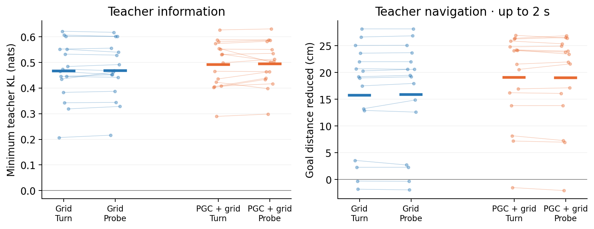

# Native turn teacher: information and navigation

This descriptive preflight asks whether the original full-vision teacher supplies different action targets when the student receives the same current input, and how the teacher then navigates. Every context and both preparations are retained.

Each dot is one of 16 source contexts; thin lines join the same context across preparations, and thick marks show means. Left: generalized Jensen–Shannon information in nats, grouped by exact complete student-current-input equality. Right: teacher goal-distance reduction during up to 30 native decisions (two seconds), scored through the first hit or episode end using positions before teleportation.

| Population | Preparation | Pair TV | Pair JS (nats) | Current-input JS (nats) | First-step progress / common ceiling (mm) | Two-second progress (cm) | Hits /256 |
|---|---|---:|---:|---:|---:|---:|---:|
| Grid | Turn only | 0.516 | 0.315 | 0.467 | 1.016 / 0.000 | 15.75 | 16/256 (6.2%) |
| Grid | Probe + cue | 0.521 | 0.318 | 0.468 | 1.001 / 0.000 | 15.86 | 17/256 (6.6%) |
| PGC + grid | Turn only | 0.533 | 0.341 | 0.492 | 1.019 / 0.000 | 19.11 | 24/256 (9.4%) |
| PGC + grid | Probe + cue | 0.535 | 0.341 | 0.494 | 1.016 / 0.000 | 19.01 | 22/256 (8.6%) |

Each row contains 16 distinct source episodes, 128 antipodal heading pairs and 256 continuation cases. These are controlled copies of one original seed per population, not independent trained-model replications. The two preparations share the source contexts. No p-values, ranking-based case selection or scientific pass/fail threshold is applied.

Pair TV and JS compare each antipodal pair. Generalized JS includes every case with the same full 1,287-entry current input; it is the smallest average forward-KL mismatch achievable by one common action distribution. Context values allocate that group-level KL to their member cases, preserving groups even if they span contexts. The combined-mode grouping is also retained in summary.json.

**What the information measure means:** positive JS identifies teacher information absent from the student’s current input. The teacher itself receives full RGB and native current codes, which can differ between those cases. This measures a demand that student history could help satisfy. Learning that history and developing a ring are subsequent empirical questions.

First-step progress is the signed movement projected toward the goal. Its ceiling is the best common action across the two members of each pair. A useful turn can have zero immediate translation, so the actual two-second full-vision continuation is reported alongside it; that continuation is not a later-horizon oracle bound. Image and motor noise are disabled for this controlled preflight. Native saved-goal information remains available.

All 64 context summaries, denominators, combined-mode information groups, source-episode inventory and provenance: [summary.json](summary.json). Raw pair probabilities and every continuation case remain in the two model summary files: [Grid](../gc100/summary.json) and [PGC + grid](../pgc33/summary.json).
