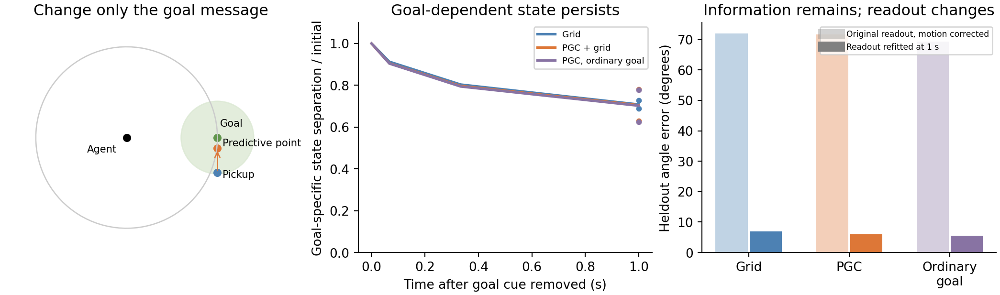

# Original RL agents: what remains after the goal cue disappears?

**The original RNNs retain information about the goal. This pilot does not show that PGCs make that memory more stable, or that it is a ring attractor.**



We used the existing1-billion-frame Grid and PGC+grid LSTMs, with their original512 hexagonal maps, vision, six actions, and square arena. No network was trained or modified.

We collected four real native-policy histories from each of two seed pairs. At each history, we replayed1second of exactly the same physical inputs while changing only the saved goal message. The synthetic goals lay around the observer. Each message was made from a valid pickup point29cm from its goal, with predictive cells evaluated20cm along the inward arrival direction. Three arrival directions separate the observer bearings of the true center, pickup, and predictive point.

We then removed only the saved goal input for1second. Vision, current spatial code, previous action, and reward followed the same actual physical replay for every branch. Goal removal after discovery is an experimental intervention; the original training task supplies this message continuously.

The angle readouts are analysis tools fitted separately within each physical context and arrival-offset family, using alternating angles for training and the remaining angles for testing. They are not an extra input, the original actor, or evidence of a universal goal decoder. State separation means the RMS radius of the full(h,c) family, not percent variance retained.

|After1second without the saved goal cue|Grid|PGC+grid|Same PGC model, ordinary goal|
|---|---:|---:|---:|
|Full-state goal separation retained|70.8%|70.5%|70.2%|
|Original angle readout, corrected for movement/facing|72.0°|71.7°|69.3°|
|Angle readout refitted at the new time|6.8°|6.0°|5.6°|

**Meaning:** the goal leaves a lasting trace in recurrent activity. A new readout can still recover which goal was supplied. The original readout does not remain aligned to that information, even after correcting the actual observer movement and facing. This suggests a changing goal representation, not a fixed angular memory coordinate.

**Predictive versus ordinary:** replacing only the169 predictive goal channels by their ordinary-grid values produces almost the same memory persistence. Current predictive input remains intact. The comparison is matched within the same PGC network and native history. Grid models contribute descriptive context using their own native histories.

**Why this is not a demonstrated ring attractor:** rotating a continuous input naturally produces a periodic state family. We additionally tested the full512-dimensional(h,c) state, exact angular tangents, and three equal-size normal perturbations. The tangent errors shrink; the normal perturbations do not show the preferential recovery expected around a stable ring. This result is sensitive to the h/c metric, so both raw and relative-RMS gains are retained in the data. We do not equate angular decoding, a projected loop, or residual state separation with an attractor.

**Checks and limits:** four scientific tests pass. Native replay reconstructs the recorded state within3e−4; original model files are unchanged;343 ordinary goal channels and all other input columns remain untouched. Exact angular Jacobian-vector products agree with central differences. Increasing angular resolution192→768 shrinks neighboring-state gaps. The first context of every model also has an explicitly artificial fixed-input check. No seed-level significance claim is made from two pairs. The synthetic goal messages are geometrically valid but were not experienced in the preceding native history; the continuation is forced physical replay, not a policy rollout under those false goals.

An arrival-direction transfer check did not reliably identify whether a simple readout represented the true center, pickup, or predictive point. All three semantic targets and the actual observer-coordinate corrections are saved; this assay does not establish a literal aiming-point decoder.

Reproduce:

```bash
OPENBLAS_NUM_THREADS=1 OMP_NUM_THREADS=2 python scripts/lstm_goal_bearing_manifold.py --conditions gc100 pgc33 --seeds 1 2
OPENBLAS_NUM_THREADS=1 OMP_NUM_THREADS=2 python scripts/refine_lstm_goal_bearing_manifold.py
OPENBLAS_NUM_THREADS=1 python scripts/finalize_lstm_goal_bearing_manifold.py
python -m pytest -q tests/test_lstm_goal_bearing_manifold.py
```

Numerical results: [aggregate](aggregate.json), per-model summary/refinement/coordinate audits in the four model folders. Full native inputs and(h,c) arrays are retained locally in the compressed context archives(~1.1GB total); they are not required to view this report.
