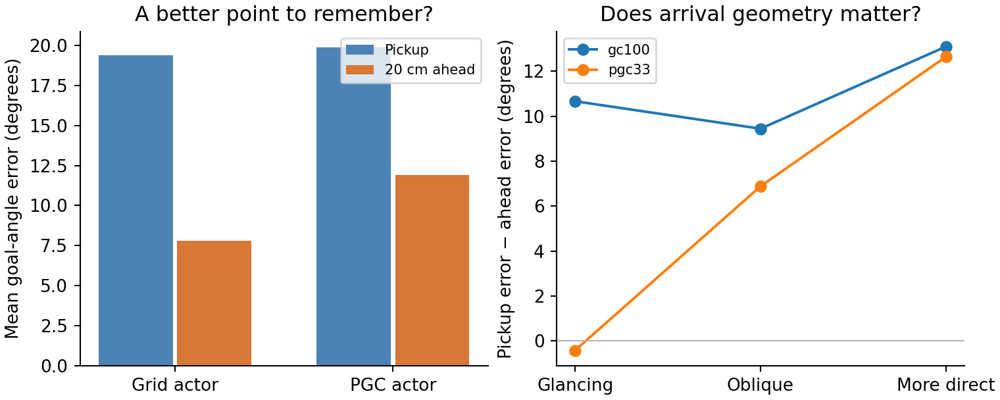

# Is there a useful goal-angle cue to store?

**This is a geometry feasibility check using actual first pickups from the original frozen RL agents in the same square arena, with goal centers restricted to a0.65m circle. No ring was built or trained.**

For each actual pickup, we compare the angle of the ordinary pickup point with the angle of the point20cm along arrival—the point represented by predictive goal cells. Both estimates are projected onto the known goal circle. True goal coordinates are used only to measure error.

**Stage limitation:** pickup and arrival coordinates come from evaluation records. They represent the ideal result of perfectly inverting the noiseless spatial maps; map inversion has not yet been tested. These coordinates were never supplied to an actor by this analysis.

|Original frozen actor|Actual pickups / episodes|Pickup angle error|Ahead angle error|Ahead point better|
|---|---:|---:|---:|---:|
|gc100, seed1|64/64|19.39°|7.81°|87.5%|
|pgc33, seed1|63/64|19.90°|11.91°|77.8%|

Every discovered first pickup is included. Episodes without discovery are reported in the denominator; they cannot supply a goal cue. The same pickup set is used for both estimates within each actor. First discoveries precede every goal-message intervention.

**Grid with arrival history:** if ordinary-grid history recovers the same arrival direction, it produces exactly the same ahead point. That equality is geometric, not a measured history-decoding result: these baseline records did not save the preceding positions. A later implementation must test the actual map/history reconstruction.

**What this can show:** whether a predictive snapshot contains a more accurate circular goal estimate worth storing. It does not show that a ring exists in the original LSTM, that the actor reads this angle, or that predictive input changes cue-free ring stability. One original training seed per population is a feasibility sample; pickups are not independent trained-network replicates, so no population-significance test is reported.

The arrival-angle bins are descriptive, fixed before these files were inspected: inward cosine below0.5,0.5–0.8, and at least0.8. Detailed paired errors, projected-point reward-disk containment, missing discoveries, and source hashes are in the JSON files.

Reproduce with `python scripts/lstm_goal_circle_cue_feasibility.py --source results/ring_cloud_artifacts/ring-20261105-rl-goal-memory-t4-01`. Original environment and evaluator sources remain unchanged.
