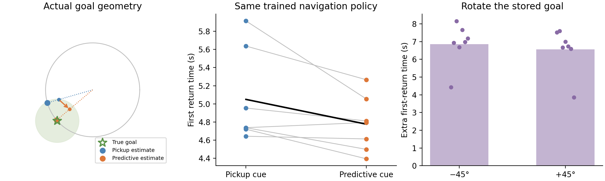

# A goal-memory ring connected to the original navigation agent

**This model uses the original trained RL policies, original square arena, original hexagonal spatial maps, and original six actions. The added goal-memory ring is explicitly designed.**

At a real reward pickup, ordinary map cells describe where the agent entered the reward disk. Predictive cells describe the point 20 cm farther along its arrival direction. We decode those observed rates, store the estimated goal angle in a 2D ring, and regenerate the original 512-cell goal-input code from that memory. The frozen original LSTM chooses every action. No hidden goal coordinate, true arrival angle, or external navigation controller enters the model.

We first checked original Grid actor seed 1, then froze the protocol and tested the remaining seven original Grid actors. Every cue condition uses the **same actor weights and current-code inputs**. The goal prior is a 0.65 m circle, so goal location is one circular variable.

|Goal input|First return time ↓|Episode reward ↑|
|---|---:|---:|
|Original saved goal code|5.09 s|134.53|
|Ring, ordinary pickup cue|5.05 s|135.98|
|Ring, predictive ahead cue|4.78 s|146.74|
|Predictive ring, phase +45°|11.34 s|99.80|
|Predictive ring, phase −45°|11.63 s|95.78|

**Primary result:** predictive initialization gives a mean first-return improvement of **0.273 s**. Evidence is borderline and depends on the statistical method: exact two-sided sign-flip p=0.04688, paired t p=0.05316, and the 95% seed-paired interval [-0.0051, 0.5515] s crosses zero. The statistical unit is the trained policy: **seven previously untested seeds**, not episodes. Seed 1 remains a separate pilot.

**Descriptive reward result:** the predictive cue increases episode reward by 10.76 points on average, with improvement in all seven heldout actors. Reward was not the new confirmatory primary endpoint; this consistent pattern is reported descriptively.

**The stored phase is more accurate:** actual rate-decoded goal memories have mean angular error 16.29° from ordinary pickup cues versus 8.33° from predictive ahead cues. Each trained actor is weighted equally; per-seed errors and inclusion counts are in the summary.

The primary endpoint includes only episodes whose shared first discovery occurs by zero-based step 1049, giving 300 subsequent updates (20 s). Each failed eligible return contributes 20 s. This criterion is fixed by a pre-intervention event; every episode remains in the reward totals. A one-step timing correction and JSON serialization fix occurred before any heldout evaluation, with the original source/protocol archived.

**Causal phase test:** after the same first pickup, we rotate only the stored ring angle by ±45°. The actor, physical state, vision and current spatial code remain unchanged at that point. The ensuing policy and environment dynamics are real closed-loop RL behavior.

- Predictive ring, phase +45° adds 6.57 s to first-return time; Holm-corrected exact p = 0.03125.
- Predictive ring, phase −45° adds 6.86 s to first-return time; Holm-corrected exact p = 0.03125.

The two phase-pulse tests form a separate prespecified Holm family. The first actor distributions after pickup are compared at identical physical observations, before trajectories diverge. One-second paths are not used as an unbiased causal endpoint because early returns censor those records.

**What the ring does:** its stored phase persists without a cue; radial errors shrink by 0.9 per update. The phase multiplier is 1 and the radial multiplier is 0.9 for both cue sources. Those dynamics are designed, and the numerical Jacobian checks match the equations. Unit-radius writes and normalized readout mean radial contraction is not functionally exercised in the navigation comparison.

**What predictive input changes:** the remembered goal estimate, rather than intrinsic ring stability. This demonstrates a concrete route from actual predictive map activity → stored goal location → the original trained navigation policy. It does not discover a ring inside the original LSTM or show that a ring is uniquely necessary for memory; simple persistent phase storage would share the relevant cue-free behavior.

The exact known-map inverse starts from observed rates and an independent position dictionary, then refines the fit. Independent random-position tests and all live pickup reconstructions pass; true positions are diagnostic checks, never inverse initializers. Original checkpoint/config and frozen evaluator hashes are verified.

**Information-matched history control:** ordinary spatial-code history can reconstruct the same arrival cue. In 64 actual first pickups, a rate-only history decoder recovered an ahead point within 9.6e−8 m and regenerated the ring goal code within 1.2e−6 activity units of the PGC-derived version. Thus predictive cells package information from arrival history directly into the saved snapshot; they do not provide uniquely unavailable information. This does not claim that the original Grid LSTM learned the explicit decoder/history calculation. [Measured history control](history_control/README.md).

[Frozen confirmation protocol](confirmation/protocol.json) · [Complete results](confirmation/summary.json) · [Pre-outcome correction](confirmation/PREOUTCOME_AMENDMENT.md) · [Original frozen-agent cue geometry](../original_goal_circle_cue_feasibility/README.md) · [Original LSTM state-family test](../original_goal_bearing_manifold/pilot/README.md)

Reproduce: `python scripts/original_rl_goal_ring_cohort.py`, then `python scripts/finalize_original_rl_goal_ring.py`. Original checkpoints are required.
