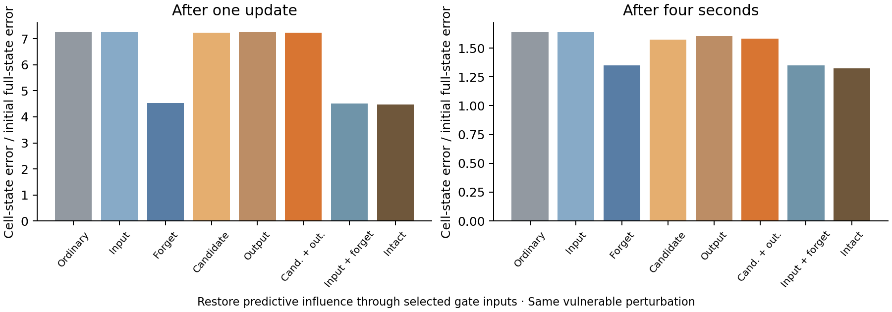

# The forget gate protects the sensitive memory direction

**Restoring predictive influence to the forget gate recovers 98% of the mean one-step cell-state protection and 92% of the protection remaining after four seconds.** These are fractions of the difference between ordinary and intact input in this targeted perturbation test, not fractions of navigation performance.

We started with the same ordinary-goal-sensitive disturbance used in the preceding experiment. We then restored the predictive goal message to selected gate input drives while leaving the other gate inputs ordinary. Each branch carried its own actual h/c state through the same 60 physical inputs.

| Predictive influence restored to | Cell error after one update | Cell error after four seconds |
|---|---:|---:|
| Ordinary | 7.2652 | 1.6397 |
| Input | 7.2505 | 1.6392 |
| Forget | 4.5329 | 1.3497 |
| Candidate | 7.2298 | 1.5752 |
| Output | 7.2652 | 1.6028 |
| Cand. + out. | 7.2298 | 1.5799 |
| Input + forget | 4.5208 | 1.3513 |
| Intact | 4.4777 | 1.3255 |

The units are amplification relative to the initial full h/c perturbation. The primary displayed amplitude is 0.0001 RMS raw-state units; 0.01 sensitivity results are also saved. This is an exploratory gate attribution, following the earlier fixed four-comparison analysis.

The cell-update derivative was independently decomposed into four terms: directly retained cell-state error; error entering through the forget-gate feedback; input-gate feedback; and candidate-update feedback. All terms are projected onto the same ordinary-goal cell-response direction, so their signed contributions add. Their norms are also saved, but norms do not add because terms can cancel.

| Cell derivative term | Native projection | Ordinary projection |
|---|---:|---:|
| direct_memory | 0.1078 | 0.1019 |
| forget_feedback | 3.5947 | 6.4775 |
| input_feedback | 0.1235 | 0.1410 |
| candidate_feedback | 0.4446 | 0.5447 |

**What the mechanism means:** an error in hidden activity can perturb the forget gate. Because that gate multiplies the stored cell state, a small gate error can become a larger memory error when the stored value is large. The predictive goal message reduces this amplification along the tested vulnerable directions. Average forget-gate openness changes little; the relevant change is the sensitivity of the weighted memory feedback.

The candidate-plus-output restoration recovers only 19% of this four-second cell-state protection. Earlier, that pathway recovered most of the navigation loss when prediction was removed from both current and goal codes. The present test changes only the goal code. These results suggest different contributions to memory protection and action computation; a matched goal-only behavioral rescue would directly compare those functions.

Forget restoration improves the targeted cell-state response in all eight seeds at both horizons. Twelve exploratory paired-seed contrasts (six partial restorations at two horizons) receive Holm adjustment separately for paired-t and exact sign-flip tests. One-step forget restoration passes corrected paired-t testing; at this sample size the corrected exact test is 0.09375, and the four-second corrected paired-t test is about 0.098. Full results and intervals are saved; the earlier four worst-direction comparisons are unchanged.

Validation checks that restoring all gates exactly reproduces native input drive, restoring none exactly reproduces ordinary input drive, both full trajectories reproduce the preceding experiment, and the cell derivative sum matches the analytic full-state Jacobian.

These are vulnerable recurrent-state directions, not established ring tangents or normals. The analysis isolates a gate mechanism for memory-state amplification; behavior and ring geometry are evaluated separately.

[Results](summary.json) · [Protocol](protocol.json) · [Source](../../../scripts/lstm_gate_stability.py)
