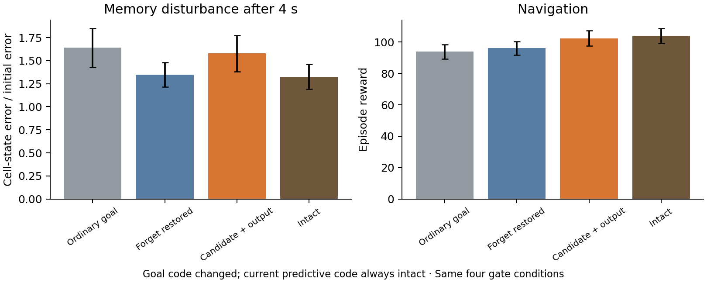

# Goal-only gate rescue: memory protection and navigation

**Different gate pathways dominate memory protection and navigation.**

The four conditions change only how the saved goal code enters the LSTM. Current predictive code stays intact. The behavioral experiment adds no state noise; the memory panel comes from the separately measured targeted perturbation experiment.

| Condition | Mean episode reward |
|---|---:|
| Ordinary goal | 93.896 |
| Forget restored | 96.104 |
| Candidate + output | 102.354 |
| Intact | 103.994 |

| Restored route | Mean memory protection recovered | Mean navigation loss recovered |
|---|---:|---:|
| Forget gate | 92% | 22% |
| Candidate update + output gate | 19% | 84% |

Each percentage is relative to the intact-versus-ordinary-goal gap in that assay, using the difference of seed means. The gates interact, so these percentages are not additive.

**What this suggests:** the predictive goal message has at least two uses in the trained LSTM. The forget gate protects particular stored-state directions from amplification. The candidate update and output gate provide the larger measured route from predictive goal information to successful navigation.

| Planned score contrast | Difference | 95% interval | Holm t p | Holm exact p |
|---|---:|---:|---:|---:|
| intact_minus_goal_ordinary | +10.098 | [+6.749, +13.446] | 0.0007539 | 0.03125 |
| restore_forget_minus_goal_ordinary | +2.207 | [+0.482, +3.932] | 0.01925 | 0.03125 |
| restore_candidate_output_minus_goal_ordinary | +8.457 | [+5.545, +11.369] | 0.0007539 | 0.03125 |
| restore_candidate_output_minus_restore_forget | +6.250 | [+2.297, +10.203] | 0.01454 | 0.03125 |

Independent units are training seeds. Four score contrasts receive Holm correction separately for paired-t and exhaustive sign-flip tests. The four branches share episode layouts, per-step physical noise, and action-sampling uniforms; each branch evolves its own state and trajectory. Episodes before goal discovery are identical. Weights remain frozen.

This compares the functions of the same goal-input gate pathways. The neural assay injects a targeted disturbance on a common forced trajectory; the behavioral assay measures unperturbed closed-loop navigation. It does not itself show that the measured memory protection causes a navigation advantage.

[Results](summary.json) · [Protocol](protocol.json) · [Source](../../../scripts/lstm_goal_gate_behavior.py)
