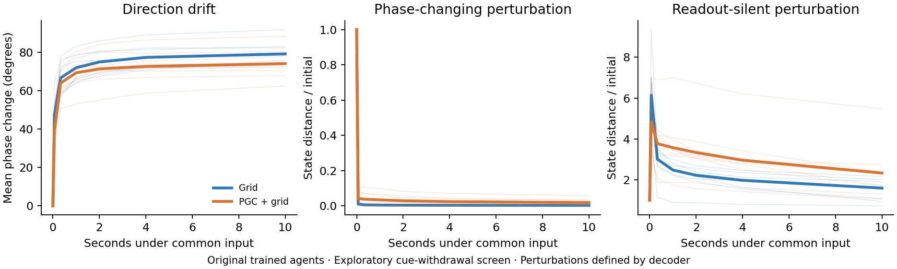

# Original trained agents: first ring-dynamics screen

**The original networks represent direction, but this screen finds that much of the directional pattern depends on the continuing input.** This is a starting point for a controlled ring-attractor model, not a positive autonomous-ring result.



Thin lines are individual seeds; thick lines are the equal-weight average of eight seeds. All three panels continue the original saved states under the same mean input for every state within a model. The phase-changing and readout-silent directions are defined by a circular decoder; they are not established manifold tangents or normals.

| Measure | Grid | PGC + grid |
|---|---:|---:|
| Held-out facing error | 28.5° | 31.6° |
| Held-out travel-direction error | 44.4° | 47.0° |
| Held-out egocentric goal-bearing error | 55.8° | 46.3° |
| Travel-phase drift after 10 s, common mean input | 79.2° | 74.1° |
| Travel-phase drift after 10 s, own frozen input | 20.2° | 19.7° |
| State variance remaining after 10 s, common input | 7.8% | 11.7% |

The circular readout predicts cosine and sine from all 512 recurrent-state coordinates (`h` and `c`). Its accuracy is evaluated on held-out episodes. The continuation readout is fitted to all snapshots and measures changes from the initial decoded phase. A single shuffled-label reference is included for each model; it is a descriptive control rather than a permutation significance test.

We used 2,471 native snapshots across all 16 frozen 1B-frame models. Each snapshot was continued for 150 updates (10 seconds at the training rate). Inputs were either the same mean native vector for every state, all zeros, or the state's own frozen vector. The mean input removes state-specific direction and goal information. It remains an artificial input; all-zero input caused large cell-state excursions in some models and is retained as a sensitivity result, not the primary comparison.

Perturbations have equal starting RMS size in diagonally scaled state coordinates. They change decoded phase or initially leave the two readout coordinates unchanged. These are exploratory arbitrary h/c perturbations, not guaranteed on-manifold or physically reachable initial states. Fast loss of a decoder-gradient perturbation therefore cannot exclude a ring whose true tangent combines h and c differently.

The known-ring diagnostic control preserves phase-changing perturbations and suppresses transverse ones. A contracting-point control preserves decoded angle numerically while losing virtually all state separation. This illustrates why circular decoding or phase retention alone is insufficient: an attractor account needs the full geometry and perturbation dynamics to agree.

The next mechanistic test uses a trained circular navigation task with explicit matched controls and a learned state manifold. The original-agent bridge requires context-controlled circular trajectories, coherent state perturbations, and a behavioral return test.

Run the complete screen:

```bash
OPENBLAS_NUM_THREADS=1 OMP_NUM_THREADS=2 /opt/anaconda3/bin/python scripts/lstm_ring_probe.py \
  --seeds 1 2 3 4 5 6 7 8 --steps 150 \
  --out results/ring_attractor/original_pilot/all_seeds
```

The full run took 43 CPU seconds, excluding imports and plotting. The expanded gate equations reproduced `torch.nn.LSTMCell` with zero error for every tested model and input regime. Checkpoint and snapshot hashes are recorded in each result. No checkpoint was changed, and no training or cloud compute was used for this screen.

Source: [script](../../../scripts/lstm_ring_probe.py), [audit and follow-up design](../../../docs/research/ring_local_audit.md), [all-seed machine-readable results](all_seeds/summary.json).
