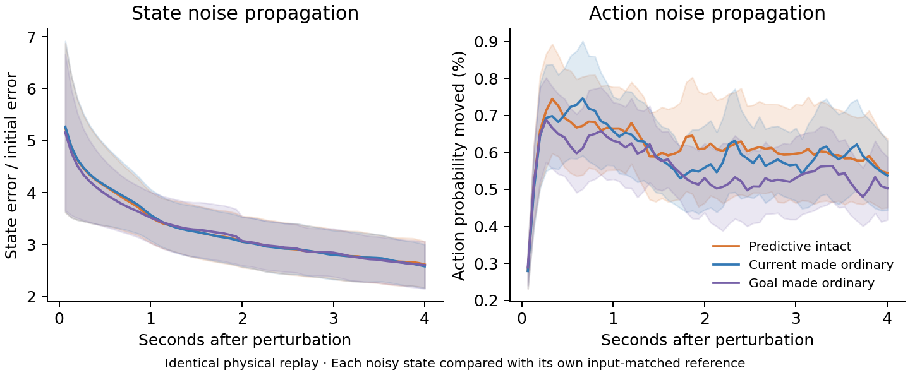

# Does predictive input suppress recurrent noise?

We gave the frozen original LSTMs the same physical experience, added a small error to their recurrent state, and measured how the error spread. We then repeated this after making the predictive current code, goal code, or both ordinary.

**Every noisy trajectory is compared with an unperturbed trajectory receiving the same input variant.** The measurements therefore separate noise propagation from the direct action change caused by removing prediction.

Equal averages across 8 independently trained PGC models. Shading is the standard error across seeds. The physical inputs and actions follow the saved replay; the analyzed policies do not control the trajectory.

| Input | Mean action probability moved by noise | State error after 4 s / initial error |
|---|---:|---:|
| Predictive intact | 0.6160% | 2.6140 |
| Current made ordinary | 0.6018% | 2.5801 |
| Goal made ordinary | 0.5580% | 2.6033 |
| Both made ordinary | 0.5573% | 2.5723 |

The state measure uses all 512 h/c coordinates, divided by their training-fold standard deviations before measuring distance. Separate h, c, and unscaled full-state results are saved to check dependence on this choice. Values above one indicate amplification of the initial error in this metric; values below one indicate contraction.

The primary perturbation is 0.01 RMS units of this scaled state, with positive and negative copies averaged. The 0.05 run is an amplitude sensitivity check. Isotropic perturbations define the primary comparisons. Goal-phase-changing and goal-readout-silent perturbations are exploratory decoder directions, not measured manifold tangents or normals.

| Primary contrast: ordinary minus predictive intact | Difference | 95% paired interval | Holm t p | Holm exact p |
|---|---:|---:|---:|---:|
| current_ordinary_action_tv | -0.014229 pp | [-0.056069, +0.027610] | 1 | 1 |
| current_ordinary_state_gain | -0.033897 | [-0.134025, +0.066231] | 1 | 1 |
| goal_ordinary_action_tv | -0.058086 pp | [-0.136648, +0.020477] | 0.4956 | 0.0625 |
| goal_ordinary_state_gain | -0.010707 | [-0.152035, +0.130621] | 1 | 1 |

A positive contrast means that making the code ordinary increased error propagation; a negative contrast means the opposite. Four primary comparisons were specified before the full-seed run. The independent units are training seeds, with Holm adjustment separately for paired-t and exhaustive paired sign-flip tests.

The circular goal-bearing readout has mean held-out-episode error 57.6°. Angle changes are only summarized when both decoded vector amplitudes are at least 0.2; the valid fraction and unconditional cosine/sine-vector error are also saved. These decoder analyses are exploratory.

At the primary amplitude, 1.42% of perturbed h coordinates initially fall outside [-1, 1]. The first recurrent update restores the LSTM output range. These are injected mathematical state errors, not naturally occurring observations or proven on-manifold perturbations.

Each seed starts at 411 known-goal states across 16 common replay episodes, retaining only starts with a complete 60-update future. States were saved after an input; the first continuation uses the next physical input. Episode means receive equal weight within seed. Weights stay frozen, and every intervention preserves non-PGC code channels. Exact image and checkpoint hashes plus saved-state reproduction errors are recorded.

This experiment measures input-supported robustness of the learned update. A ring-attractor mechanism additionally requires a closed circular state manifold, weak tangent dynamics, transverse recovery, and a predicted behavioral consequence.

[Results](summary.json) · [Protocol](protocol.json) · [Source](../../../scripts/lstm_predictive_stability.py)

**Comparison with Grid-trained networks:** the same relative-state perturbation produces larger responses in PGC-trained networks. These three secondary population contrasts are corrected separately from the four acute-input contrasts.

| Measure | Grid | PGC + grid | Holm t p | Holm exact p |
|---|---:|---:|---:|---:|
| Mean action probability moved (%) | 0.2624 | 0.6160 | 0.01312 | 0.02344 |
| state_gain | 1.2443 | 2.6140 | 0.02317 | 0.02344 |
| raw_state_gain | 0.9538 | 1.0539 | 0.02317 | 0.02344 |

Ordinary-code replacement is exactly a no-op in all eight Grid-trained models, providing a negative control for the intervention implementation. The primary PGC within-model tests remain unchanged. These network comparisons use each model's own state scaling and remain conditional on that perturbation definition; the raw-state gain sensitivity has the same direction.

Together with the targeted singular-direction follow-up, the pattern suggests an overall more responsive PGC-trained network with selective protection of particular vulnerable memory directions, rather than a globally quieter update. [Population-context numbers](grid_context.json) · [Targeted follow-up](../worst_direction/README.md)
