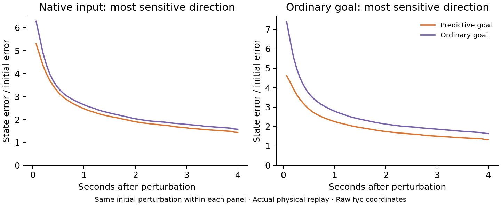

# Predictive goal input protects sensitive memory directions

**Predictive goal input reduces amplification along particular vulnerable state directions.** The effect is selective: the separate isotropic-noise experiment found no broad reduction in average noise propagation.

This follow-up revisits the exact 32 states per model used in the earlier Jacobian analysis. It finds the most amplified initial state direction under predictive input and under ordinary goal input, then tests each of those two directions under both inputs.

Each panel keeps its initial perturbation direction fixed. Both branches receive the actual next 60 physical inputs; each perturbed trajectory is compared with its own unperturbed input-matched reference. The plotted perturbation is 0.0001 RMS raw-state units. A 0.01 sensitivity run is saved as well.

| Input-defined perturbation direction and horizon | Ordinary minus predictive gain | 95% interval | Holm t p | Holm exact p |
|---|---:|---:|---:|---:|
| native_direction_at_1 | +0.9782 | [+0.3264, +1.6301] | 0.02809 | 0.03125 |
| native_direction_at_60 | +0.1380 | [-0.0599, +0.3358] | 0.1431 | 0.1562 |
| goal_ordinary_direction_at_1 | +2.7777 | [+2.0661, +3.4893] | 0.0001447 | 0.03125 |
| goal_ordinary_direction_at_60 | +0.3141 | [+0.1010, +0.5272] | 0.02809 | 0.03125 |

For the ordinary-goal-sensitive direction, the same initial error grows by 4.62 times under predictive goal input and 7.40 times under ordinary goal input on the first update. After four seconds, the gains are 1.33 and 1.64. The larger 0.01 perturbation produces a similar pattern.

The lasting difference is concentrated in cell state c. At four seconds, hidden-output h error is only 0.0068 times the initial full-state perturbation under predictive input, while c error is 1.33 times. Action-probability effects at this horizon are very small and vary in direction across seeds.

**Mechanistic interpretation:** the predictive goal message changes the gates so that some vulnerable memory-state disturbances are amplified less. This supports input-dependent protection of stored state. Identifying these directions with a ring and linking their protection to better navigation are separate tests.

The two initial directions were specified before this follow-up. They are singular vectors in raw h/c coordinates, not circular manifold tangents. A gain above one means initial state error was amplified in that metric; it is distinct from an autonomous attractor, persistent phase memory, or navigation performance.

The analysis reproduces the earlier singular values and checks the small finite perturbation against the local linear prediction. It includes a larger perturbation sensitivity. All states, weights, and input sequences retain recorded provenance.

[Results](summary.json) · [Protocol](protocol.json) · [Source](../../../scripts/lstm_worst_direction_stability.py)
