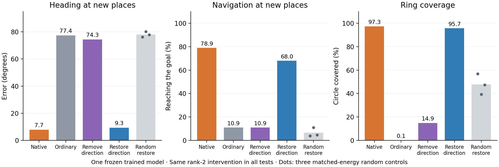

# Two learned directions carry most of the useful cue

The frozen PGC model's encoder turns its large grid-cell input into a 64-number drive entering the recurrent network. We found a two-dimensional direction signal inside that drive. Removing it largely removed accurate heading and navigation. Putting only that signal back recovered most of both.

At previously untested places 10 m away:

| Input to the same frozen RNN | Heading error | Reached the goal by 40 s |
|---|---:|---:|
| Native predictive drive | 7.7° | 78.9% |
| Ordinary grid drive | 77.4° | 10.9% |
| Native drive minus the direction plane | 74.3° | 10.9% |
| Ordinary drive plus the direction plane | 9.3° | 68.0% |
| Three equal-energy random restorations | 76–80° | 3.9–10.9% |

**What we changed.** For the same observed position and direction, the experiment generated both the predictive code and the counterfactual ordinary grid code and passed them through the trained encoder. Their difference is the extra drive caused by prediction. Using separate fitting positions, we found the two drive directions associated with cosine and sine of travel direction. We then projected each observed drive difference onto that fixed plane. The intervention uses this observed difference; it receives no true heading or desired answer during evaluation. This is an experimental manipulation, not a claim that the unmodified network explicitly receives both input vectors as separate channels.

The fitted plane contains **65% of predictive-drive energy** at held-out places. A direction readout from that plane has 13.6° error, close to 12.8° using all 64 drive components. Thus, the whole predictive code is not two-dimensional, but much of its useful directional influence is concentrated in two learned directions. Adding second and third harmonics barely increases directional regression fit (within-position variance explained: 65.6% to 66.1%); that was a secondary fit-only check.

**What happens to the ring.** We initialized nearby full neural states corresponding to a ±10° phase error and supplied the same physical input to each replica. Native input and direction-plane restoration both removed the phase error while preserving a full circle of correctly arranged headings. After 5 s, circle coverage was 97.3% with native input and 95.7% after restoration; full-state differences fell to roughly 0.005% and 0.004% of their initial sizes. Ordinary input also made replicas converge, but to the wrong state: heading error was 90° and circle coverage fell to 0.09%. That is collapse, not useful stabilization. With completely blank input, the ring retained 92% coverage and the phase perturbation persisted, consistent with a heading-memory ring that needs a directional reference to correct its phase.

**What this suggests.** The trained encoder extracts a compact directional reference from the predictive spatial code. That drive anchors the learned heading ring to the observed direction; accurate heading then supports position estimation and navigation. The same intervention changes the full recurrent state and behavior, so this is more than a cosmetic change to the final readout.

This is a mechanistic pilot in **one newly trained heading model**, not a population claim about the original navigation LSTMs. This task supplies a noisy direction reference through predictive displacement and trains the network to report heading; its controller then uses the decoded heading for navigation. No claim that the model invents an external direction reference is intended. The all-16-model follow-up is frozen in [the confirmation protocol](../../subspace_confirmation/PROTOCOL.md).

The heading result uses 256 matched forced trajectories; navigation uses 128 matched closed-loop episodes with each intervention controlling its own physical path. Native-region navigation was 82.0%, 5.5%, 8.6%, and 75.0% in the four main conditions. The 10 m success results also appear in sustained holding: 78.9%, 4.7%, 7.0%, and 67.2%, respectively.

Validation: native and ordinary full-state trajectories exactly match the untouched model; navigation success, arrival times, final distances, and position-estimate errors exactly match the independent existing evaluator. Deletion and residual-only interventions agree within 2.3×10⁻⁶ through the full forced trajectory. Random controls match the intervention energy to relative error below 2.4×10⁻⁷. All intervention doses are zero during sensory blackouts. Checkpoint hashes are unchanged. Exact executed sources, fitted projectors, protocols, per-episode outcomes, and full-state anchoring results are saved alongside this file.
