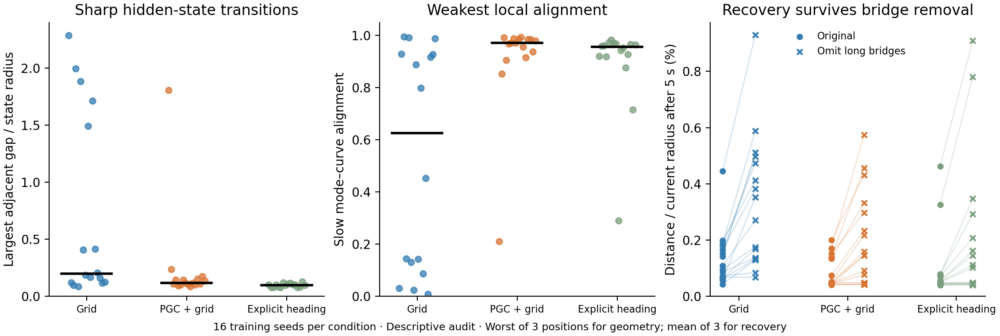

# Full-state geometry: useful local memory, with sharp exceptions

The learned networks preserve direction, but some have very sharp changes in other hidden features. A circular decoded output alone does not describe that full geometry.

Each dot is one training seed. The first two panels use the worst of three tested positions after four initialization cues and two seconds with all inputs zero. Horizontal lines mark medians. The last panel begins with disturbances of 10% of state radius and measures recovery after five more seconds; it averages the three positions.

| Descriptive measure | Grid | PGC + grid | Explicit heading |
|---|---:|---:|---:|
| Median largest adjacent gap / radius | 0.195 | 0.115 | 0.097 |
| Seeds with an adjacent gap larger than radius | 5 | 1 | 0 |
| Median of each seed’s weakest slow-mode alignment | 0.626 | 0.972 | 0.956 |
| Seeds with any slow-mode alignment below 0.5 | 8 | 1 | 1 |
| Median 5 s residual distance / current radius, original (%) | 0.101 | 0.048 | 0.050 |
| Median 5 s residual, long bridge interiors omitted (%) | 0.311 | 0.152 | 0.106 |

The gap and alignment thresholds are descriptive summaries, not validated ring classifiers or exclusion criteria. All 16 seeds remain in the functional analyses.

**What the recovery check changes.** A sparse curve joins neighboring measured states with straight lines. A long line can cross hidden states the network never occupies. We repeat the distance measurement after omitting interiors of segments longer than five times the curve’s median segment, while retaining every measured state. The residual distance increases, but recovery remains strong. This sensitivity check does not establish that every omitted segment is physically invalid.

**What this suggests.** PGC models usually have smoother conditional direction-memory geometry and fewer severe alignment exceptions than Grid models in this sampled assay. The learned direction memory is still not a globally uniform smooth ring in every network. Local correction and the causal benefits of the direction input remain meaningful without that stronger claim.

A dense follow-up of seed 2001 resolves extremely narrow continuous transitions, largely in the readout-null dimensions. This is a separate exploratory investigation, not a new cohort selection rule. The 2 s initial curves are not necessarily the asymptotic attractors. Later cue-free evolution can sharpen additional transitions.

Methods: 128 initial directions, 3 positions, 16 seeds in each of 3 conditions; underlying state maps and weights unchanged. No new hypothesis test is introduced here. [Raw audit](curve_bridge_sensitivity_all_available.json) · [Audit code](../../../scripts/audit_heading_curve_bridges.py) · [Figure code](../../../scripts/plot_heading_curve_bridge_audit.py).
