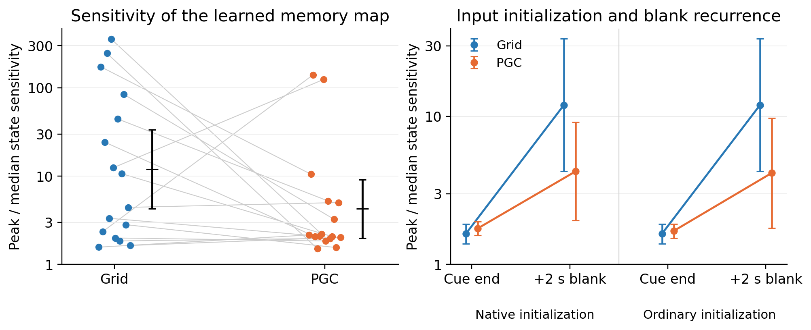

# Independent memory-geometry replication

**All 16 new Grid/PGC pairs are complete. The proposed smoother-map difference remains heterogeneous and did not meet the prespecified significance criterion.** The confirmed input-anchoring and navigation results come from separate experiments and are unchanged.

*Left: all paired training seeds, plus geometric means and 95% intervals. Right: geometric means and intervals for the initialization controls. Vertical axes use a logarithmic scale.*

We asked whether a tiny change in the initial direction sometimes produces an unusually large change in the later recurrent state. The metric compares the largest estimated angular state sensitivity with that network's usual (median) sensitivity, after four native initialization cues and two seconds of blank input. Every measurement uses all 64 state dimensions. The protocol was frozen after exploratory seeds 2001–2016 and before training the independent seeds 5001–5016.

The sole primary contrast, PGC minus Grid log10 sharpness, is **−0.448**, with a 95% paired interval **[−1.013, 0.117]** and an exact two-sided sign-flip **p=0.11014**. PGC has lower sharpness in 10/16 pairs. The geometric-mean PGC/Grid ratio is 0.356; its interval includes one. Thus the new cohort shows a tendency in the exploratory direction, with substantial seed variability, rather than a reliable population-wide geometry advantage.

| Initialization and measurement | Grid sharpness | PGC sharpness |
| --- | ---: | ---: |
| Native cue end | 1.61 | 1.75 |
| Native cue, then 2 s blank | 11.95 | 4.26 |
| Ordinary cue end | 1.61 | 1.68 |
| Ordinary cue, then 2 s blank | 11.95 | 4.15 |

Table values are geometric means of peak/median sensitivity across all 16 seeds. The same-ordinary-input control gives a paired log contrast of −0.459 [−1.052,0.134], also uncertain. Cue-end differences are small; the larger differences develop during blank recurrence. This remains a result about a trained initialization-to-memory map, not a measurement of recurrent weights alone or a binary ring classification.

Both populations retain accurate directions at the primary measurement: Grid/PGC errors are 3.76°/3.93°, sampled angular coverages are 0.994/0.997, and full-state radii are 5.81/4.09. No model triggered a small-radius, small-sensitivity, unreliable-readout or numerical-floor flag. All 32 unique checkpoints are retained. Reconstructing every primary scalar independently from its archived derivative arrays agrees within 2.3×10⁻¹⁶; a separate enumeration of all 65,536 sign patterns reproduces the p-value exactly. Frozen protocol, evaluator and training-source hashes all match.

The practical interpretation is that useful predictive cue anchoring can coexist with different internal geometries. A selected learned network supports a well-resolved approximate memory ring, while other networks contain sharply varying state regions. The reliable mechanism in the wider study is the cue's correction of direction memory and steering; uniformly smoother autonomous organization is not required by those results.

[Complete statistics and every seed](summary.json) · [Independent archive/statistic verification](endpoint_validation.json) · [Frozen protocol](../../../docs/research/heading_geometry_confirmation_protocol.md) · [Frozen sources](../../../docs/research/heading_geometry_confirmation_sources.json)
